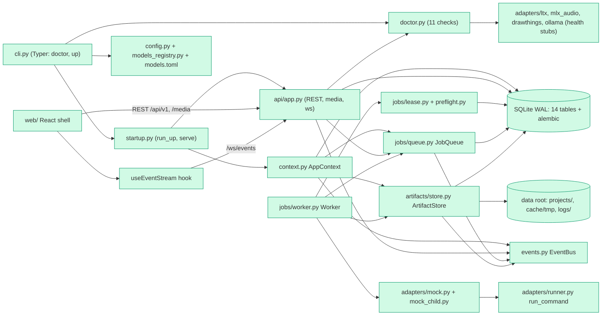

# Tech spec — Build the ReelForge M1 backbone (config, data, jobs, API, doctor, UI shell)

## Approach
The worktree is greenfield (only the three spec documents and `phases/`), so there are no existing code patterns to follow. Structure and names follow the repo's Technical Spec (sections "Process and memory model", "Data model", "File system layout", "Adapters", "API and realtime events", "Startup, doctor and configuration"), which wins on design, and the standards' layout (`src/reelforge/`, `tests/`, `tests/acceptance/`, `web/`, `web/tests/acceptance/`, `web/e2e/`).

Design in one paragraph. One Python package `reelforge` (uv, hatchling, src layout). A flat Pydantic `Settings` is resolved by `load_settings` (CLI > `REELFORGE_*` > `config.toml` > defaults); model IDs live only in a packaged `models.toml` read through a `ModelRegistry`, so no source file contains a model ID (a grep test enforces it). SQLAlchemy 2 (sync engine, WAL, `expire_on_commit=False`) with Alembic migrations packaged inside the library and run programmatically. An `ArtifactStore` writes files through `cache/tmp` then `rename`, writes a sidecar JSON, records sha256 and an `inputs_fp` fingerprint, and answers cache lookups. A persistent `JobQueue` (SQLite) is drained by an in-process asyncio `Worker`; heavy jobs take an `asyncio.Lock` plus a lease row (key `gpu_lease` in the existing `settings` table, so no extra table) after Ollama unload and a `psutil` memory pre-flight. A single `run_command` runner executes every adapter command as an argument list, logs it verbatim, enforces a timeout, samples the child tree's RSS, and supports cancel. The `mock` adapter produces PNG, sine WAV and test-pattern MP4 files and spawns a tiny child process (`python -m reelforge.adapters.mock_child`) so cancel, timeout, kill and memory sampling are real. A FastAPI app (all routes `async def`; DB calls are short and run inline) exposes REST, range-capable media and `/ws/events`, fed by an in-process `EventBus`. `doctor` is a registry of 11 check functions shared by the CLI and `GET /health`. `web/` is a React 19 + Vite + strict TS shell with an `openapi-typescript`/`openapi-fetch` typed client generated from a committed `web/openapi.json`, a WebSocket hook that maps events to TanStack Query keys, and four screens.

Decisions taken where the product spec left open questions (override in `answers.md` if you disagree):
- Mock backend does NOT downgrade the ltx / mlx-audio / Draw Things checks; `up --allow-degraded` is required on a machine without them (as written in R9, AC-9).
- Memory pre-flight waits up to `preflight_wait_s` (default 120 s; 0 means fail immediately) with the job staying `queued` and `message` set to the reason; after the wait the job is `failed` with that reason.
- `up` serves API + worker only. The UI runs on the Vite dev server (`ui_port` 7401). No browser auto-open.
- Stage stepper state is derived from `projects.stage` (gate order) plus the project's jobs; no `approvals` seed data. Locking is visual only.
- Progress is an integer 0-100 everywhere, including the `job.updated` event (deviation from the Technical Spec's 0-1).
- Job control routes are `POST /api/v1/jobs/{job_id}/cancel` and `/retry` (product spec shape). The Technical Spec's `:cancel` / `:retry` aliases are registered too.
- Per-job log files go to `<data_root>/logs/jobs/<job_id>.log` (not per-project) in M1.
- `DELETE` project is a hard delete of the DB rows (cascade); files on disk stay.
- Exit code -9 / 137 is classified as transient, so it is retried once, then fails with `killed, likely out of memory`.

## Architecture

## Interface contract

All Python imports are from the installed package `reelforge` (src layout; `uv sync` installs it editable). All new; nothing pre-exists.

### Settings and models
- `reelforge.config.Settings` (Pydantic v2 `BaseModel`, `extra="forbid"`, frozen). Fields and defaults:
  `host: str = "127.0.0.1"`, `api_port: int = 7400`, `ui_port: int = 7401`, `data_root: Path = ~/ReelForge` (expanded), `backend: Literal["mock"] = "mock"`, `models_path: Path` (default: packaged `reelforge/models.toml`), `ollama_url: str = "http://127.0.0.1:11434"`, `drawthings_url: str = "http://127.0.0.1:7860"`, `ltx_path: Path | None = None`, `mlx_audio_path: Path | None = None`, `command_timeout_s: float = 600.0`, `preflight_wait_s: float = 120.0`, `sample_interval_s: float = 2.0`, `health_poll_s: float = 15.0`, `worker_poll_s: float = 0.2`, `max_light_jobs: int = 4`.
  Validation: `host` must be exactly `"127.0.0.1"` (`"0.0.0.0"`, `"localhost"`, anything else is rejected); ports 1..65535.
  Properties: `db_path -> Path` (`data_root/reelforge.db`), `cache_tmp -> Path` (`data_root/cache/tmp`), `api_url -> str` (`http://127.0.0.1:<api_port>`).
- `reelforge.config.ConfigError(ValueError)`: attributes `key: str | None`, `message: str`; `str(e)` contains the key name for validation errors and contains `config.toml` plus the line number for malformed TOML.
- `reelforge.config.load_settings(*, cli: Mapping[str, object] | None = None, env: Mapping[str, str] | None = None, config_path: Path | None = None) -> Settings`
  - Precedence: `cli` (entries whose value is `None` are ignored) > `env` (default `os.environ`; variable `REELFORGE_<FIELD_NAME_UPPER>`, e.g. `REELFORGE_API_PORT`, `REELFORGE_DATA_ROOT`) > `config.toml` > defaults.
  - `config.toml` location: `config_path` if given (missing file then raises `ConfigError`), else `<data_root>/config.toml` if it exists, where `data_root` is itself resolved cli > env > default. TOML layout: `[server] host/api_port/ui_port`, `[paths] data_root/models_path`, `[services.ollama] url`, `[services.drawthings] url`, `[tools.ltx] project_path`, `[tools.mlx_audio] project_path`, `[runtime] command_timeout_s/preflight_wait_s/sample_interval_s/health_poll_s/worker_poll_s/max_light_jobs`. Unknown keys raise `ConfigError`.
  - Raises `ConfigError` on invalid values, malformed TOML, or an unreadable file.
- `reelforge.models_registry.ModelEntry` (frozen model): `key: str`, `id: str`, `revision: str`, `license: str = ""`, `license_url: str = ""`.
- `reelforge.models_registry.ModelRegistry`: `get(key: str) -> ModelEntry` (raises `KeyError`), `keys() -> list[str]`, `entries() -> list[ModelEntry]`, `missing_license() -> list[str]` (keys whose `license` is empty).
- `reelforge.models_registry.load_models(path: Path) -> ModelRegistry`. TOML format: one table per key under `[models.<key>]` with `id`, `revision`, `license`, `license_url`. Packaged keys: `image`, `video`, `tts`, `llm`. `ModelRegistry` for `Settings.models_path` is obtained with `load_models(settings.models_path)`; the mock adapter receives the resolved `ModelEntry` in `TaskSpec.model`, so editing one entry in a temp `models.toml` changes `ModelEntry.id` seen by the adapter and the `model_id` in artifact sidecars.
- Invariant: no model ID literal from `models.toml` appears anywhere under `src/` except `src/reelforge/models.toml` itself (no adapter module needs one in M1).

### Logging and ids
- `reelforge.logging.configure_logging(*, stream: TextIO | None = None, log_file: Path | None = None, level: str = "INFO") -> None`: structlog JSON, one object per line with at least `ts` (ISO-8601 UTC), `level`, `event`. Optional rotating file handler at `log_file`.
- `reelforge.ids.new_id() -> str` (26-char ULID, Crockford base32), `reelforge.ids.is_ulid(value: str) -> bool`.

### Database
- `reelforge.db.session.make_engine(db_path: Path) -> sqlalchemy.Engine`: sets `PRAGMA journal_mode=WAL`, `foreign_keys=ON`, `busy_timeout=5000` on every connection. `make_session_factory(engine) -> sessionmaker[Session]` (`expire_on_commit=False`).
- `reelforge.db.migrate.upgrade(db_path: Path | str, revision: str = "head") -> None`: runs the packaged Alembic migrations (no `alembic.ini` required); creates the file and parent dirs.
- `reelforge.db.models`: SQLAlchemy 2 declarative classes `Project, StoryVersion, Character, Voice, ProjectCharacter, Scene, Line, Artifact, ArtifactInput, Job, Approval, ReelVersion, BrandKit, Setting` with table names `projects, story_versions, characters, voices, project_characters, scenes, lines, artifacts, artifact_inputs, jobs, approvals, reel_versions, brand_kits, settings`. Columns are those of the Technical Spec "Data model" table, plus the additions listed in "Data and state changes". Primary keys are 26-char ULID strings (`settings.key` is the key string; `project_characters` and `artifact_inputs` use composite keys). Datetimes are timezone-aware UTC. All stored paths (`projects.data_dir`, `artifacts.path`, `jobs.log_path`, `brand_kits.data_dir`) are POSIX-style, relative to the data root, never starting with `/`.

### Artifacts
- `reelforge.artifacts.fingerprint.compute_inputs_fp(*, adapter: str, adapter_version: str, model_key: str, model_revision: str, prompt: str, seed: int, params: Mapping[str, object], input_sha256: Sequence[str]) -> str`: SHA-256 hex of canonical JSON (sorted keys, no whitespace) of those fields. Changing any argument, including `seed`, changes the result.
- `reelforge.artifacts.store.ArtifactSpec` (Pydantic): `project_id: str`, `owner_type: str`, `owner_id: str`, `kind: str`, `subdir: str` (relative to the project folder, e.g. `"frames/s2"`), `prompt: str`, `seed: int`, `model_key: str`, `model_revision: str`, `adapter: str`, `version: str`, `params: dict[str, Any] = {}`, `input_artifact_ids: list[str] = []`, `job_id: str | None = None`, `width: int | None`, `height: int | None`, `duration_s: float | None`.
- `reelforge.artifacts.store.ArtifactStore(data_root: Path, session_factory: sessionmaker[Session], on_created: Callable[[Artifact], None] | None = None)`:
  - `inputs_fp(spec: ArtifactSpec) -> str`: looks up each input artifact's sha256 and calls `compute_inputs_fp`.
  - `lookup(spec: ArtifactSpec) -> Artifact | None`: returns the active artifact for (project, owner_type, owner_id, kind) whose `inputs_fp` equals `inputs_fp(spec)`, whose file exists, whose recomputed sha256 equals the row, and whose sidecar exists and parses; otherwise `None` (a corrupt or missing file or sidecar is a miss).
  - `write(spec: ArtifactSpec, source: bytes | Path, *, ext: str) -> Artifact`: `source` bytes are first written to `cache/tmp`; a `Path` must already be a file inside `cache/tmp`. File is `os.rename`d to `projects/<project dir>/<subdir>/take_<NNN>.<ext>` (`ext` without dot; `take_no` = previous max for owner+kind + 1), the sidecar `take_<NNN>.json` is written the same way, then one transaction inserts the row, sets `is_active` on it and clears it on previous artifacts of the same owner and kind, and inserts `artifact_inputs` rows. Calls `on_created`. Never deletes files.
  - `absolute_path(artifact: Artifact) -> Path`.
  - Sidecar JSON keys: `id, kind, owner_type, owner_id, take_no, prompt, seed, model, model_id, model_revision, version, adapter, params, inputs_fp, job_id, sha256, created_at`. Equality contract (AC-3): `row.prompt == sidecar["prompt"]`, `row.seed == sidecar["seed"]`, `row.model_key == sidecar["model"]`, `row.version == sidecar["version"]`, all non-empty; also `row.inputs_fp`, `row.sha256`, `row.params`, `row.created_by_job == sidecar["job_id"]` match.
- `reelforge.artifacts.service.ArtifactRequest` (Pydantic): `project_id: str`, `owner_type: str`, `owner_id: str`, `kind: str`, `media: Literal["image", "audio", "video"]`, `prompt: str`, `seed: int`, `model_key: str | None = None` (default by media: image -> `image`, video -> `video`, audio -> `tts`), `params: dict[str, Any] = {}`, `input_artifact_ids: list[str] = []`, `subdir: str | None = None` (default `<kind>s`), `stage: Literal["story","cast","voices","frames","shots","assembly"] | None = None`, `heavy: bool = False`, `mem_need_gb: float = 0.0`.
  `params["mock"]` (mock-backend hooks, all optional): `sleep_s: float` (child runtime, default 0), `steps: int` (progress ticks, default 5), `exit_code: int` (child exits with it), `kill: bool` (child SIGKILLs itself, exit -9), `transient_failures: int` (the first N attempts raise a transient error), `fail: str` (non-transient failure with this message), `timeout_s: float` (command timeout override), `duration_s: float`, `width: int`, `height: int`, `freq_hz: float`.
- `reelforge.artifacts.service.request_artifact(ctx: AppContext, req: ArtifactRequest) -> RequestResult` (`RequestResult`: `cache_hit: bool`, `artifact: Artifact | None`, `job: Job | None`). Cache hit: `artifact` set, `job` `None`, no job row created, no `job.updated` event. Miss: enqueues a job of type `artifact.generate` with `payload = req.model_dump()`, `heavy`/`mem_need_gb` from the request.
- Job handler `artifact.generate` (run by the worker): resolves the model via the registry, re-checks `lookup` (a hit completes the job without running the adapter, which is what makes crash recovery not regenerate finished artifacts), else runs the adapter into `cache/tmp/<job_id>/` and calls `store.write`.

### Adapters and runner
- `reelforge.adapters.base`:
  - `TaskSpec` (Pydantic): `kind: Literal["image","audio","video"]`, `prompt: str`, `seed: int`, `params: dict[str, Any]`, `model: ModelEntry`, `input_paths: list[Path] = []`.
  - `ProducedFile`: `path: Path`, `ext: str`, `width: int | None`, `height: int | None`, `duration_s: float | None`.
  - `HealthReport`: `name: str`, `ok: bool`, `version: str | None`, `detail: str`.
  - `ProgressCb = Callable[[int, str], None]` (percent 0-100, message). `CancelToken`: `cancel()`, `cancelled: bool`, `async wait() -> None`.
  - `Adapter` Protocol: `name: str`, `version: str`, `async health() -> HealthReport`, `async capabilities() -> set[str]`, `async run(task: TaskSpec, out_dir: Path, progress: ProgressCb, cancel: CancelToken, *, ctx_job_id: str | None = None) -> list[ProducedFile]`.
  - Exceptions: `AdapterError(Exception)` (non-transient, message becomes `job.error`), `TransientError(AdapterError)` (retried once).
- `reelforge.adapters.runner.run_command(argv: Sequence[str], *, timeout_s: float, cancel: CancelToken | None = None, on_start: Callable[[int], None] | None = None, sample_interval_s: float = 2.0, log_path: Path | None = None, job_id: str | None = None) -> CommandResult` (async). Uses `asyncio.create_subprocess_exec` (never a shell). Emits a structlog event `adapter.command` with `argv` (the exact list of strings executed), `timeout_s`, `job_id` before starting. `CommandResult`: `argv: list[str]`, `exit_code: int | None`, `stdout: str`, `stderr: str`, `timed_out: bool`, `cancelled: bool`, `peak_rss_mb: float`, `duration_s: float`, `error: str | None` (classification or timeout text). On timeout the process tree is killed and `error == f"timed out after {n}s"` where `n` is `timeout_s` formatted without a trailing `.0` for whole numbers (e.g. `timed out after 2s`). On cancel the tree is terminated (kill after 2 s grace) and `cancelled=True`. Samples the child tree (psutil) every `sample_interval_s` and reports the maximum RSS in MB. If `log_path` is given, appends command, stdout, stderr, exit code and peak RSS.
- `reelforge.jobs.classify.classify_exit(code: int | None) -> str | None`: returns exactly `"killed, likely out of memory"` for `-9` and `137`, otherwise `None`. `OOM_REASON` constant holds that string.
- `reelforge.adapters.mock.MockAdapter(registry: ModelRegistry, *, default_timeout_s: float = 600.0, sample_interval_s: float = 2.0)`: `name == "mock"`, `version == "mock-1"`. `run` spawns `[sys.executable, "-m", "reelforge.adapters.mock_child", ...]` through `run_command` (honouring the `params["mock"]` hooks), then produces: image -> `.png` solid-colour placeholder (colour from the seed; `width`/`height` default 320x576); audio -> `.wav` mono 24 kHz sine (`duration_s` default 1.0, `freq_hz` default 440); video -> `.mp4` via `ffmpeg -f lavfi -i testsrc=...` (argument list through `run_command`). Reports progress via `progress(percent, message)`. Maps child failure to `TransientError` for OOM exits (-9/137) with message `killed, likely out of memory`, `AdapterError("timed out after {n}s")` for timeouts, `AdapterError(f"exit code {code}")` for other non-zero codes, and honours `transient_failures` / `fail` hooks.
- Health stubs `reelforge.adapters.ltx|mlx_audio|drawthings|ollama`: each exposes a class with `async health() -> HealthReport` (real presence/reachability on loopback only; never loads a model). `reelforge.adapters.ollama.OllamaAdapter.unload() -> None` posts `keep_alive: 0` and swallows connection errors.

### Jobs
- `reelforge.jobs.queue.JobQueue(session_factory, bus: EventBus | None = None)`; all methods synchronous:
  - `enqueue(*, type: str, project_id: str | None = None, payload: dict | None = None, heavy: bool = False, mem_need_gb: float = 0.0, priority: int = 0) -> Job` (status `queued`, attempts 0, progress 0). Publishes `job.updated`.
  - `get(job_id: str) -> Job` (raises `JobNotFound`), `list(*, status: str | None = None, project_id: str | None = None) -> list[Job]` (newest first).
  - `cancel(job_id: str) -> Job`: `queued` -> `cancelled` immediately; `running` -> signals the job's `CancelToken`, the worker ends it `cancelled` once the child is gone; raises `JobStateError` if the job is `succeeded`, `failed` or `cancelled`. Final state is decided by a compare-and-set on `status` so a concurrent completion and cancel never both apply.
  - `retry(job_id: str) -> Job`: only `failed`; resets to `queued`, `attempts=0`, `error=None`, `progress=0`, `exit_code=None`; raises `JobStateError` otherwise.
  - `recover_orphans(lease: GpuLease | None = None) -> list[str]`: every `running` job is set to `queued` with `pid=None`, `started_at=None`; if its recorded `pid` is alive and its command line matches the job's stored `command`, that process is terminated first; the lease row is cleared. Returns recovered job ids.
  - `tokens: dict[str, CancelToken]` registry shared with the worker.
  - Exceptions `JobNotFound`, `JobStateError` in `reelforge.jobs.queue`.
- `reelforge.jobs.lease.GpuLease(session_factory)`: `async hold(job_id: str)` async context manager (acquires the `asyncio.Lock` named gpu, then writes settings row `gpu_lease` = `{"job_id", "pid", "since"}`; removes it on exit even on error); `holder() -> str | None`; `clear() -> None`. Two heavy jobs never overlap.
- `reelforge.jobs.preflight.preflight(need_gb: float, *, available_gb: Callable[[], float], unload_ollama: Callable[[], Awaitable[None]], wait_s: float, poll_s: float = 0.5, on_wait: Callable[[str], None] | None = None) -> PreflightResult` (async). Awaits `unload_ollama()` once before the first measurement. `PreflightResult`: `ok: bool`, `free_gb: float`, `need_gb: float`, `reason: str | None`. Reason text is exactly `f"Only {free_gb:.1f} GB free, job needs {need_gb:.1f} GB."`. Polls until `ok` or `wait_s` elapses (`wait_s=0` fails on the first measurement); `on_wait(reason)` is called when waiting. Default `available_gb` is `psutil.virtual_memory().available / 1024**3`.
- `reelforge.jobs.worker.Worker(ctx: AppContext)`: `async start() -> None`, `async stop() -> None` (cancels running children, leaves their rows to orphan recovery), `async wait_idle(timeout_s: float = 30.0) -> None` (returns when no job is `queued` or `running`; raises `TimeoutError`). Behaviour: polls every `worker_poll_s`; light jobs run in parallel (up to `max_light_jobs`); a heavy job first waits for the lease lock, runs `preflight` (job remains `queued`, `message` = reason, lease row absent), then writes the lease row, sets `running` with `started_at` and `pid` (child pid via `on_start`), and runs the handler. Progress is persisted (integer, only when changed) and published as `job.updated`. On success: `succeeded`, `progress=100`, `finished_at`, `peak_rss_mb`, `exit_code=0`, `command` (JSON argv list). On `TransientError` with `attempts < 2`: back to `queued`, `attempts += 1`, message `retrying`. Second failure, or any non-transient `AdapterError`: `failed` with `error` set (attempt count 2 after a retried failure; never a third attempt). Cancel: `cancelled`, child gone. Unknown job `type`: `failed` with `error = "unknown job type"`.

### Context
- `reelforge.context.AppContext.create(settings: Settings, *, adapter: Adapter | None = None, available_gb: Callable[[], float] | None = None, ollama_unload: Callable[[], Awaitable[None]] | None = None, doctor: Callable[[], DoctorReport] | None = None, migrate: bool = True) -> AppContext`. Creates the data root folders (`cache/tmp`, `logs/jobs`, `projects`), runs `upgrade` when `migrate`, builds engine, session factory, registry, store (wired to publish `artifact.created`), bus, queue, lease, worker, health monitor. Public attributes: `settings`, `engine`, `session_factory`, `registry`, `store`, `queue`, `lease`, `bus`, `worker`, `health`, `adapter`. `close() -> None` disposes the engine.
- `reelforge.events.EventBus`: `publish(type: str, data: dict) -> None` (thread-safe), `subscribe() -> asyncio.Queue[Event]`, `unsubscribe(q) -> None`. `Event` has `type: str`, `data: dict`. Event types: `job.updated`, `artifact.created`, `stage.changed`, `health.changed`.
- `ctx.health.poll_once() -> list[CheckResult]` runs doctor and publishes `health.changed` for each check whose pass/fail status differs from the previous poll, returning the changed ones. The app's lifespan calls it every `health_poll_s`.

### Doctor
- `reelforge.doctor.CheckResult` (Pydantic): `name: str`, `status: Literal["pass","fail"]`, `severity: Literal["blocking","warning"]`, `detail: str`, `fix: str | None`.
- `reelforge.doctor.DoctorReport`: `checks: list[CheckResult]`; properties `passed: int`, `warnings: int` (failed with severity `warning`), `blocking_failures: int` (failed with severity `blocking`), `ok: bool` (no blocking failure), `overall: Literal["ok","degraded","fail"]` (`fail` if blocking failure, `degraded` if only warnings, else `ok`).
- `reelforge.doctor.CHECKS: dict[str, Callable[[Settings], CheckResult]]` — ordered, exactly these keys in this order: `arm64`, `binaries_native`, `ffmpeg_filters`, `ltx`, `mlx_audio`, `draw_things`, `ollama`, `ports`, `disk`, `memory`, `licenses`. Tests may replace entries with `monkeypatch.setitem(CHECKS, name, fn)`.
- `reelforge.doctor.run_doctor(settings: Settings) -> DoctorReport` calls every entry of `CHECKS` in order (an exception inside a check becomes a failing result with the exception text).
- Severity rules: `arm64`, `binaries_native`, `ffmpeg_filters`, `ltx`, `mlx_audio`, `draw_things`, `ports` are `blocking`; `ollama`, `memory`, `licenses` are `warning`; `disk` passes at >= 30 GB free, is `fail`/`warning` below 30 GB and `fail`/`blocking` below 5 GB. `ports` failure detail is `Port 7400 is used by another process.` (with the actual port), `fix` names the holder (via `lsof -iTCP:<port> -sTCP:LISTEN`) and the next free port. `licenses` fails (warning) when `ModelRegistry.missing_license()` is non-empty, listing the keys. `memory` fails (warning) below 24 GB total; `detail` always shows available GB. Every failing result has a non-empty `fix`.

### CLI
Entry point `reelforge` -> `reelforge.cli:app` (a `typer.Typer`; tests use `typer.testing.CliRunner`). `reelforge --help` lists `doctor` and `up`. Shared options on both commands (flag -> field): `--host`, `--api-port`, `--ui-port`, `--data-root`, `--backend`, `--models-path`, `--ollama-url`, `--drawthings-url`, `--config PATH`. A `ConfigError` prints `config error: <message>` to stderr and exits 2 (for example `--host 0.0.0.0` names `host`; malformed `config.toml` message contains `config.toml` and the line).
- `reelforge doctor`: one line per check in `CHECKS` order: `{PASS|FAIL}  {name}  {severity}  {detail}`, followed for a failing check by an indented line `    fix: {fix}`. Final line `N passed, W warnings, B blocking failures`. Exit 0 when `B == 0`, else 1.
- `reelforge up [--allow-degraded]`: prints, in order, the step lines `==> doctor`, `==> migrate`, `==> recover jobs`, `==> start API + worker`. After `==> doctor` it prints the doctor table. If `B > 0` and not `--allow-degraded`: prints `Refusing to start: {B} blocking check(s) failed. Fix them or pass --allow-degraded.` and exits 1 without migrating or serving. With `--allow-degraded` and failures it prints `Starting in degraded mode` plus one line per failing check and continues. Then logs/prints `http://127.0.0.1:<api_port>` and serves until interrupted.
- `reelforge.startup.run_up(settings: Settings, *, allow_degraded: bool) -> int` implements the sequence (returns the exit code); `reelforge.startup.serve(ctx: AppContext) -> None` runs uvicorn (`host=settings.host`, `port=settings.api_port`) with the worker; `run_up` calls it through the module attribute so tests may `monkeypatch.setattr("reelforge.startup.serve", fake)`.
- Running `reelforge up --allow-degraded --backend mock --data-root DIR --api-port N` as a subprocess starts a working server (used by Playwright and crash-recovery tests).

### HTTP API (`reelforge.api.app.create_app(ctx: AppContext, *, start_worker: bool = True) -> FastAPI`)
With `start_worker=True` the lifespan starts the worker and the health poller and stops them on shutdown; `TestClient(app)` used as a context manager therefore runs jobs. CORS allows `http://127.0.0.1:<ui_port>` and `http://localhost:<ui_port>` only. Timestamps are ISO-8601 UTC strings. Error bodies are `{"detail": "<message>"}`.
- `GET /health` -> 200 `{"status": "ok"|"degraded"|"fail", "checks": [{"name","status","severity","detail","fix"}, ...]}`; same 11 names, order and pass/fail as `doctor` (uses `ctx.doctor` if injected, else `run_doctor`).
- `POST /api/v1/projects` body `{"title": str (1..200 chars)}` -> 201 project; creates folder `projects/<YYYY-MM-DD>_<slug>_<ulid>/` with `cast/ voices/ frames/ shots/ assembly/ uploads/ logs/`. Duplicate titles allowed. 422 on invalid body.
- `GET /api/v1/projects` -> 200 list of projects (newest `updated_at` first). `GET /api/v1/projects/{id}` -> 200 or 404 `project not found`. `PATCH /api/v1/projects/{id}` body `{"title"?: str, "stage"?: one of DRAFT|STORY_APPROVED|CAST_APPROVED|VOICES_APPROVED|FRAMES_APPROVED|SHOTS_APPROVED|ASSEMBLED|EXPORTED}` -> 200 project (a changed `stage` publishes `stage.changed`; `updated_at` advances). `DELETE /api/v1/projects/{id}` -> 204, later GET -> 404.
- Project JSON: `{"id","slug","title","data_dir","stage","stages_approved": int (0..6),"brand_kit_id": null,"created_at","updated_at"}`.
- `GET /api/v1/projects/{id}/stages` -> 200 `{"stages": [{"key","label","state","progress","locked"}]}` for keys/labels in order `story Story`, `cast Cast`, `voices Voices`, `frames Key frames`, `shots Shots`, `assembly Assembly`. `state` in `not_started|queued|rendering|needs_review|approved|stale|failed`; `progress` is an int 0-100 only when `rendering`, else `null`. Derivation: gate index of `project.stage` marks stages up to it `approved` (story needs >= STORY_APPROVED ... assembly needs >= ASSEMBLED); otherwise the project's jobs whose `payload.stage` equals the key decide: a running job -> `rendering` with its progress, a queued one -> `queued`, a failed latest one -> `failed`, else `not_started`. `locked` is true for every stage after the first one that is not `approved`.
- `POST /api/v1/projects/{id}/artifacts` body = `ArtifactRequest` fields without `project_id` -> 202 `{"cache_hit": bool, "artifact_id": str | null, "job_id": str | null}` (404 for unknown project).
- `GET /api/v1/jobs?status=<s>&project=<project_id>` -> 200 list of jobs (both filters optional; unknown `status` value -> 422). `GET /api/v1/jobs/{job_id}` -> 200 or 404 `job not found`. `POST /api/v1/jobs/{job_id}/cancel` (alias `:cancel`) -> 200 job; 409 `job already finished` if the job is finished. `POST /api/v1/jobs/{job_id}/retry` (alias `:retry`) -> 200 job (status `queued`); 409 `only failed jobs can be retried` otherwise.
- Job JSON: `{"id","project_id","type","status","priority","heavy","mem_need_gb","attempts","progress","message","error","pid","exit_code","peak_rss_mb","command","payload","created_at","started_at","finished_at"}`.
- `GET /media/{artifact_id}`: unknown artifact -> 404 `artifact not found`; the stored relative path is joined to the data root and fully resolved (symlinks and `..` followed); if the result is not inside the resolved data root -> 403 `path outside data root` and no bytes are read; file missing -> 404 `file missing`. Otherwise `Content-Type` from the extension, `Accept-Ranges: bytes`. No `Range` header -> 200 full body with `Content-Length`. `Range: bytes=a-b`, `a-`, `-n` -> 206, body is exactly the slice, `Content-Range: bytes a-b/total`. Unsatisfiable (start >= size) -> 416 with `Content-Range: bytes */<size>`.
- `WebSocket /ws/events`: server pushes text frames, JSON `{"type": "<event>", "data": {...}}`; no messages are required from the client. Payloads: `job.updated` `{"job_id","project_id","status","progress" (int 0-100),"eta_s": null,"message","error"}`; `artifact.created` `{"project_id","owner_type","owner_id","kind","artifact_id","take_no"}`; `stage.changed` `{"project_id","stage"}`; `health.changed` `{"service","status"}` (`service` = check name, `status` = `pass`|`fail`). A client disconnect does not affect jobs.
- `GET /openapi.json` is FastAPI's default; `reelforge.api.openapi_export.export(path: Path) -> None` writes the app's schema (sorted, 2-space indent, trailing newline); the committed `web/openapi.json` must equal `export` output (drift test).

### Web (`web/`, pnpm, React 19, Vite, TypeScript strict, vitest + Testing Library + jsdom, Playwright)
Scripts in `web/package.json`: `dev` (`vite --host 127.0.0.1 --port 7401 --strictPort`), `build` (`tsc --noEmit && vite build`), `lint` (`eslint .`), `test` (`vitest`), `gen:api` (`openapi-typescript openapi.json -o src/api/schema.d.ts`), `e2e` (`playwright test`). Vite dev proxy: `/api`, `/health`, `/media` -> `http://127.0.0.1:${REELFORGE_API_PORT ?? 7400}`, `/ws` (ws: true) likewise. Path alias `@` -> `web/src`. `web/vitest.config.ts` and `web/playwright.config.ts` are authored by the test-author (frozen); Playwright starts the backend with `uv run reelforge up --allow-degraded --backend mock --data-root <tmpdir> --api-port 7400` and the UI with `pnpm --dir web dev`.
- `@/api/client`: `api` (an `openapi-fetch` client typed from `schema.d.ts`, `baseUrl: window.location.origin`, uses global `fetch`), plus query-key helpers `queryKeys = { projects: ["projects"], project(id), stages(id), jobs: ["jobs"], health: ["health"] }` where `project(id)` is `["project", id]` and `stages(id)` is `["project", id, "stages"]`.
- `@/api/events`: `type ServerEvent = { type: "job.updated" | "artifact.created" | "stage.changed" | "health.changed"; data: Record<string, unknown> }`; `eventToQueryKeys(event: ServerEvent): readonly (readonly unknown[])[]` pure mapping: `job.updated` -> `["jobs"]` and (when `data.project_id` is a string) `stages(project_id)`; `artifact.created` -> `stages(project_id)`; `stage.changed` -> `["projects"]`, `project(project_id)`, `stages(project_id)`; `health.changed` -> `["health"]`. `useEventStream(options?: { url?: string }): { connected: boolean }` opens one WebSocket (default `ws(s)://<location.host>/ws/events`), on each message calls `queryClient.invalidateQueries({ queryKey })` for each mapped key (from the `QueryClientProvider` context), on close sets `connected=false` and reconnects with exponential backoff (500 ms doubling, cap 8 s) using the global `WebSocket`.
- `@/AppRoutes` (named export `AppRoutes`, no router inside; wrap in `MemoryRouter`/`BrowserRouter` and a `QueryClientProvider`): routes `/` -> redirect to `/projects`; `/projects` -> `ProjectsPage`; `/projects/:projectId` -> `ProjectPage`; `/settings` -> `SettingsPage`. `main.tsx` mounts `<BrowserRouter><QueryClientProvider><AppRoutes/></QueryClientProvider></BrowserRouter>`. `AppRoutes` renders the layout: `<nav aria-label="Main">` with links named `Projects` and `Settings & status` (no Cast library or Brand kit links), the page, and `<ReconnectBanner/>`.
- Visible text and roles (tests query these exactly):
  - Theme: `<html>` has class `dark` by default; `prefers-color-scheme: light` switches it via CSS only.
  - `ProjectsPage`: heading `Projects`; loading shows 3 skeleton rows with `data-testid="project-skeleton"`; list is `<ul aria-label="Projects">` with one `<li>` per project containing a link whose accessible name is the project title, text `{n}/6 stages approved`, and the last edited time (`<time>`); empty state text `No projects yet.` with a button `New project`; error state text `Couldn't load projects.` with a button `Retry`. `New project` (also shown above a non-empty list) reveals a form with a textbox labelled `Project title` and a button `Create` that `POST`s the project and invalidates `["projects"]`.
  - `ProjectPage`: heading with the project title; `StageStepper` rendered as `<ol aria-label="Stages">` with six `<li>` in order, each containing the stage label and a badge whose text is one of `Not started`, `Queued`, `Rendering {n}%`, `Needs review`, `Approved`, `Stale`, `Failed`; a locked stage `<li>` has `aria-disabled="true"`. Exported `StageStepper` props: `{ stages: StageInfo[] }` with `StageInfo = { key: string; label: string; state: StageState; progress: number | null; locked: boolean }`. Below it, the placeholder text `This stage arrives in a later milestone.`. Unknown project shows `Project not found.`.
  - `SettingsPage`: heading `Settings & status`; `<ul aria-label="Dependencies">` with rows for `Draw Things` (check `draw_things`), `ltx-2-mlx` (`ltx`), `mlx-audio` (`mlx_audio`), `Local LLM` (`ollama`), `ffmpeg` (`ffmpeg_filters`). Each `<li>` has `aria-label="{Name}: green|amber|red"` (pass -> green, fail+warning -> amber, fail+blocking -> red), shows the check `detail`, and for non-green rows the text `Fix: {fix}`. It reads `GET /health` and is refreshed by `health.changed`.
  - `ReconnectBanner`: element with `role="status"` and text `Reconnecting...` shown only while `connected` is false (the socket is opened by `AppRoutes` through `useEventStream`).

## Data and state changes
- New SQLite database `<data_root>/reelforge.db` (WAL), migrated by Alembic revision `0001_initial` (packaged at `src/reelforge/db/migrations/`). Tables are exactly the 14 in R3; `ensembles` from the Technical Spec is left for M3.
- Columns added to the Technical Spec's table definitions (needed by AC-3 and the UI):
  - `artifacts`: `prompt TEXT NOT NULL`, `version TEXT NOT NULL` (adapter version), `created_at`.
  - `jobs`: `progress INTEGER NOT NULL DEFAULT 0`, `message TEXT`, `created_at`, `project_id` nullable.
  - `projects`: `stage TEXT NOT NULL DEFAULT 'DRAFT'`.
  - `settings`: also holds the GPU lease under key `gpu_lease` (no separate table).
- Indices: `artifacts(project_id, owner_type, owner_id, kind, is_active)`, `artifacts(inputs_fp)`, `jobs(status, priority, created_at)`. Foreign keys with `ON DELETE CASCADE` from project-owned tables to `projects`.
- File layout under the data root per the Technical Spec: `projects/<date>_<slug>_<ULID>/{cast,voices,frames,shots,assembly,uploads,logs}`, `cache/tmp/`, `logs/app.log`, `logs/jobs/<job_id>.log`.
- Environment variables: `REELFORGE_<FIELD>` for every `Settings` field (`REELFORGE_HOST`, `REELFORGE_API_PORT`, `REELFORGE_UI_PORT`, `REELFORGE_DATA_ROOT`, `REELFORGE_BACKEND`, `REELFORGE_MODELS_PATH`, `REELFORGE_OLLAMA_URL`, `REELFORGE_DRAWTHINGS_URL`, `REELFORGE_LTX_PATH`, `REELFORGE_MLX_AUDIO_PATH`, `REELFORGE_COMMAND_TIMEOUT_S`, `REELFORGE_PREFLIGHT_WAIT_S`, `REELFORGE_SAMPLE_INTERVAL_S`, `REELFORGE_HEALTH_POLL_S`, `REELFORGE_WORKER_POLL_S`, `REELFORGE_MAX_LIGHT_JOBS`). Web: `REELFORGE_API_PORT` read by `vite.config.ts` for the proxy target.
- Dependencies. Python runtime: `fastapi`, `uvicorn`, `websockets`, `typer`, `structlog`, `pydantic>=2`, `sqlalchemy>=2`, `alembic`, `psutil`, `python-ulid`, `httpx`. Python dev group: `pytest`, `pytest-asyncio`, `ruff`, `pyright`. Web runtime: `react@19`, `react-dom@19`, `react-router`, `@tanstack/react-query`, `openapi-fetch`. Web dev: `vite`, `@vitejs/plugin-react`, `typescript`, `openapi-typescript`, `eslint`, `typescript-eslint`, `eslint-plugin-react-hooks`, `vitest`, `jsdom`, `@testing-library/react`, `@testing-library/jest-dom`, `@testing-library/user-event`, `@playwright/test`. Tailwind is not used; theme is plain CSS variables in `web/src/theme.css`.
- `pyproject.toml`: `requires-python = ">=3.12,<3.13"`, hatchling build, `[project.scripts] reelforge = "reelforge.cli:app"`, `[tool.pytest.ini_options]` with `asyncio_mode = "auto"`, `testpaths = ["tests"]`, `pythonpath = ["src"]`; `[tool.ruff]` (line-length 100, select `E,F,I,B,UP,S` with `S603`/`S607` allowed only in `adapters/runner.py` and `doctor.py`); `[tool.pyright]` strict on `src`, basic on `tests`.

## Tasks

1. **Python scaffold, logging, ids** — `pyproject.toml`, `uv.lock`, `.gitignore`, `src/reelforge/__init__.py`, `src/reelforge/cli.py` (Typer `app` with a callback and `--version`; commands are added in task 9), `src/reelforge/logging.py`, `src/reelforge/ids.py`, `tests/unit/test_logging_ids.py`. Configure ruff, pyright, pytest as above. Done when `uv sync`, ruff check/format, pyright and pytest are green.
2. **Config and model registry** — `src/reelforge/config.py`, `src/reelforge/models_registry.py`, `src/reelforge/models.toml` (keys `image`, `video`, `tts`, `llm`; IDs copied from the Technical Spec where given, `revision = "unpinned"`, `license` filled for all but left empty on none), `tests/unit/test_config.py`, `tests/unit/test_models_registry.py`. Add `ConfigError` mapping of Pydantic errors to `key: message` and TOML line numbers.
3. **Database layer and migrations** — `src/reelforge/db/__init__.py`, `db/models.py`, `db/session.py`, `db/migrate.py`, `db/migrations/env.py`, `db/migrations/script.py.mako`, `db/migrations/versions/0001_initial.py`, `tests/unit/test_db.py`. Check that WAL is on, all 14 tables exist, ULIDs are 26 chars, and `upgrade` is idempotent.
4. **Artifact store and fingerprint** — `src/reelforge/artifacts/__init__.py`, `artifacts/fingerprint.py`, `artifacts/store.py`, `tests/unit/test_artifact_store.py`. Atomic write via `cache/tmp` + rename, sidecar, sha256, one active per owner and kind, `lookup` miss rules.
5. **Adapter protocol, runner, classification, mock adapter** — `src/reelforge/adapters/__init__.py`, `adapters/base.py`, `adapters/runner.py`, `adapters/mock.py`, `adapters/mock_child.py`, `jobs/__init__.py`, `jobs/classify.py`, `tests/unit/test_runner.py`, `tests/unit/test_mock_adapter.py`. Verbatim `adapter.command` log, timeout kill, cancel, RSS sampling, no `shell=True`.
6. **Events and job queue** — `src/reelforge/events.py`, `jobs/queue.py`, `tests/unit/test_events.py`, `tests/unit/test_queue.py`. Enqueue, list, cancel, retry, compare-and-set transitions, `recover_orphans`.
7. **GPU lease, pre-flight, worker, context, artifact service** — `src/reelforge/jobs/lease.py`, `jobs/preflight.py`, `jobs/worker.py`, `adapters/ollama.py` (unload only plus health), `context.py`, `artifacts/service.py`, `tests/unit/test_lease_preflight.py`, `tests/unit/test_worker.py`, `tests/unit/test_request_artifact.py`. Retry-once, cancel, orphan recovery wired to the lease, progress persisted and published, job logs under `logs/jobs/`.
8. **Doctor and health monitor** — `src/reelforge/doctor.py`, `adapters/ltx.py`, `adapters/mlx_audio.py`, `adapters/drawthings.py`, `health.py` (`HealthMonitor.poll_once`, wired into `AppContext.health`), `tests/unit/test_doctor.py`, `tests/unit/test_health_monitor.py`. Uses `psutil.disk_usage`, `psutil.virtual_memory`, `shutil.which`, `subprocess` argument lists (`file`, `sysctl`, `ffmpeg -filters`, `lsof`), loopback-only `httpx` probes with 1 s timeouts.
9. **FastAPI app and routes** — `src/reelforge/api/__init__.py`, `api/app.py`, `api/schemas.py`, `api/routes_projects.py`, `api/routes_jobs.py`, `api/routes_media.py`, `api/ws.py`, `api/stages.py`, `tests/unit/test_api_projects.py`, `tests/unit/test_api_jobs.py`, `tests/unit/test_api_media.py`, `tests/unit/test_api_ws.py`. Hand-rolled range parser in `routes_media.py`; 403 check uses `Path.resolve()` and `is_relative_to`; lifespan starts worker and health poller.
10. **CLI commands and startup** — `src/reelforge/cli.py` (modified: `doctor`, `up`, shared options, exit-code mapping), `src/reelforge/startup.py`, `tests/unit/test_cli.py`. `run_up` does doctor, migrate, recover, then `serve`.
11. **OpenAPI export and committed schema** — `src/reelforge/api/openapi_export.py`, `web/openapi.json` (generated), `tests/unit/test_openapi_drift.py`. Backend is now complete; Python lint, types and tests are green.
12. **Web scaffold** — `web/package.json`, `web/pnpm-lock.yaml`, `web/tsconfig.json`, `web/vite.config.ts` (React plugin, proxy, `@` alias), `web/eslint.config.js` (typescript-eslint strict, `no-explicit-any` error, react-hooks), `web/index.html`, `web/src/main.tsx`, `web/src/theme.css`, `web/src/api/schema.d.ts` (generated by `pnpm gen:api`), `web/src/api/client.ts`, `web/src/AppRoutes.tsx` (layout, nav, routes with placeholder pages), `web/src/test-setup.ts` (jest-dom matchers; referenced by the test-author's vitest config), `web/tests/unit/appRoutes.test.tsx`. `pnpm lint`, `tsc --noEmit`, `pnpm build` and `pnpm test --run` are green.
13. **Live events hook and banner** — `web/src/api/events.ts`, `web/src/components/ReconnectBanner.tsx`, `web/src/AppRoutes.tsx` (modified: call `useEventStream`, render banner), `web/tests/unit/events.test.tsx` (mapping function, invalidation on a fake `WebSocket`, backoff via fake timers).
14. **Projects screen** — `web/src/routes/ProjectsPage.tsx`, `web/src/components/ProjectCard.tsx` (row), `web/src/components/NewProjectForm.tsx`, `web/src/api/queries.ts` (`useProjects`, `useCreateProject`), `web/tests/unit/projectsPage.test.tsx` (loading, empty, error with Retry, list, create).
15. **Project route and stage stepper** — `web/src/routes/ProjectPage.tsx`, `web/src/components/StageStepper.tsx`, `web/src/api/queries.ts` (modified: `useProject`, `useStages`), `web/tests/unit/stageStepper.test.tsx` (order, badge texts, `Rendering 42%`, locked `aria-disabled`, placeholder text).
16. **Settings and status panel** — `web/src/routes/SettingsPage.tsx`, `web/src/api/queries.ts` (modified: `useHealth`), `web/tests/unit/settingsPage.test.tsx` (green/amber/red mapping, `Fix:` hint, refetch on `health.changed`).
17. **E2E wiring** — `web/package.json` (modified: `e2e` script, Playwright dev dependency), `web/e2e/.gitkeep`, `README.md` (how to run `reelforge doctor`, `up`, `pnpm --dir web dev`, `pnpm --dir web exec playwright install chromium`). Playwright config and flows come from the test-author.

## Implementation tests
Unit and integration tests the implementer adds with each task (all offline, mock backend, temp data roots from `tmp_path`; shared helpers live in `tests/unit/_helpers.py` because `**/conftest.py` is frozen at Gate 2):
- Config: one test per precedence level plus malformed TOML, unknown key, `host=0.0.0.0` rejected, port range.
- Registry: license-missing detection, temp `models.toml` edit changes the resolved `ModelEntry.id`; grep test over `src/` for every `id` in the packaged `models.toml`.
- DB: migration creates 14 tables, WAL, idempotent upgrade, FK cascade on project delete.
- Fingerprint: stable for equal inputs, changes on seed, params or input sha.
- Store: atomic write leaves no partial files on a simulated crash (rename patched to raise), sidecar equals row, single active artifact, `take_no` increments, miss on corrupt sidecar, on missing file and on sha mismatch.
- Runner: argv logged verbatim (use `structlog.testing.capture_logs`), timeout kills a sleeping child and yields `timed out after 1s`, cancel kills the child, peak RSS sampled, `classify_exit` for -9, 137, 1, 0, `None`; grep test for `shell=True` across `src/`, `tests/` and `scripts/`.
- Mock adapter: PNG magic bytes, WAV frames and rate via `wave`, MP4 probed with `ffprobe` (skipped with a clear reason if `ffmpeg` is absent).
- Queue: state machine, 409-style errors, compare-and-set under concurrent cancel and completion, `recover_orphans` on a dead pid and a clean lease row.
- Preflight: reason text, `wait_s=0` fail-fast, wait-then-succeed with a stub `available_gb`, Ollama unload called before the first measurement.
- Worker: retry once then `failed` with `attempts == 2`; transient then success; cancel a running mock job; two heavy jobs never overlap (compare `started_at`/`finished_at` and sampled `lease.holder()`); light jobs overlap; insufficient memory keeps the job `queued` with the reason; crash simulation (running row with dead pid) requeues and the next run is a cache hit with no new artifact.
- API (`TestClient`): project CRUD and 404/422, stages derivation, jobs filter/cancel/retry/409, media 200/206/416/403 (`..` and symlink)/404, ws receives `job.updated` from a mock job without any GET polling, `/health` equals `run_doctor` names.
- CLI: `--help`, doctor exit codes with patched `CHECKS`, `up` refusal text and exit 1, `--allow-degraded` reaches the patched `serve`, exit 2 on bad host.
- OpenAPI drift: `export` output equals `web/openapi.json`.
- Web (vitest): the files listed in tasks 12-16.

## Risks and rollout
- Large greenfield change in 17 commits; each is green on its own (web tasks only start after the backend is finished, and the commands block skips the web steps until `web/package.json` exists, so tasks 1-11 stay green on Python alone).
- The frozen test config (`conftest.py`, `vitest.config.*`, `playwright.config.*`) is written by the test-author before the implementation exists. The implementer must satisfy it, not edit it. The network guard (AC-12) should live in the frozen root `tests/conftest.py`: the implementation must not open non-loopback sockets, and uvicorn/TestClient/Playwright only use `127.0.0.1`.
- `pnpm install --frozen-lockfile` needs a committed `web/pnpm-lock.yaml`; tasks 12 and 17 must commit it. Playwright browsers must be installed on the machine (not offline-installable in CI).
- Mock video uses `ffmpeg` with `testsrc`; ffmpeg is present on the reference Mac (`/opt/homebrew/bin/ffmpeg`). Tests that need it skip with a clear reason when it is absent.
- The `ltx`, `mlx_audio`, `draw_things` doctor checks are blocking and fail on a bare Mac, so every dev and e2e invocation of `up` uses `--allow-degraded`.
- Worker and API share one asyncio loop and use synchronous SQLAlchemy inline; operations are small, but a long DB lock would stall the loop. `busy_timeout=5000` and short transactions mitigate this. If it shows up later, move DB calls to `asyncio.to_thread`.
- Crash recovery treats every `running` row at startup as an orphan (single worker per data root). Running two `reelforge up` against one data root is unsupported in M1.
- Deviations from the Technical Spec are listed under "Approach" (progress scale, route aliases, per-job log location, no `ensembles` table, hard delete).

## Open questions
- Confirm the default decisions under "Approach": no mock downgrade of doctor checks, pre-flight waits up to 120 s then fails, `up` serves API only (UI via Vite), stepper derived from `projects.stage`.
- Is progress 0-100 in the `job.updated` event acceptable, instead of the Technical Spec's 0-1?
