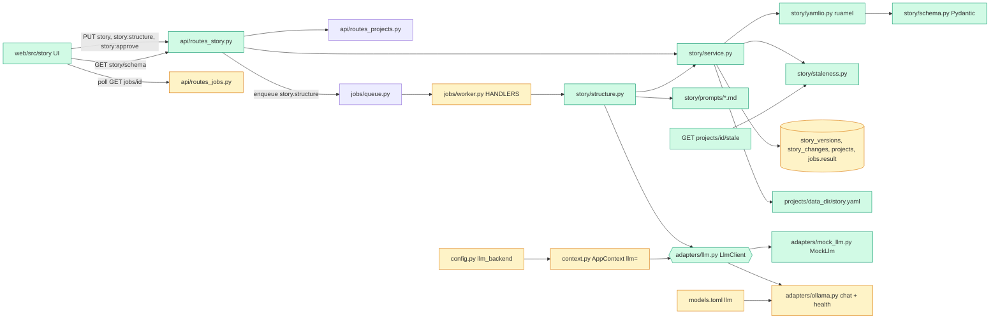

# Tech spec — Add Story stage (story.yaml, versions, Ollama structuring, editor UI)

## Approach
Build the Story stage as a new backend package `src/reelforge/story/` (schema, YAML round-trip, version service, staleness diff, structuring task, prompts) plus a thin `api/routes_story.py`, following the M1 pattern in `api/routes_projects.py` (`build_router(ctx)`, `ctx.session_factory.begin()`, `HTTPException`, `ctx.bus.publish("stage.changed", ...)`). Structuring runs as a normal queue job (`story.structure`, light, `payload.stage = "story"`) registered in `jobs/worker.py` `HANDLERS`, so progress, retry, cancel and the stepper work unchanged. Jobs gain a nullable `result` JSON column so the handler can return a version, gap questions or a draft. The LLM sits behind a small `LlmClient` protocol (`adapters/llm.py`) with `MockLlm` (default, `Settings.llm_backend = "mock"`) and `OllamaAdapter.chat` (selected with `llm_backend = "ollama"`); `AppContext.create(..., llm=...)` lets tests inject stubs. Model id comes only from `models.toml` (`[models.llm]` already `qwen3:8b`). Staleness follows the Tech Spec "computed on read" rule: editing an approved story writes `story_changes` rows (the dependency record); an active artifact is stale when a change row for its owner is newer than the artifact. Nothing is stored as a flag. The raw submitted YAML text is what is stored and exported, so export is byte-identical and comments/order survive trivially; ruamel round-trip is used for validation, the form-to-YAML path and server-generated YAML. The UI adds `web/src/story/*`, mounted from `routes/ProjectPage.tsx`; Form and YAML views share one draft held as a `yaml` (eemeli) Document so comments survive form edits. Monaco is lazy-loaded; under vitest (`import.meta.env.MODE === "test"`) the YAML view renders a plain `<textarea>` with the same accessible name.

## Architecture

## Interface contract

### Python modules

- `reelforge.story.schema`
  - `Story` (Pydantic v2, `extra="forbid"`, strict types, no coercion). Fields in this order: `version: Literal[1]` (required), `title: str` (required, non-empty), `language: Literal["hindi","english","hinglish"]` (required), `style: str = ""`, `aspect: str = "9:16"` (must match `^\d+:\d+$`), `fps: int = 24` (> 0), `target_seconds: int = 12` (> 0 and <= 60), `brand_kit: str | None`, `characters: dict[str, Character]` (required; keys match `^[a-z][a-z0-9_]*$`), `product: Product | None`, `scenes: list[Scene]` (required, at least 1), `music: Music | None`, `captions: Captions | None`.
  - `Character`: `library_id: str | None`, `name: str`, `look: str` (non-empty), `voice: Voice | None`. `Voice`: `mode: Literal["preset","designed","cloned"]`, `ref: str | None`, `reference_clip: str | None`, `speed: float | None` (> 0). `Product`: `name: str`, `asset: str | None`.
  - `Scene`: `id: str` (`^s\d+$`), `setting: str | None`, `action: str`, `framing: Literal["wide","medium","closeup"] | None`, `duration: float | None` (> 0), `speaker: str | None`, `line: str | None`, `product_in_shot: bool | None`, `continue_from: str | None`, `end_card: bool | None`, `suggested: bool | None`. `Music`: `mode: str`, `track: str | None`, `duck_under_speech: bool | None`. `Captions`: `style: str`, `script: str`.
  - Cross-field rules, reported with exact paths: duplicate scene `id`, `speaker` not a character key, `continue_from` not a scene id.
  - `story_json_schema() -> dict[str, Any]` returns `Story.model_json_schema()`.
- `reelforge.story.errors`
  - `StoryError(path: str, message: str, line: int | None = None, column: int | None = None)` (Pydantic model). `str`-form shown to users is `f"{path}: {message}"`, e.g. `foo: unknown field`, `fps: must be an integer`, `scenes[2].fps: unknown field`. Root-level problems use path `""` rendered as just the message.
  - `StoryInvalid(Exception)` with `.errors: list[StoryError]`.
  - Message mapping: Pydantic `extra_forbidden` becomes `unknown field`; int type/parsing errors become `must be an integer`; `missing` becomes `field required`; other errors use Pydantic's message. All errors are collected, not just the first.
- `reelforge.story.yamlio`
  - `load_story_text(text: str) -> ruamel.yaml.comments.CommentedMap`: ruamel round-trip loader (`YAML(typ="rt")`, `preserve_quotes=True`). Raises `StoryInvalid` for: empty/whitespace text (`story.yaml is empty`), syntax errors (with `line`, `column`, 1-based), duplicate keys, a non-mapping root, and any unsafe or non-core tag (message exactly `unsafe or unsupported YAML tag`). Never constructs Python objects.
  - `dump_story_text(doc: CommentedMap) -> str`: dumps with `indent(mapping=2, sequence=4, offset=2)`, `width=4096`, so the Product Spec example style is reproduced. `dump_story_text(load_story_text(t)) == t` for any text written in that style (comments, key order, quoting preserved).
  - `parse_story(text: str) -> Story`: load, then validate; raises `StoryInvalid` listing every error.
  - `story_to_yaml(story: Story) -> str`: server-side YAML for LLM output (field order of the model, `None` fields omitted).
- `reelforge.adapters.llm`
  - `ChatMessage = dict[str, str]` (keys `role`, `content`).
  - `class LlmClient(Protocol)`: `name: str`; `async def chat(self, messages: list[ChatMessage], *, schema: dict[str, Any], temperature: float = 0.3, heavy_next: bool = False) -> str` returning the raw model text (JSON expected).
- `reelforge.adapters.mock_llm.MockLlm(responses: list[str] | None = None)`: implements `LlmClient`; attribute `calls: list[list[ChatMessage]]`. With no `responses` it returns, for every call, a canned valid structure result: 2 characters (`tomato`, `potato`), 5 scenes `s1..s5` with total duration 10.0 s, no questions, and dialogue on `s2`/`s3`. With `responses`, returns them in order (last one repeats). Makes no network access.
- `reelforge.adapters.ollama.OllamaAdapter(url: str, model: str | None = None, *, transport: httpx.AsyncBaseTransport | None = None)`
  - `async chat(messages, *, schema, temperature=0.3, heavy_next=False) -> str`: `POST {url}/api/chat` with JSON body `{"model": <model>, "messages": messages, "stream": false, "format": <schema>, "options": {"temperature": <t>}, "keep_alive": 0 if heavy_next else "5m"}`; returns `response["message"]["content"]`. `temperature` outside 0.2 to 0.4 raises `ValueError`. Connection failure raises `AdapterError("Ollama isn't reachable on port 11434.")` (port taken from `url`); HTTP 404 whose body mentions the model raises `AdapterError(f"{model} isn't pulled.")`. Only loopback URLs are used (reuse `is_loopback_url`).
  - `async health() -> HealthReport`: `GET {url}/api/tags` (uses `transport` when given). Not reachable: `ok=False`, `detail="Ollama isn't reachable on port 11434."`, `fix="Start Ollama: ollama serve"`. Reachable but the model is missing from `models[].name`: `ok=False`, `detail=f"{model} isn't pulled."`, `fix=f"ollama pull {model}"`. Otherwise `ok=True`. The sync `check()` used by `doctor.py` is unchanged.
  - `HealthReport` (in `adapters/base.py`) gains `fix: str | None = None`.
- `reelforge.context.AppContext.create(settings, *, ..., llm: LlmClient | None = None)`; attribute `ctx.llm: LlmClient`. Default is `MockLlm()` when `settings.llm_backend == "mock"`, else `OllamaAdapter(settings.ollama_url, registry.get("llm").id)`.
- `reelforge.config.Settings.llm_backend: Literal["mock","ollama"] = "mock"` (env `REELFORGE_LLM_BACKEND`, toml `[runtime] llm_backend`).
- `reelforge.db.models`: `StoryVersion` gains `created_at: UTCDateTime`; new `StoryChange` (table `story_changes`: `id`, `project_id`, `story_version_id`, `owner_type` (`"scene"` or `"character"`), `owner_id` (scene id like `s2`, or character key like `tomato`), `kinds: list[str]`, `created_at`); `Job` gains `result: dict[str, Any] | None`.
- Staleness convention: an artifact belongs to a scene or character via `Artifact.owner_type`/`owner_id` (`"scene"` + `"s2"`, `"character"` + `"tomato"`), with `kind` such as `voice_take`, `shot`, `frame`, `candidate`.

### HTTP
All under `/api/v1`. Unknown project: 404 `{"detail": "project not found"}`. Story text bodies are raw UTF-8 text (any content type; tests send `text/plain`). Bodies over 1,048,576 bytes: 413 `{"detail": "story.yaml is larger than 1 MB"}`. Validation failures return 422 with `{"detail": "story.yaml is invalid", "errors": [{"path": str, "message": str, "line": int|null, "column": int|null}, ...]}` and create nothing.

- `PUT /projects/{id}/story` (body: YAML text): 200 `StoryVersionOut` = `{"id", "version": int, "is_current": true, "approved_at": null, "created_at", "affected": [{"owner_type", "owner_id", "kinds": [str]}]}`. Creates a row (even for identical text), sets `is_current` on it and clears it on all other rows of the project, stores the raw submitted text, writes `<data_dir>/story.yaml`. If the project stage is not `DRAFT` and the new story differs semantically (parsed model compare, so comments/whitespace do not count) from the previous current version, the project stage becomes `DRAFT`, a `stage.changed` event is published and `story_changes` rows are written; `affected` lists them. Semantic diff rules: a changed scene `line` gives `kinds = ["voice_take","shot"]` for that scene; any other changed field of a scene (including added, removed, `speaker`) gives `kinds = ["*"]` for that scene; a changed character `look` (or added/removed character, or a change to its other fields) gives `["*"]` for `("character", key)`; a change to a top-level field (title excepted; language, style, aspect, fps, target_seconds, brand_kit, product, music, captions) gives `["*"]` for every scene and character. Scenes and characters not changed produce no row. An identical-meaning save leaves the stage as is and `affected = []`. Scene rows are compared by `id`, so reordering alone changes nothing.
- `GET /projects/{id}/story`: 200 `StoryVersionOut` plus `"yaml_text"` for the current version; 404 `{"detail": "no story yet"}`.
- `GET /projects/{id}/story/versions`: 200 list of `StoryVersionOut` (without `affected`, without text), newest first.
- `GET /projects/{id}/story/versions/{n}`: 200 `StoryVersionOut` with `yaml_text`; 404 `{"detail": "version not found"}`.
- `POST /projects/{id}/story:import` (body: YAML text): same validation and result as PUT, status 201. Never calls the LLM.
- `GET /projects/{id}/story/export`: 200, `Content-Type: application/yaml`, body is exactly `current.yaml_text.encode("utf-8")`; 404 when no story.
- `POST /projects/{id}/story:approve`: 200 `ProjectOut` with `stage = "STORY_APPROVED"` (when the stage was `DRAFT`; a later stage is left unchanged); sets `approved_at` on the current version; publishes `stage.changed`; idempotent. 409 `{"detail": "There is no story to approve yet."}` without a version; 409 `{"detail": "A structuring job is running."}` while a queued or running `story.structure` job exists for the project.
- `POST /projects/{id}/story:structure` (JSON body `StructureRequest`): 202 `JobOut` (type `story.structure`, `payload.stage == "story"`, light). Body: `{"storyline": str, "characters": str|null, "locations": str|null, "product": str|null, "dialogue": str|null, "style": str|null, "language": "hindi"|"english"|"hinglish"|null, "target_seconds": int = 12 (1..60), "library_picks": [str] = [], "answers": [{"path": str, "question": str, "answer": str}] = []}`. Blank or whitespace `storyline`: 422 `{"detail": "storyline is required"}`.
- `GET /projects/{id}/stale`: 200 `{"items": [{"artifact_id", "owner_type", "owner_id", "kind"}]}` listing active artifacts (`is_active`) that have a `story_changes` row for the same `(owner_type, owner_id)` created after the artifact's `created_at`, whose `kinds` contains `"*"` or the artifact's `kind`.
- `GET /story/schema`: 200 the JSON Schema of `Story` (same as `story_json_schema()`).
- `JobOut` (existing `GET /jobs/{id}`) gains `result: object | null`.

### `story.structure` job
The handler is `reelforge.story.structure.structure_story(ctx, job, progress, cancel)`. On success `job.result` is `{"version": StoryVersionOut | null, "questions": [{"path": str, "question": str}], "draft_yaml": str | null}`:
- No questions and valid story: `version` set (new current version saved), `questions = []`, `draft_yaml = null`.
- Questions returned: no version is saved. `draft_yaml` holds the draft when it validates (after gap fields are cleared), else `null`. For every question `path` (for example `scenes[1].setting`), any value the LLM supplied at that path is removed from the draft, so nothing is invented. A required field that is removed (for example a character `look`) makes the draft invalid, so only the questions are returned.
- The LLM is asked for `{"story": <Story object or null>, "questions": [{"path", "question"}]}` with `format` set to that schema. The server sets `version = 1`, `target_seconds` (and `language`, `style` when given in the request) on the draft. Structured checks beyond `Story`: 4 to 8 scenes, summed scene `duration` (missing counts 0) not above `target_seconds` (+0.05 s), every `look` a single line. Failure runs exactly one repair call: the original messages, then the model's raw reply as an `assistant` message, then a `user` message containing the validation errors as `path: message` lines. So at most 2 `chat` calls. If the repair is invalid (or not JSON) the job fails with `job.error = "The model's story didn't match the schema after one repair attempt: <errors joined by '; '>"` and no version is created. Questions responses skip the repair round.
- When the request had no `dialogue`, every scene with a `line` gets `suggested: true`. Request `answers` are included in the prompt and the result is saved as a new version.
- `heavy_next` is true when a queued heavy job exists for any project.
- Ollama errors fail the job with the adapter's message (`Ollama isn't reachable on port 11434.` or `qwen3:8b isn't pulled.`) and no retry loop (`AdapterError`, not `TransientError`).
- Prompts are loaded from `src/reelforge/story/prompts/structure.v1.md` and `repair.v1.md` (versioned file names, few-shot examples inside).

### UI (`web/`)
Mounted inside `routes/ProjectPage.tsx` in place of "This stage arrives in a later milestone." (the stepper stays). Routes used by the UI, which tests stub with `stubFetch`: `GET /api/v1/projects/{id}/story` (404 means input screen), `GET …/story/versions`, `GET /api/v1/story/schema`, `PUT …/story` (text/plain body), `POST …/story:structure`, `POST …/story:approve`, `POST …/story:import`, `GET …/story/export`, `GET /api/v1/jobs/{job_id}` (polled every 1 s while the structure job is queued or running).

Visible text and roles (exact):
- Input screen: textbox labelled `Storyline`; collapsible sections (`
`, closed by default) with summaries `Characters`, `Backgrounds/locations`, `Product placement`, `Dialogue`, `Style`, `Language`, `Target length`, `Use characters from library`; Language is a select with options `Hindi`, `English`, `Hinglish`; Target length is a spinbutton (default 12, max 60) labelled `Target length (seconds)`; library empty state `No saved characters yet. They appear here after Cast (coming later).`; button `Structure my story` (disabled when the storyline is blank or whitespace, or a job runs; label `Structuring your story…` while running); link-button `Import story.yaml` (file input, accessible name `Import story.yaml`). No templates menu.
- Gap questions: list items showing the question text, each with a textbox labelled by the question, buttons `Answer` and `Skip`. Failure: message from `job.error` and button `Try again`.
- Editor header: heading with the story title, select labelled `Version` (options like `v3 (current)`), length text `Estimated length: 11.5 s of 12 s target` (suffix ` (2 scenes have no duration yet)` when needed; `Over target by 1.5 s` when over), buttons `Save`, `Approve story`, `Export story.yaml`, `Import story.yaml`. `Approve story` is disabled with `title="Save your changes first"` when the draft differs from the saved version, and disabled while the YAML has errors. Unaccepted suggestions: `window.confirm("N lines are still marked suggested. Approve anyway?")`.
- Tabs (`role="tab"`) named `Form` and `YAML`. Form view: character cards (labelled textboxes `Key`, `Name`, `Look`, `Voice`), scene cards (textboxes `Setting`, `Action`, `Speaker`/select, `Line`, `Duration`, select `Framing`, checkbox `Product in shot`, `Continue from`, checkbox `End card`), buttons `Add character`, `Add scene`, `Delete`, `Move up`, `Move down` per card, a badge `suggested` and button `Accept` on suggested lines, collapsible `Story settings`. Scene cards are labelled `Scene s1` and so on; the scene Action textbox of card `Scene s1` has accessible name `Action`. New scene ids use the next unused number.
- YAML view: element with accessible name `YAML editor` (Monaco in the browser, a `<textarea>` under test) whose text is the draft; an error list (`role="list"`, name `YAML errors`) with items like `scenes[2].fps: unknown field`. When the YAML is invalid the Form view shows `YAML has errors; fix them to keep editing in Form view` and keeps the last valid state.
- Version panel: `v3 (current)` entries, older entries show a timestamp and `Approved` mark; selecting an old version shows it read-only with button `Restore as new version`.
- After approval: banner `Story approved. Editing it will mark dependent items for update.`; saving an edit shows an amber badge `needs update` for items in the PUT response `affected`/the stale endpoint. Leaving with unsaved changes: `You have unsaved changes. Leave anyway?`.

## Data and state changes
- Migration `src/reelforge/db/migrations/versions/0002_story.py` (down_revision `0001`): `jobs.result` JSON nullable; `story_versions.created_at` datetime (server default now, backfill existing rows); new table `story_changes` (columns above, index on `project_id, owner_type, owner_id`, FK `project_id` cascade, FK `story_version_id` cascade); unique constraint on `story_versions(project_id, version)`. Only one `is_current` per project is guaranteed by doing the clear-and-insert in a single transaction in `story/service.py`.
- Config: `llm_backend` setting and env `REELFORGE_LLM_BACKEND`. `models.toml` already holds `[models.llm] id = "qwen3:8b"`; unchanged.
- Dependencies: `ruamel.yaml>=0.18` in `pyproject.toml` (and `uv.lock`); web: `monaco-editor`, `@monaco-editor/react`, `monaco-yaml`, `yaml`, `@dnd-kit/core`, `@dnd-kit/sortable` (and `pnpm-lock.yaml`).
- `web/openapi.json` and `web/src/api/schema.d.ts` regenerated whenever routes or schemas change (`test_openapi_drift` enforces it).
- Files: `<data_dir>/story.yaml` rewritten on each saved version.

## Tasks
1. **Story schema, YAML round-trip, errors** — `pyproject.toml`, `uv.lock` (modified, add `ruamel.yaml`); `src/reelforge/story/__init__.py`, `story/schema.py`, `story/errors.py`, `story/yamlio.py` (new). Implements the contract above including safe-mode loading, unsafe tag rejection, error path formatting and JSON Schema export. No routes yet. Follow `config.py` for Pydantic style and `strict` pyright cleanliness.
2. **Database migration and models** — `src/reelforge/db/migrations/versions/0002_story.py` (new), `src/reelforge/db/models.py` (modified: `StoryVersion.created_at`, `StoryChange`, `Job.result`), `src/reelforge/api/schemas.py` (modified: `JobOut.result`), `web/openapi.json`, `web/src/api/schema.d.ts` (regenerated). Update the table-count wording in the `models.py` docstring if present.
3. **Story versions API, staleness, approve, import, export** — `src/reelforge/story/service.py`, `story/staleness.py`, `api/routes_story.py` (new); `api/schemas.py` (modified: `StoryVersionOut`, `AffectedItem`, `StaleItem`, `StaleOut`, `StructureRequest`), `api/app.py` (modified: include router); regenerate `web/openapi.json` and `schema.d.ts`. Implements PUT, GET story, versions, import, export, approve, stale, schema endpoints with the rules above (1 MB limit, 422 body, project stage to DRAFT, `stage.changed` event, writing `story.yaml`). `story:structure` is added in task 5, so approve's running-job check queries `Job` rows by type here.
4. **LLM protocol, mock LLM, Ollama chat and health, wiring** — `src/reelforge/adapters/llm.py`, `adapters/mock_llm.py` (new); `adapters/ollama.py`, `adapters/base.py` (`HealthReport.fix`), `config.py` (`llm_backend`, toml map), `context.py` (`llm` kwarg and attribute) (modified). Reuse `_net.is_loopback_url`; keep `check()` and `unload()` behaviour.
5. **structure_story task, prompts and endpoint** — `src/reelforge/story/structure.py`, `story/prompts/structure.v1.md`, `story/prompts/repair.v1.md`, `story/prompts.py` (loader, files shipped in the wheel via hatch default include of the package) (new); `jobs/worker.py` (modified: `HANDLERS["story.structure"]`), `api/routes_story.py` (modified: `story:structure` route, 422 "storyline is required"), `story/service.py` (modified: reuse `save_version` from the handler; handler writes `job.result` via `ctx.queue.update_running(job.id, result=...)`); regenerate openapi. The handler never saves a version when questions are present or validation fails.
6. **Web: story API hooks and pure logic** — `web/package.json`, `web/pnpm-lock.yaml` (add `yaml`, `monaco-editor`, `@monaco-editor/react`, `monaco-yaml`, `@dnd-kit/*`); `web/src/api/story.ts` (new: hooks `useStory`, `useStoryVersions`, `useSaveStory`, `useStructure`, `useApprove`, `useImportStory`, `useStorySchema`, job polling), `web/src/api/client.ts` (modified: query keys), `web/src/story/draft.ts` (new: parse YAML text with `yaml` `parseDocument`, `setIn` edits that keep comments, add/delete/reorder, next scene id), `web/src/story/length.ts` (new: estimate text). Pure functions with unit tests.
7. **Web: Story input screen, gap questions and structuring job** — `web/src/story/StoryInput.tsx`, `GapQuestions.tsx`, `StructureStatus.tsx` (new); `web/src/routes/ProjectPage.tsx` (modified: show input screen when `GET story` is 404; keep the editor placeholder component until task 8); `web/src/api/events.ts` (modified only if story queries need invalidation on `job.updated`: add `queryKeys.story(id)`).
8. **Web: Story editor (Form, YAML, versions, approve)** — `web/src/story/StoryEditor.tsx`, `FormView.tsx`, `YamlView.tsx`, `VersionPanel.tsx`, `StaleBadge.tsx` (new); `web/src/routes/ProjectPage.tsx` (modified: render the editor when a story exists); `web/src/theme.css` (modified: amber badge, tabs). Form and YAML share the draft from `draft.ts`; invalid YAML freezes the form with the stated message; Monaco is `React.lazy` loaded and configured with `monaco-yaml` and the schema from `GET /api/v1/story/schema`; test mode uses a textarea.

## Implementation tests
- `tests/unit/test_story_schema.py`: valid example from the Product Spec; each invalid-value rule; all errors reported at once; message wording.
- `tests/unit/test_story_yamlio.py`: round-trip string equality with comments and quoting; unsafe tag (`!!python/object:os.system`), duplicate key, syntax error line/column, empty text.
- `tests/unit/test_story_service.py`: version numbering, single `is_current`, approve idempotence, stage to DRAFT only on semantic change, `affected` rules (line vs other fields, character look, top-level), reorder-only gives none, stale endpoint with artifacts created through `ctx.store.write`.
- `tests/unit/test_api_story.py`: status codes and bodies for every route including 404, 409, 413, 422; export byte equality.
- `tests/unit/test_ollama_chat.py`: `httpx.MockTransport` request assertions (`/api/chat`, `format`, temperature range and `ValueError`, `keep_alive` 0 vs not 0, model from the registry); health messages for unreachable and not pulled via `/api/tags`.
- `tests/unit/test_structure_story.py`: exactly 2 calls on invalid output, repair prompt contains the errors, failure leaves version count unchanged; questions clear invented values; `suggested` flag forced; scene count 3 and 9 rejected; Ollama error surfaces as job error.
- `web/tests/unit/storyDraft.test.ts`, `storyLength.test.ts`, `storyInput.test.tsx`, `storyEditor.test.tsx` (form-to-YAML and YAML-to-form sync, invalid YAML message, approve disabled states, version restore).
- Migration test: upgrade from 0001 with an existing `story_versions` row keeps data (extend `tests/unit` DB test style used for 0001).

## Risks and rollout
- Migration 0002 must land with the model change in the same commit (task 2) or `test_ac13_database` style checks fail. `story_versions.created_at` backfill must handle existing rows.
- ruamel round-trip string equality depends on the indent settings matching the Product Spec style; text outside that style is stored raw, so export is unaffected.
- Detecting unsafe tags in ruamel `rt` mode needs a tree walk (unknown tags do not always raise); covered by unit tests in task 1.
- Monaco cannot run in jsdom; the test-mode textarea means the Monaco path is verified manually and by the Playwright e2e later (M7), not in vitest.
- Real-model quality (`qwen3:8b`) is a manual check; CI uses the mock only. No outbound network: the adapter only accepts loopback URLs and tests use a stub transport.
- Frozen test config (`conftest.py`, `vitest.config.*`) must not be touched; `rf_helpers.make_ctx` does not pass `llm`, so the default `MockLlm` must be what tests get.

## Open questions
- none
