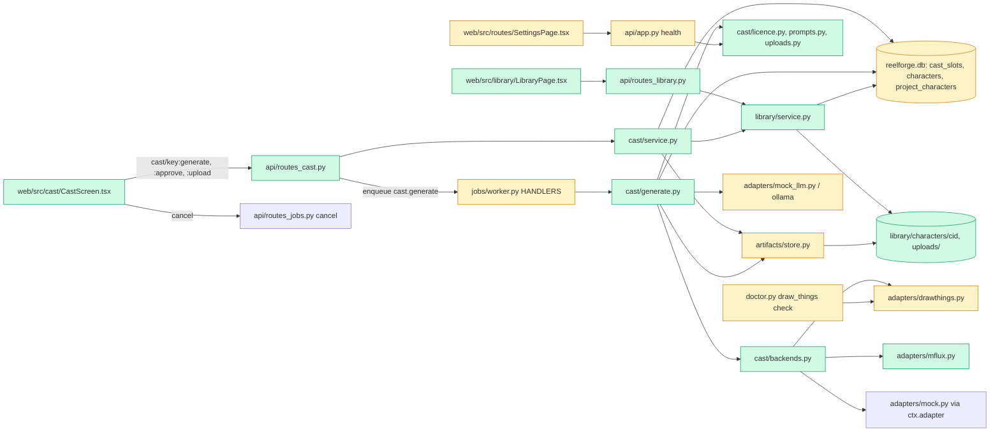

# Tech spec — Add Cast stage with Draw Things/mflux adapters and character library

## Approach
Cast is a new vertical slice that reuses the M1 backbone and follows the M2 story slice. Image generation is one new job type, `cast.generate`, registered in `HANDLERS` in `src/reelforge/jobs/worker.py` like `story.structure`. It is heavy, so it takes the GPU lease. The handler loops image by image. Each image gets a fingerprint lookup in `ArtifactStore.lookup` (the R16 cache) and, on a miss, exactly one `adapter.run` call. Finished images are written through `ArtifactStore.write` as they complete, so Cancel keeps them. Cancel uses the existing `POST /api/v1/jobs/{id}/cancel` and `CancelToken`. The handler hands each `adapter.run` a fresh token so the current image finishes before the loop stops.

Cast state that is not an artifact lives in one new table, `cast_slots` (one row per project and story character). It holds the bible line, seeds, ordered candidate ids and approval. The existing `characters` table is the library and gets new columns. The existing `project_characters` table links a story key to a library character. A new migration `0003` follows `0002_story.py`.

Routes follow `routes_story.py`: `:action` suffixes, a `build_router(ctx)` factory, `HTTPException` bodies of the form `{"detail": ...}`, and 202 job bodies via `job_body`. Two new routers go in `app.py`: `routes_cast.py` and `routes_library.py`.

Image adapters implement the existing `Adapter` protocol in `adapters/base.py`. `DrawThingsAdapter` grows from a health probe into a real `run`, patterned on `OllamaAdapter` (loopback only, `httpx`, `trust_env=False`). The new `MfluxAdapter` goes through `adapters/runner.run_command`, which already uses an argument list and never a shell, supports cancel, and logs.

Adapter choice stays out of the artifact code. In `backend="mock"`, which is the default, the cast handler uses `ctx.adapter`, so tests inject a counting or recording adapter exactly as the M1 helpers do. In `backend="real"`, a small resolver, `cast/backends.py`, picks Draw Things, or mflux when it is selected and Draw Things is down. `ctx.adapter` is untouched.

Licence handling is one pure function over `ModelEntry` (`cast/licence.py`). Its text feeds the cast API, a new optional `image_licence_warning` key on `GET /health` (the Status panel), and the artifact sidecar. The sidecar gains `license` and `license_url` keys only when the spec carries them, so M1 sidecars are unchanged (AC-14).

The library is the `characters` table plus a file mirror at `library/characters/<cid>/` (`master.<ext>`, `character.json`). The library must outlive project artifacts, so approval copies the master bytes into the library folder. `character.json` is the exact JSON the API returns for that record.

The LLM bible line reuses `ctx.llm.chat` with a schema and a versioned prompt file, like `story/prompts.py`. `MockLlm` gets a small branch that returns a deterministic bible line when the schema has a `bible_line` property.

The web side adds `web/src/cast/*`, `web/src/library/*` and `web/src/api/cast.ts`, `library.ts`. It follows the `web/src/story/*` and `api/story.ts` patterns (react-query, the typed `api` client, `queryKeys`). The cast query key is nested under the `stages` key. The M1 `eventToQueryKeys` mapping is frozen, and this way job, artifact and stage events already refresh the cast screen.

## Architecture



## Interface contract

All HTTP routes are under the existing FastAPI app (`reelforge.api.app.create_app`). Errors use FastAPI's `{"detail": "<message>"}` body. Tests build the app as in `tests/acceptance/rf_helpers.py`: `make_settings`, `make_ctx(settings, adapter=...)`, `make_client`. The mock LLM is the default (`llm_backend="mock"`).

### Settings (`reelforge.config.Settings`, all optional)
- `backend: Literal["mock","real"] = "mock"`. Widened from `"mock"`. With `"mock"` the cast handler uses `ctx.adapter`. With `"real"` it uses the Draw Things or mflux adapters through the resolver.
- `image_fallback: Literal["none","mflux"] = "none"`. `"mflux"` means mflux is selected in Settings.
- `mflux_command: Path | None = None`. The mflux executable. mflux counts as configured only when `image_fallback == "mflux"` and `mflux_command` is set.
- `max_upload_mb: int = 10` (`>= 1`).
- `drawthings_url` already exists. The port in messages comes from it (default 7860).
- Env: `REELFORGE_BACKEND`, `REELFORGE_IMAGE_FALLBACK`, `REELFORGE_MFLUX_COMMAND`, `REELFORGE_MAX_UPLOAD_MB`. config.toml: `[runtime] image_fallback`, `[runtime] max_upload_mb`, `[tools.mflux] command`.

### Python: adapters
- `reelforge.adapters.drawthings.DrawThingsAdapter(url: str, *, model_id: str | None = None, timeout_s: float = 600.0)`. `name = "draw_things"`, `version = "dt-1"`.
  - `async run(task: TaskSpec, out_dir: Path, progress, cancel: CancelToken, *, ctx_job_id: str | None = None) -> list[ProducedFile]` is the standard `Adapter.run`. It makes exactly one HTTP request per call.
    - Without `task.input_paths`, it sends `POST {url}/sdapi/v1/txt2img`. With them, it sends `POST {url}/sdapi/v1/img2img` and adds `init_images: [base64 of input_paths[0]]` and `strength` (`task.params.get("strength", 0.6)`).
    - JSON body keys: `prompt`, `seed`, `width`, `height`, `steps`, `model`. The `model` value is `task.model.id`. `width`, `height` and `steps` come from `task.params`, defaulting to 576, 1024 and 4.
    - The body never contains `batch_size` or `batch_count`.
    - The response `{"images": [<base64 png>]}` becomes `out_dir/out.png`. The result is `[ProducedFile(path, ext="png", width, height)]`.
  - Errors, all `AdapterError`:
    - Connection failure: exactly `Draw Things isn't reachable on port <port>`.
    - HTTP 422: message `Draw Things doesn't have the model <task.model.id>`.
    - img2img endpoint 404: message `This Draw Things setup can't edit images`.
    - Any other non-2xx status: the message includes the status code.
  - `check() -> HealthReport` keeps its current behaviour for an unreachable server. When `model_id` is set and `GET /` succeeds, it also sends one `POST /sdapi/v1/txt2img` with `{"prompt": "health check", "seed": 0, "width": 64, "height": 64, "steps": 1, "model": model_id}`. A 422 gives `ok=False` with a detail containing `model_id`. A timeout counts as ok. A success is cached per `(url, model_id)` for the process.
  - `health()` and `capabilities()` (`{"image"}`) are unchanged in shape.
- `reelforge.adapters.mflux.MfluxAdapter(command: Path | str, *, timeout_s: float = 600.0)`. `name = "mflux"`, `version = "mflux-1"`. `run(...)` executes, through `run_command` with an argument list and no shell:
  `[command, "--model", task.model.id, "--prompt", prompt, "--seed", str(seed), "--width", str(w), "--height", str(h), "--steps", str(n), "--output", <out_dir>/out.png]`
  For img2img it appends `"--image-path", <path>, "--image-strength", <str(strength)>`.
  - The fake command in tests is any executable that writes a PNG to the `--output` path.
  - A non-zero exit raises `AdapterError`. A cancelled run raises `AdapterError("cancelled")`.
  - It returns `[ProducedFile(path, ext="png", width, height)]`.
- `reelforge.cast.licence.licence_warning(entry: ModelEntry) -> str | None`:
  - Empty `license` returns `"Image model licence is not filled in. Check <entry.id> before commercial use."`.
  - A licence that, lower-cased, contains `non-commercial`, `noncommercial`, `non commercial` or `-nc` returns `"Image model licence: <license> - not for commercial use. See <license_url>."`.
  - Otherwise it returns `None`.

### Doctor / CLI
- `reelforge.doctor.run_doctor(settings)` keeps its 11 check names. The `draw_things` check (blocking) now also validates the pinned `image` model from `settings.models_path` via `DrawThingsAdapter(url, model_id=...)`. If the stub returns 422, the check is `status="fail"` and `detail` contains the model id. `reelforge doctor` then exits non-zero (existing behaviour for blocking failures).
- `GET /health`: body keys are unchanged. When the image model has a licence warning it gains `"image_licence_warning": "<text from licence_warning>"`. The key is absent otherwise.

### HTTP: cast (`/api/v1/projects/{project_id}/cast...`)
- Common errors:
  - Unknown project: 404 `project not found`.
  - Stage is `DRAFT` (story not approved): 409 `Approve the story first.`
  - Unknown story character key: 404 `character not found`.
- `GET /api/v1/projects/{project_id}/cast` returns 200:
  ```
  {
    "stage": "STORY_APPROVED",
    "approved_count": 1,
    "total": 2,
    "image_backend": {"kind": "mock"|"draw_things", "reachable": true, "port": 7860, "mflux_available": false},
    "licence_warning": "<text>",
    "characters": [{
      "key": "tomato", "name": "Tamatar", "aliases": [], "look": "<story look>",
      "bible_line": "<str, empty before first generation>",
      "bible_source": "llm"|"user"|"raw"|"",
      "note": "Using your look text as written.",
      "state": "empty"|"generating"|"ready"|"approved"|"failed"|"stopped",
      "job_id": "<latest cast.generate job id>",
      "progress": {"completed": 2, "total": 4, "elapsed_s": 38.2, "message": "image 2 of 4"},
      "error": "<job error when state=failed>",
      "candidates": [{"id": "<artifact id>", "kind": "generated"|"refine"|"upload", "prompt": "...", "seed": 5,
                      "model": "<models.toml id>", "model_key": "image", "license": "...", "license_url": "...",
                      "image_url": "/media/<id>", "width": 576, "height": 1024}],
      "approved": false,
      "master_artifact_id": "<id>", "master_sha256": "<hex>", "seed": 5, "voice_reference": "",
      "library_character_id": "<cid>", "variant_of_library_id": "<cid>"
    }]
  }
  ```
  - Optional keys are omitted when empty: `licence_warning`, `note`, `job_id`, `progress`, `error`, `master_*`, `seed`, `library_character_id`, `variant_of_library_id`. In candidates, `license` and `license_url` are omitted when empty.
  - `image_backend.kind` is `"mock"` for `backend="mock"` (always reachable). Otherwise it is `"draw_things"`, with `reachable` from `GET /` on the URL. `mflux_available` is true only when mflux is configured.
  - `voice_reference` is always present (a string, possibly `""`).
  - `state="stopped"` means the latest job was cancelled with fewer images than total. `progress.completed` and `progress.total` then give the "Stopped after 2 of 4 images" numbers.
  - A story with no characters returns `characters: []`.
- `POST /api/v1/projects/{project_id}/cast/{key}:generate` takes body (all optional):
  `{"look_text": str, "seed": int, "regenerate": bool, "refine": {"from_candidate": "<artifact id>", "instruction": str}, "backend": "draw_things"|"mflux"}`
  - It returns 202 with a job body (same shape as `story:structure`). The payload includes `"stage": "cast"`, `"key"` and `"total"`.
  - A queued or running `cast.generate` job for the same project and key is returned as-is, so there is no second job.
  - `look_text` stores the edited bible line (`bible_source="user"`). If the character is library-sourced and the text differs from the stored bible line, a linked variant is created first (see Library below).
  - `seed` sets the base seed. Without it, a stable seed is derived from project and key.
  - Seeds: a fresh run uses `s..s+3`. `regenerate=true` continues from the next unused seed and appends 4. `refine` makes one image with the next unused seed using img2img from `from_candidate` and appends it (404 if `from_candidate` is not a candidate of this character).
  - Job lifecycle:
    - The job message is `image n of N` and `result` is `{"candidate_ids": [...], "completed": n, "total": N, "elapsed_s": float}`.
    - A cancelled job (`POST /api/v1/jobs/{id}/cancel`) ends `cancelled` with finished images kept and no further adapter calls.
    - A job that fails because Draw Things is unreachable (and mflux is not usable) ends `failed` with `error == "Draw Things isn't reachable on port <port>"`.
- `POST /api/v1/projects/{project_id}/cast/{key}:approve` takes `{"candidate_id": "<artifact id>"}` and returns 200:
  `{"project_stage": "STORY_APPROVED"|"CAST_APPROVED", "approved_count": n, "total": m, "character": <cast item>}`
  - An unknown candidate (not in this character's candidates) returns 404 `candidate not found`.
  - Approving the same candidate twice is idempotent (no new artifact, no new library row).
  - Approving creates a `cast_master` artifact, saves or updates the library character, and writes `library/characters/<cid>/character.json`.
  - The licence warning never blocks approval.
  - The stage becomes `CAST_APPROVED` when every story character is approved, and a `stage.changed` event is published.
- `POST /api/v1/projects/{project_id}/cast/{key}:reopen` takes no body. It clears this character's approval (the library character is untouched). If the stage was `CAST_APPROVED` it goes back to `STORY_APPROVED`. It returns the same body as `:approve`.
- `POST /api/v1/projects/{project_id}/cast/{key}:use-library` takes `{"character_id": "<cid>"}` and returns the same body as `:approve`.
  - An unknown id returns 404 `That library character no longer exists.`
  - A library character without a master image returns 409.
  - It copies the library master bytes into a new project `cast_master` artifact (same sha256). It copies look text (as `bible_line`), seed and `voice_reference` into the project. It marks the character approved and links `project_characters`. Stage rules are as for `:approve`.
- `POST /api/v1/projects/{project_id}/cast/{key}:upload` takes multipart form with a `file` part. It returns 201 with the cast item.
  - The type is judged by content (PNG or JPEG signature plus a parseable header with width and height). The client filename and content-type are ignored.
  - A non-image, empty or corrupt-header file returns 415 `That file isn't a PNG or JPEG image.`
  - A file over `max_upload_mb` MB, or an image with a side over 8192 px, returns 413 `That image is larger than <max_upload_mb> MB.`
  - Rejected uploads change nothing.
  - On success the file is stored as an artifact (`kind="cast_upload"`) under `<project data_dir>/uploads/` with a generated name `take_NNN.<png|jpg>`. The client name never appears in the path. The character's candidates become exactly `[that artifact]`, with `kind="upload"`.
- Artifact sidecar JSON (`<artifact path>.json`): the candidate and master artifacts include `prompt`, `seed`, `model` (registry key), `model_id`, and `license` / `license_url` when non-empty. M1 sidecars are unchanged.

### HTTP: library
`LibraryCharacter` JSON (the same object is mirrored in `character.json`):
`{"id", "name", "aliases": [], "look_text", "master_image_url": "/api/v1/library/characters/<id>/master", "master_sha256", "seed", "model", "model_id", "created_at", "tags": [], "voice_reference": "", "license", "license_url", "parent_character_id"}`
- `master_image_url`, `master_sha256`, `seed`, `model`, `model_id`, `license`, `license_url` and `parent_character_id` are omitted when empty.
- `GET /api/v1/library/characters` returns 200 with a list of `LibraryCharacter`, ordered by `created_at` then `id`.
- `POST /api/v1/library/characters` takes `{"name": str, "aliases"?: [], "look_text": str, "tags"?: [], "seed"?: int, "voice_reference"?: str, "master_artifact_id"?: str}` and returns 201 with a `LibraryCharacter`. If `master_artifact_id` names an existing artifact, its bytes are copied into the library folder. An unknown one returns 404.
- `GET /api/v1/library/characters/{cid}` returns 200 with a `LibraryCharacter`, or 404 `character not found`.
- `PATCH /api/v1/library/characters/{cid}` accepts only `name`, `aliases` and `tags`.
  - Any other key (for example `look_text`, `master_artifact_id`, `seed`, `model`) returns 400 `Only name, aliases and tags can be changed.`
  - An unknown id returns 404.
  - On success it returns 200 with the updated record and rewrites `character.json`.
- `GET /api/v1/library/characters/{cid}/master` returns the master image bytes (`image/png` or `image/jpeg`), or 404.
- Library rules:
  - Approving saves a library character (name, aliases from the story character, `look_text` = the bible line, master, seed, model, tags `[]`, empty `voice_reference` unless the project has one) and links it in `project_characters`.
  - Re-approving in the same project updates that project-created record (no duplicate).
  - A library-sourced character whose look text is edited, or whose candidate is approved, gets a new library row with `parent_character_id` = the original id and name `"<name> (variant)"`. The original row and its files are never written. The cast item then has `variant_of_library_id` = the original id and `library_character_id` = the variant id, and the UI shows "This changes a library character, so a copy was made."

### Web: routes and components
- `AppRoutes` adds a nav link `Library` (to `/library`) and routes `/library` (`LibraryPage`) and `/library/:characterId` (`LibraryDetail`). Existing links are unchanged.
- `ProjectPage` renders `<CastScreen projectId={...} />` after the story editor whenever `project.stage !== "DRAFT"`. If `GET .../cast` fails, nothing is shown for it.
- `web/src/cast/CastScreen.tsx` is `export function CastScreen({ projectId }: { projectId: string })`. Visible text and roles (exact):
  - Section `aria-label="Cast"` with heading `Cast`. Footer text `N of M characters approved` (for example `1 of 2 characters approved`). If there are no characters: `This story has no characters to cast.`
  - Licence banner (role `status`) with the API `licence_warning` text, shown only when present. It is repeated in the approval confirmation dialog (role `dialog`) with buttons `Approve anyway` and `Cancel` (a permissive licence shows no dialog and approves directly).
  - Unreachable panel (when `image_backend.kind === "draw_things"` and `reachable === false`):
    - Heading text exactly `Draw Things isn't reachable on port <port>`.
    - A `Retry` button that refetches `GET .../cast`.
    - An ordered list with the four steps: `Install Draw Things from the Mac App Store.`, `Open it and turn on the HTTP API server in settings.`, `Set the port to 7860 and keep the app open.`, `Click Retry.`
    - If `mflux_available`: the text `Use mflux instead` as a button, which posts `:generate` with `backend: "mflux"`. Otherwise the string "mflux" appears nowhere on the screen.
    - Generate controls are replaced by this panel; existing candidates and masters stay visible.
  - Rows are `<ul aria-label="Cast characters">` with `<li aria-label="Character: <name>">`.
    - Each row shows the name, aliases, and a textarea labelled `Character bible line`. It has a badge `Approved` or `Not approved`.
    - Empty state: `No candidates yet` and a button `Generate candidates`.
    - Generating state: text `Generating image <n> of <total> - <s> s elapsed` and a `Cancel` button. Elapsed seconds come from the job's `started_at`.
    - Stopped: `Stopped after <n> of <total> images`.
    - Failed: `Couldn't generate images.` plus the error and a `Retry` button.
  - Candidate tiles: `<li aria-label="Candidate seed <seed>">` containing an `">`. Each tile has a radio-style select control `role="radio"` named `Select candidate seed <seed>`, and buttons `Enlarge seed <seed>` and `Compare seed <seed>`. Enlarge opens a `dialog` showing prompt, seed and model.
  - Row buttons: `Approve this one`, `Regenerate 4 more`, `Edit look text and regenerate`, `Refine selected (img2img)`, `Use from library`. There is also a file input labelled `Upload my own image`. `Approve this one` and `Refine selected (img2img)` are disabled until a candidate is selected. Refine shows a text box labelled `What small change?`.
  - Approved row: shows the master image with the `Approved` badge and the buttons `Change approval` (calls `:reopen`) and `Replace from library`. If `library_character_id` is set, the note `From library: <name>` is shown. If `variant_of_library_id` is set: `This changes a library character, so a copy was made.`
  - A top-level button `Use characters from library` opens a picker (dialog) of library characters.
- `web/src/library/LibraryPage.tsx`: `export function LibraryPage()` has heading `Library`, empty text `No characters in your library yet. Approve a cast to save characters here.`, and cards `<li aria-label="Library character: <name>">` that link to the detail and show name, aliases, tags, created date and `Variant of <parent name>` when `parent_character_id` is set.
- `web/src/library/LibraryDetail.tsx`: `export function LibraryDetail()` has fields labelled `Name`, `Aliases` (comma separated), `Tags` (comma separated), and a `Save` button that sends PATCH.
- `SettingsPage` adds a list item `aria-label="Image model licence: amber"` showing the `image_licence_warning` text from `/health`, only when the key is present.

## Data and state changes
- **Migration `0003_cast`** (`src/reelforge/db/migrations/versions/0003_cast.py`, revision `0003`, down `0002`):
  - `characters` gains nullable or defaulted columns:
    - `seed INTEGER NULL`
    - `model_key VARCHAR(64) NULL`
    - `model_id TEXT NULL`
    - `license TEXT NOT NULL DEFAULT ''`
    - `license_url TEXT NOT NULL DEFAULT ''`
    - `master_path TEXT NULL` (relative to data root)
    - `master_sha256 VARCHAR(64) NULL`
    - `voice_reference TEXT NOT NULL DEFAULT ''`
    - `created_at DATETIME NOT NULL DEFAULT CURRENT_TIMESTAMP`
  - New table `cast_slots`:
    - `project_id` FK to `projects`, cascade, primary key
    - `story_key VARCHAR(64)` primary key
    - `bible_line TEXT NOT NULL DEFAULT ''`
    - `bible_source VARCHAR(8) NOT NULL DEFAULT ''`
    - `look_source TEXT NOT NULL DEFAULT ''`
    - `base_seed INTEGER NULL`
    - `next_seed INTEGER NULL`
    - `candidate_ids JSON NOT NULL`
    - `approved_artifact_id VARCHAR(26) NULL`
    - `approved_candidate_id VARCHAR(26) NULL`
    - `origin VARCHAR(8) NOT NULL DEFAULT ''` (`''`, `saved` or `reused`)
    - `variant_of_id VARCHAR(26) NULL`
    - `seed INTEGER NULL`
    - `voice_reference TEXT NOT NULL DEFAULT ''`
    - `updated_at DATETIME`
  - ORM classes `Character` (extended) and `CastSlot` (new) in `db/models.py`. The module docstring count "15 tables" becomes 16.
- **Artifact kinds** (no schema change):
  - `cast_cand_<seed>` and `cast_refine_<seed>`: owner `("character", <story key>)`, subdir `cast/<key>`. Kind is per seed because `ArtifactStore.write` deactivates other artifacts of the same owner and kind, and the cache lookup needs `is_active`.
  - `cast_master`: subdir `cast/<key>/master`.
  - `cast_upload`: subdir `uploads`.
- **Job type** `cast.generate`: heavy, `mem_need_gb=10.0`, payload `{key, stage:"cast", regenerate, refine, seed, backend, total}`.
- **Prompt file** `src/reelforge/cast/prompts/bible.v1.md` (fixed bible-line format, one line, `bible_line` JSON key).
- **Files on disk**: `<data_root>/library/characters/<cid>/master.<ext>` and `character.json`. They are written atomically (temp file, then `os.replace`).
- **Dependency**: `python-multipart>=0.0.9` in `pyproject.toml` and `uv.lock`, needed for FastAPI form uploads.
- **Env/config**: as listed under Settings. No other global state.

## Tasks
Each task is one commit and leaves lint, typecheck, build and tests green.

1. **Settings and multipart dependency** — `src/reelforge/config.py` (modified: widen `backend`; add `image_fallback`, `mflux_command`, `max_upload_mb`; map `[runtime] image_fallback`, `[runtime] max_upload_mb`, `[tools.mflux] command`; expand `~` for `mflux_command`), `pyproject.toml` and `uv.lock` (modified: add `python-multipart`), `tests/unit/test_config_m3.py` (new). Defaults keep every M1/M2 behaviour.
2. **Schema for cast and library** — `src/reelforge/db/models.py` (modified: `Character` columns, new `CastSlot`), `src/reelforge/db/migrations/versions/0003_cast.py` (new), `tests/unit/test_migration_0003.py` (new; same style as `test_migration_0002.py`: existing rows survive, new columns and table exist).
3. **Licence in artifact metadata** — `src/reelforge/artifacts/store.py` (modified: `ArtifactSpec.license` and `license_url`, default `""`; the sidecar writes `license` and `license_url` only when non-empty), `src/reelforge/cast/__init__.py` and `src/reelforge/cast/licence.py` (new: `licence_warning`), `src/reelforge/api/app.py` (modified: `/health` adds `image_licence_warning` only when set, using `response_model_exclude_unset=True` and an optional unset field on `HealthOut` in `schemas.py`), `tests/unit/test_licence.py` (new), `tests/unit/test_store_licence.py` (new).
4. **Draw Things adapter and doctor model check** — `src/reelforge/adapters/drawthings.py` (modified: `run`, `model_id` check, error messages, `unreachable_message(url)`), `src/reelforge/doctor.py` (modified: `check_draw_things` passes the pinned image model id from `models_path`), `tests/unit/test_drawthings_adapter.py` (new, loopback stub `http.server` in a thread).
5. **mflux adapter** — `src/reelforge/adapters/mflux.py` (new), `tests/unit/test_mflux_adapter.py` (new; fake executable script, asserts argv list and that no shell is used by patching `asyncio.create_subprocess_exec`).
6. **Cast helpers (prompts, bible, uploads, backend resolver)** — `src/reelforge/cast/prompts.py` and `src/reelforge/cast/prompts/bible.v1.md` (new: `bible_messages`, `bible_schema`, `image_prompt(bible_line, style)` appending front-facing, plain background, 9:16 full body), `src/reelforge/adapters/mock_llm.py` (modified: when `schema["properties"]` has `bible_line`, return `{"bible_line": "Character: <name>. Look: <look>."}` derived from the user message; otherwise unchanged), `src/reelforge/cast/uploads.py` (new: `sniff_image(data) -> (ext, width, height)`, raises `NotAnImage`, `TooLarge`), `src/reelforge/cast/backends.py` (new: `async resolve_image_adapter(ctx, backend) -> Adapter`, `async probe_backend(ctx) -> BackendStatus`), unit tests for each (`tests/unit/test_cast_helpers.py`).
7. **Library service and routes** — `src/reelforge/library/__init__.py` and `service.py` (new: `to_record`, `list_all`, `get`, `create`, `patch`, `save_from_artifact`, `make_variant`, atomic `character.json` mirror, master copy), `src/reelforge/api/routes_library.py` (new), `src/reelforge/api/schemas.py` (modified: library request models; responses are plain dicts with empty keys omitted), `src/reelforge/api/app.py` (modified: include the router), `tests/unit/test_api_library.py` (new).
8. **`cast.generate` job** — `src/reelforge/cast/state.py` (new: slot get/create, story character loader via `service.current_version` and `parse_story`, seed derivation, candidate listing from sidecars), `src/reelforge/cast/generate.py` (new: `async cast_generate(ctx, job, progress, cancel)`), `src/reelforge/jobs/worker.py` (modified: register `"cast.generate": cast_generate`), `tests/unit/test_cast_generate.py` (new).
   - The handler flow:
     - Load the slot and make sure the bible line exists (LLM call with `heavy_next=True`, fallback to the raw look text with `bible_source="raw"`).
     - Resolve the adapter.
     - For each seed: stop if `cancel.cancelled`. Build the spec (with licence fields and `adapter.name`/`adapter.version`) and `store.lookup`. On a miss, call `adapter.run` once with a fresh `CancelToken`, then `store.write`.
     - After each image, persist `candidate_ids` and update the job `result`.
     - Raise `AdapterError("cancelled")` if the token was cancelled, so the worker records `cancelled`.
9. **Cast service and routes** — `src/reelforge/cast/service.py` (new: `approve`, `reopen`, `use_library`, `upload`, `recompute_stage`, `ensure_own_character` for the variant rule), `src/reelforge/api/routes_cast.py` (new: all `cast` routes including the `GET` assembly with job-derived `state`), `src/reelforge/api/app.py` (modified: include the router), `tests/unit/test_api_cast.py` (new).
   - Approve flow: write the master through `store.write` with the candidate as input artifact, call `library.save_from_artifact`, upsert `project_characters`, add an `Approval` row, then set the project stage and publish `stage.changed`.
   - The generate route applies the edited `look_text` and the variant rule before enqueueing, and returns an existing active job instead of a duplicate.
10. **Typed web client** — `web/openapi.json` and `web/src/api/schema.d.ts` (regenerated: `uv run python -m reelforge.api.openapi_export web/openapi.json && pnpm --dir web gen:api`), `web/src/api/client.ts` (modified: `queryKeys.cast(id)` = `["project", id, "stages", "cast"]`, `queryKeys.library`, `queryKeys.libraryCharacter(id)`), `web/src/api/cast.ts` and `web/src/api/library.ts` (new: query and mutation hooks, `CastUnavailableError` on 404 like `StoryUnavailableError`), `web/tests/unit/cast_api.test.tsx` (new).
11. **Cast screen** — `web/src/cast/CastScreen.tsx`, `CastRow.tsx`, `CandidateGrid.tsx`, `BackendDown.tsx`, `LicenceBanner.tsx`, `ApproveDialog.tsx`, `LibraryPicker.tsx` (new), `web/src/routes/ProjectPage.tsx` (modified: render `CastScreen` when stage is not `DRAFT`), `web/src/theme.css` (modified: minimal grid and tile styles), unit tests in `web/tests/unit/cast_screen.test.tsx` (new).
12. **Library screen, nav and Status licence row** — `web/src/library/LibraryPage.tsx`, `LibraryDetail.tsx` (new), `web/src/AppRoutes.tsx` (modified: nav link and routes), `web/src/routes/SettingsPage.tsx` (modified: licence row), `web/src/api/queries.ts` (modified: `HealthReport` type gains the optional `image_licence_warning`), `web/tests/unit/appRoutes.test.tsx` (modified: expected links now include `Library`), `web/tests/unit/library_screen.test.tsx` (new).
13. **End-to-end and hardening** — `web/e2e/cast.spec.ts` (new Playwright flow on the mock backend: approve story, generate 4, select, approve, see `CAST_APPROVED`, open the Library), `tests/unit/test_cast_offline.py` (new: mock-adapter generate, approve and reuse with outbound sockets blocked, same guard as `tests/acceptance/conftest.py`), `docs/manual-checks.md` (new: the AC-13 reference-Mac checklist; reviewer records pass/fail).

## Implementation tests
Not frozen; the implementer adds these with the code.
- **Config:** new fields default correctly and parse from env and toml.
- **Migration 0003:** existing `characters` rows survive; `cast_slots` exists with its primary key.
- **Store:** the sidecar has no `license` keys for M1 specs and has them for cast specs.
- **Licence:** each of Apache-2.0, `FLUX.1 [dev] Non-Commercial License`, `CC-BY-NC-4.0` and an empty string gives the expected result.
- **Draw Things adapter** (stub server):
  - txt2img body has `model`, and no `batch_size` or `batch_count`.
  - img2img carries base64 `init_images`.
  - 422 gives the model message.
  - Connection refused gives the unreachable message.
  - `check()` with a model that returns 422 is `ok=False`.
  - A successful model check is cached.
- **Doctor:** the `draw_things` check fails and names the model on 422.
- **mflux:** argv exactness; non-zero exit; cancel.
- **Cast helpers:** `sniff_image` accepts a PNG and a JPEG, and rejects text named `.png`, empty bytes, truncated headers and huge dimensions. The resolver covers every combination: mock, DT up, DT down with mflux selected, DT down with no mflux, and explicit `backend="mflux"` without config.
- **`cast.generate`** (mock adapter wrapped to record seeds and cancel after image 2):
  - Seeds are `s..s+3` in order.
  - A second run makes 0 calls and returns the same artifact ids.
  - Changing the bible line makes 4 new calls.
  - Cancel after image 2 leaves 2 artifacts, makes no 3rd call, and the job is `cancelled`.
  - `regenerate` appends seeds `s+4..s+7`.
  - Refine appends one candidate.
  - LLM failure falls back to the raw look text with `bible_source="raw"`.
  - A mid-run adapter failure keeps finished images.
  - The edited line appears in the prompt and the LLM line does not.
- **Cast API:**
  - Approve one of two characters leaves the stage at `STORY_APPROVED`; the last one gives `CAST_APPROVED`; reopen goes back.
  - Approve is idempotent.
  - Upload accepts PNG and JPEG with a wrong extension, rejects text (415), over-size (413) and empty/corrupt files, and the stored path has no client name.
  - 409 before story approval, and 404 for an unknown key, candidate or library id.
  - A non-commercial licence still approves and the sidecar has the licence.
  - A duplicate `:generate` returns the same job.
- **Library:**
  - POST and GET round-trip.
  - PATCH accepts only name, aliases and tags (400 otherwise).
  - `character.json` equals the GET body, also after PATCH.
  - Re-approval makes no duplicate.
  - Use in project B gives equal sha256, look text, seed and voice reference.
  - A look edit makes a variant with `parent_character_id` and leaves the parent byte-identical.
- **Web:** the cast screen states (empty, generating, stopped, failed, approved), the unreachable panel with and without mflux, the licence dialog, tile selection and enable/disable of Approve and Refine, upload error messages, the library empty state and PATCH, and the Settings licence row.

## Risks and rollout
- **Migration order:** `0003` follows `0002`, adds nullable or defaulted columns only, and `upgrade()` runs on `up`. Existing rows stay valid.
- **Frozen M1/M2 tests:** `/health` and sidecars change only when a licence warning exists or a cast spec is written. The widened `backend` literal keeps `"mock"` as the default. `eventToQueryKeys` is untouched because the cast query key is nested under `stages`. The doctor check names stay at 11, so the model check lives inside `draw_things`. The M2 UI acceptance tests do not stub `/cast` for approved stories, so `CastScreen` must render nothing on a failed fetch.
- **Doctor and health polling:** the model check sends one tiny txt2img. The health poller calls `run_doctor` every 15 s, so a success is cached per process and the 120 s timeout is treated as ok. Only failures re-probe. A reviewer should confirm this does not compete with a running render, since the GPU lease is not taken for it.
- **Real mode wiring:** `backend="real"` affects cast only. `ctx.adapter` stays the mock for other kinds until later milestones.
- **Story edits after cast approval:** the stage drops to `DRAFT` through the existing path, and approved masters are kept (the staleness mechanism already marks them). On story re-approval the stage returns to `STORY_APPROVED` and the user re-confirms by approving the characters again. Slots keep their old approvals, so `approved_count` can show them as approved. This is unchanged by M3, and stale artifacts are reported through `GET .../stale`.
- **`uv.lock`:** adding `python-multipart` needs network once at implementation time. Tests then run offline.
- **AC-13** is manual (reference Mac). Task 13 provides the checklist.

## Open questions
- None blocking. Assumptions taken from the product spec's open questions:
  - The licence warning is its own "Image model licence" row in Settings & status.
  - The Library nav entry is global.
  - There is no library delete or archive.
  - The upload dimension cap is 8192 px per side.
  - Creating a variant does not prompt the user.
