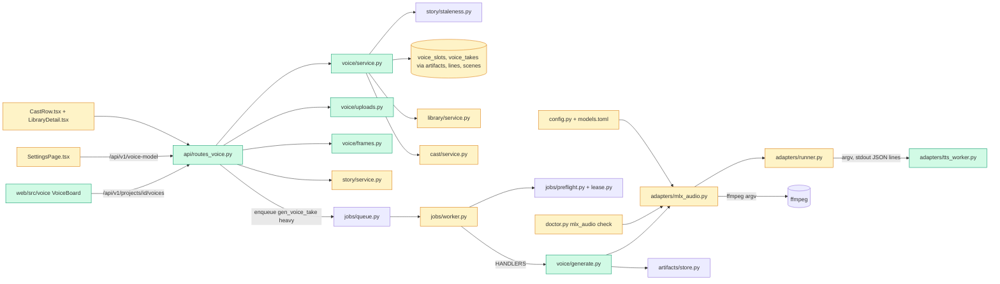

# Tech spec — Add Hindi voice-overs (M4 Voice) with OmniVoice, Kokoro fallback and a voice board

## Approach
Follow the M3 cast pattern end to end. A new `src/reelforge/voice/` package mirrors `cast/` (`service.py` for state and queries, `generate.py` for the job handler). It is registered in `jobs/worker.py` `HANDLERS` as `gen_voice_take`, a heavy job that takes the GPU lease, with `mem_need_gb = settings.voice_mem_gb`. API routes go in a new `api/routes_voice.py`, built like `api/routes_cast.py` (`build_router(ctx)`, `:action` URLs, `JSONResponse` bodies). The web board is a new `web/src/voice/` folder, wired like `web/src/cast/`.

Reuse over new tables:
- Takes are `Artifact` rows (`owner_type="scene"`, `owner_id=<scene id>`, `kind="voice_take"`). `ArtifactStore.write` already deactivates the older take of the same owner and kind, so exactly one take is active. "Select take" only flips `is_active`.
- Staleness reuses `story/staleness.py` (`ChangeRow`, `is_stale`) over `story_changes`. A text-only edit already diffs to `LINE_KINDS = ["voice_take", "shot"]`. The shot length is stale when `scenes.shot_length_at` is older than a change that covers `shot`.
- The shot length is written to the existing `scenes` table (`duration_s`, `frames`). Line settings (speed, pauses, approval) go on the existing `lines` table. The library voice reuses the existing `voices` table and `characters.voice_id`.
- The reference clip is stored through `ArtifactStore.write`, which gives a generated name under the data root.

New pieces and why:
- `adapters/tts_worker.py` is a standalone script. It runs inside the mlx-audio uv environment, so it cannot import `reelforge`.
- `run_command` gains an optional stdout-line callback. The worker reports per-line progress on stdout, and today `run_command` only returns after the process exits.
- `voice/uploads.py` sniffs audio by content, like `cast/uploads.py` does for images.
- Migration 0004 adds `voice_slots` and a few columns.

Design decisions:
- **Doctor.** `tests/acceptance/test_ac09_doctor.py` (frozen M1) pins `list(CHECKS)`. So R6 extends the existing blocking `mlx_audio` check to also run `tts_worker.py --selftest`. No new check key is added. The check name stays `mlx_audio`; the Status row text carries the new detail.
- **Mock backend.** With `Settings.backend == "mock"` the voice job runs the same subprocess path with `sys.executable tts_worker.py --backend mock`. It does not use `ctx.adapter`, so the worker, ffmpeg and progress code are exercised offline.
- **Text edits from the board.** These go through `story/service.save_version(..., keep_stage=True)`. The normal story editor flow resets the stage to DRAFT; a board edit must not. Because the project stage is not reset, the edited version must keep the previous version's `approved_at`.
- **Speed and pause changes.** On an approved line these reopen it. Pauses take effect immediately in the displayed and stitched duration. Speed applies to the next take (New take or Edit and re-take), not to the existing audio.
- **Frame minimum.** The result is clamped to at least 9 frames, so k is at least 1 as the product spec states.
- **No dialogue.** A project with no dialogue lines does not auto-advance to `VOICES_APPROVED`.
- **Clip length.** A clip outside 5 to 10 s is accepted; the response carries `clip_seconds` and the UI shows the note.
- **Voice model setting.** The `voice_model` in `config.toml` is the default. A UI change is stored in the `settings` table (key `voice_model`) and wins at runtime. `voice.service.current_voice_model(ctx)` resolves it.

## Architecture



## Interface contract

### Frame math and rules (pure functions)
- `reelforge.voice.frames`:
  - `FPS = 24`
  - `frames_for(duration_s: float) -> int`. Computes `8 * ceil((duration_s * 24 - 1) / 8) + 1`, clamped to a minimum of 9.
    - `frames_for(2.9) == 73`, `frames_for(3.32) == 81`.
    - Always `8k + 1` with k >= 1.
    - Raises `ValueError` if `duration_s <= 0`.
  - `shot_length_s(frames: int) -> float` returns `frames / 24`.
- `reelforge.adapters.mlx_audio`:
  - Constants: `SPEED_MIN = 0.8`, `SPEED_MAX = 1.25`, `PAUSE_MIN = 0.0`, `PAUSE_MAX = 1.0`.
  - `check_speed(speed: float) -> float`. Raises `ValueError("speed must be between 0.8 and 1.25")` if out of range. 0.8 and 1.25 are accepted.
  - `check_pause(name: str, value: float) -> float`. Raises `ValueError(f"{name} must be between 0 and 1 seconds")` if out of range. 0 and 1 are accepted.

### TTS worker script
Path `src/reelforge/adapters/tts_worker.py`. It is also available as `reelforge.adapters.mlx_audio.WORKER_PATH: Path`. It imports only the standard library, numpy, and (lazily, real backend only) mlx-audio. It never imports `reelforge`.

CLI:
- `python tts_worker.py --batch BATCH.jsonl --out-dir DIR [--backend real|mock]`
  - Each JSONL line is `{"id": str, "text": str, "model": str, "voice": str|null, "ref_audio": str|null, "ref_text": str|null, "speed": float, "lang": "hi"}`.
  - It loads each distinct `model` once and writes `DIR/<id>.wav` (24 kHz, mono, 16-bit PCM).
  - It prints one JSON line per finished line on stdout, flushed. The line is `{"id", "path", "duration_s"}` on success and `{"id", "error": str}` on a per-line failure.
  - It continues after a per-line failure and exits 0 for the batch. A non-zero exit only means the batch could not start (unreadable batch file, model load failure).
- `python tts_worker.py --selftest [--backend real|mock]`
  - It renders one Hindi word to a temporary WAV and exits 0. On failure it prints a one-line error to stderr and exits non-zero.
- `--backend mock`
  - It loads no model and uses no network. WAVs are deterministic: identical input gives identical bytes.
  - Duration depends on the word count of `text` and on `speed` (about `0.3 + 0.25 * words` seconds, divided by `speed`). Frequency depends on a hash of the text.
  - The tone has about 0.3 s of leading and trailing silence, so trimming is observable.
  - A line whose `text` contains the token `[[fail]]` yields an `error` progress line.

In-process API, used by tests with a stub model:
- `run_batch(lines: list[dict], out_dir: Path, *, backend: str = "real", load_model: Callable[[str], Callable[[dict], tuple[numpy.ndarray, int]]] | None = None, emit: Callable[[dict], None] | None = None) -> int`
  - `load_model(model_id)` returns `synth(line) -> (samples, sample_rate)`. It is called once per distinct model id per batch.
  - Samples at another rate are resampled to 24 kHz.
  - `emit` receives one dict per line (default: print JSON to stdout).
  - Returns the exit code.
- `main(argv: list[str] | None = None) -> int`.

### mlx-audio adapter
All in `reelforge.adapters.mlx_audio`:
- `VOICE_MODELS: dict[str, str] = {"omnivoice": "tts", "kokoro": "tts_fallback"}` maps the `voice_model` setting to the models.toml key.
- `@dataclass(frozen=True) VoicePreset(id: str, label: str, voice: str)`.
- `PRESETS: dict[str, list[VoicePreset]]`:
  - `"kokoro"`: ids `hf_alpha`, `hf_beta`, `hm_omega`, `hm_psi`; `voice` equals `id`.
  - `"omnivoice"`: ids `asha` (female) and `ravi` (male); `voice` is a short English voice-description string passed to the model.
- `plan_speed(voice_model: str, speed: float) -> tuple[float, float | None]` returns `(worker_speed, atempo)`. Kokoro has a native speed argument, so it returns `(speed, None)`. OmniVoice returns `(1.0, speed)`. It calls `check_speed`.
- `@dataclass VoiceLine(id: str, text: str, voice: str | None, ref_audio: Path | None, ref_text: str | None, speed: float, lang: str = "hi")`.
- `@dataclass VoiceResult(id: str, path: Path | None, duration_s: float | None, error: str | None)`.
- `async def postprocess_wav(src: Path, dst: Path, *, atempo: float | None = None, timeout_s: float = 120.0, cancel: CancelToken | None = None) -> float`
  - Runs ffmpeg through `run_command` with argument lists.
  - Trims leading and trailing silence, applies `atempo` when given, normalises to -16 LUFS (within 1 LU), and resamples to 48 kHz mono 16-bit WAV.
  - Returns the output duration in seconds.
  - Raises `AdapterError` on ffmpeg failure.
- `MlxAudioAdapter(project_path: Path | None, *, backend: Literal["mock","real"] = "real", timeout_s: float = 600.0)`:
  - `check()` and `health()` keep their M1 behaviour.
  - `selftest(timeout_s: float = 120.0) -> HealthReport` runs `[python, WORKER_PATH, "--selftest"]`. `python` is `<project_path>/.venv/bin/python`. It returns `ok=False` with detail `tts_worker selftest failed: <first line of error>` on a non-zero exit or a timeout.
  - `async run_batch(lines: list[VoiceLine], model_id: str, voice_model: str, out_dir: Path, progress: ProgressCb, cancel: CancelToken, *, on_line: Callable[[VoiceResult], None] | None = None, job_id: str | None = None) -> list[VoiceResult]`
    - Writes the batch JSONL, starts one subprocess for the whole batch (argument list, `timeout_s`, cancel), and parses stdout lines.
    - Post-processes each finished line to `out_dir/<id>.48k.wav` with `postprocess_wav`, then calls `on_line` and `progress`.
    - The batch JSONL's `model` field is `model_id`, exactly the id passed in.
    - On the mock backend the argv is `[sys.executable, WORKER_PATH, ..., "--backend", "mock"]`.
    - On a crash or timeout it raises `AdapterError("Voice engine stopped: <reason>")`. Results already delivered through `on_line` stay.
    - On cancel it raises `AdapterError("cancelled")`.

### Doctor
- The `mlx_audio` check (name unchanged, `CHECKS` keys unchanged, still blocking) runs `MlxAudioAdapter.check()` and then `selftest()`.
  - Pass detail: `mlx-audio ready (selftest passed)`.
  - Fail: the existing missing-environment details (`mlx-audio project not found at <path>`), or `tts_worker selftest failed: <first line of error>`. The fix text mentions the arm64 uv environment and `cpython-3.12-macos-aarch64-none`.
  - `reelforge doctor` exits non-zero on the blocking failure.

### Settings and models
- `models.toml`:
  - `[models.tts]`: `id = "mlx-community/OmniVoice-bfloat16"`, `revision = "unpinned"`, `license = "Apache-2.0"`, plus a `license_url`.
  - `[models.tts_fallback]`: `id = "mlx-community/Kokoro-82M-bf16"`, `license = "Apache-2.0"`, plus a `license_url`.
- `Settings.voice_model: Literal["omnivoice", "kokoro"] = "omnivoice"`. An unknown value raises `ConfigError` whose message lists `omnivoice` and `kokoro`.
  - TOML: `[runtime] voice_model`.
  - Env: `REELFORGE_VOICE_MODEL`.
  - CLI: `--voice-model` on `doctor` and `up`.
- `Settings.voice_mem_gb: float = 4.0` (`gt=0`, no NaN or inf).
  - Precedence: CLI `--voice-mem-gb` > env `REELFORGE_VOICE_MEM_GB` > `[limits] voice_mem_gb` > 4.0.
  - Zero, negative and non-numeric values raise `ConfigError` with `key == "voice_mem_gb"`.
- `Settings.max_upload_mb` (existing) is the clip size limit too.
- HTTP `GET /api/v1/voice-model` returns 200 `{"voice_model": "omnivoice"|"kokoro", "label": "OmniVoice"|"Kokoro (fallback)", "model_id": str, "choices": [{"key": "omnivoice", "label": "OmniVoice"}, {"key": "kokoro", "label": "Kokoro (fallback)"}]}`. `label` and `model_id` describe the model in use.
- HTTP `PUT /api/v1/voice-model` with `{"voice_model": "kokoro"}` returns 200 with the same body. An unknown key returns 422 with a message listing both keys.
- `reelforge.voice.service.current_voice_model(ctx) -> str` returns the runtime choice, else `ctx.settings.voice_model`.
- UI (Settings page, text the tests query):
  - A labelled select "Voice model" with options "OmniVoice" and "Kokoro (fallback)".
  - A line `Voice model: OmniVoice (mlx-community/OmniVoice-bfloat16)`.
  - The mlx-audio row keeps `aria-label` `mlx-audio: <colour>`.
  - No licence warning row for either voice model.

### Character voices (HTTP, under `/api/v1/projects/{project_id}`)
Errors use FastAPI's `{"detail": str}` body.
- `GET /voices` returns 200 `VoicesOut`. It returns 404 `project not found` or 409 `Approve the cast first.` before `CAST_APPROVED`.
```
VoicesOut = {
  "stage": str, "voice_model": {"key", "label", "model_id"},
  "presets": [{"id", "label"}],            # presets of the voice model in use
  "approved_count": int, "total": int,     # lines with text
  "stale_count": int,
  "characters": [{"key", "name", "avatar_url"?, "voice": VoiceOut | null}],
  "lines": [LineOut],                      # story order, one per scene
  "job": JobOut | null                     # latest gen_voice_take job
}
VoiceOut = {"mode": "preset"|"cloned"|"recorded", "model": "omnivoice"|"kokoro"|null,
            "voice_id": str|null, "reference_url"?: "/media/<artifact id>",
            "reference_text": str, "speed": float, "language": "hi",
            "clip_seconds"?: float, "model_mismatch": bool}
LineOut = {"scene_id", "position", "speaker": str|null, "speaker_name"?: str, "text": str, "language": "hi",
           "state": "no_dialogue"|"no_voice"|"no_take"|"queued"|"rendering"|"ready"|"approved"|"stale"|"failed",
           "message"?: str,                # e.g. "Pick a voice for Asha", failure reason
           "speed": float, "pause_before": float, "pause_after": float,
           "takes": [{"id", "take_no", "seed", "duration_s", "active", "approved", "stale", "audio_url"}],
           "duration_s"?: float,           # active take + both pauses
           "frames"?: int, "shot_length_s"?: float, "shot_length_stale": bool,
           "over_budget"?: {"line_s": float, "budget_s": float}}
```
- `POST /voices/characters/{key}:set` with `{"mode": "preset"|"cloned"|"recorded", "voice_id"?: str, "reference_text"?: str, "speed"?: float}` returns 200 `VoiceOut`.
  - `preset` needs a `voice_id` that is a preset of the model in use, else 422.
  - `cloned` needs an uploaded clip and a non-empty `reference_text`, else 422 `Cloned voices need a clip and a transcript.`
  - `speed` is checked with `check_speed`; out of range returns 422 `speed must be between 0.8 and 1.25`.
  - An unknown character returns 404 `character not found`.
  - Changing the voice reopens and marks stale that character's lines, and updates the linked library character's voice.
- `POST /voices/characters/{key}:clear` returns 200 `{"voice": null}`.
- `POST /voices/characters/{key}:upload-reference` (multipart `file`, optional form `reference_text`) returns 201 `VoiceOut` with `mode="cloned"`.
  - Type is checked by content (WAV, MP3, M4A, FLAC, OGG signature plus a successful `ffprobe`), never by extension or client content type.
  - Not audio returns 415 `That file isn't an audio clip.`
  - Over `max_upload_mb` returns 413 `That clip is larger than 10 MB.` (N is the configured whole MB).
  - A rejected upload changes nothing.
  - An accepted file is stored as an artifact (`kind="voice_reference"`, `owner_type="character"`, `subdir="voices/<key>"`), a generated name that never contains the client filename.
- `reelforge.voice.uploads`: `sniff_audio(data: bytes) -> str` returns the ext, or raises `NotAnAudioClip`. `async probe_seconds(path: Path) -> float` raises `NotAnAudioClip`.

### Generation, takes and line actions (HTTP, under `/api/v1/projects/{project_id}`)
- `POST /voices:generate` with `{"mode": "missing"|"stale"|"lines", "lines"?: [scene_id]}` returns 202 with a `JobOut` body.
  - `missing` (the default) renders every line that has text, a voice and no active take, in story order.
  - `stale` renders only stale lines.
  - `lines` renders the listed lines as new takes with new seeds.
  - The job has `type == "gen_voice_take"`, `payload.stage == "voices"`, `heavy=true`, and `mem_need_gb == settings.voice_mem_gb`.
  - An unknown scene returns 404 `line not found`.
  - Before the cast is approved it returns 409.
  - If nothing qualifies it returns 409 `Nothing to generate.`
- Job `result` (present once set): `{"scene_ids": [...], "completed": int, "total": int, "elapsed_s": float, "lines": {"<scene_id>": {"status": "done"|"failed", "take_id"?: str, "error"?: str}}, "skipped": [{"scene_id", "reason"}]}`.
  - Progress messages read `line n of N`.
  - A memory shortfall fails the job with `Not enough free memory for voice: need 4.0 GB, have 1.2 GB. Lower voice_mem_gb or close other apps.`
  - A crash or timeout fails the job with `Voice engine stopped: <reason>`.
  - A missing clip fails that line with `Reference clip for <character> is missing. Upload it again.`
  - Cancel keeps the takes already written.
- Line actions, all `POST /voices/lines/{scene_id}:<action>`. Each returns 200 `{"project_stage": str, "approved_count": int, "total": int, "line": LineOut}`. An unknown scene returns 404 `line not found`; before the cast is approved they return 409.
  - `:select-take` with `{"take_id": str}`. It makes that take active and un-approves the line. An unknown take returns 404 `take not found`.
  - `:approve`. It approves the active take (a line with no take returns 409 `This line has no take yet.`), writes `scenes.duration_s = take duration + pause_before + pause_after` and `scenes.frames = frames_for(that)`, and recomputes the stage. When every line with text is approved the stage becomes `VOICES_APPROVED`; it is idempotent.
  - `:edit-text` with `{"text": str}`. It saves the text to the story line (new story version, stage untouched), reopens only that line (the stage leaves `VOICES_APPROVED` for `CAST_APPROVED`), and records a `story_changes` row only for that scene. It does not enqueue a job.
  - `:set-timing` with any of `{"speed"?, "pause_before"?, "pause_after"?}`. It validates with `check_speed` and `check_pause`; out-of-range returns 422 `speed must be between 0.8 and 1.25` or `pause_before must be between 0 and 1 seconds` (same for `pause_after`). It reopens an approved line.
  - `:upload-recording` (multipart `file`). It uses the same content checks and 415/413 messages as the clip upload. The upload becomes the line's new active take (`params.source == "upload"`), trimmed and normalised like a generated take. It returns 201 with the same body.
  - `:speed-up`. It sets the line speed to the smallest 0.05 step <= 1.25 that fits the scene `duration`, and returns `LineOut`, plus `"message": "Even at 1.25x this is too long."` if none fits (speed is then 1.25).
  - `:extend-scene`. It sets the story scene `duration` to the line length rounded up to 0.5 s, saved as a new story version without staling anything and without changing the stage.
  - `:shorten`. It asks the LLM (`ctx.llm`) for a shorter line and returns 200 `{"proposal": str}`, or 503 `The language model isn't available. Edit the text yourself.` It changes nothing; the client accepts a proposal through `:edit-text`.
- `GET /voices/preview` returns `audio/wav`. Query `scene_id` (optional).
  - It stitches the active takes in story order with pause_before and pause_after as silence. With `scene_id` it covers that scene only.
  - Lines without an active take are skipped; the header `X-Skipped-Lines: <n>` carries the count.
  - If there is no take at all it returns 404 `No takes to play yet.`
  - It changes no state.
- `POST /voices/presets/{preset_id}:preview` returns 202 with a `JobOut` (`gen_voice_take`, `payload.preview` set). Its `result.audio_url` is `/media/<artifact id>`. An unknown preset returns 404.

Resolved line states:
- `no_dialogue`: text is empty. It does not count toward `total`.
- `no_voice`: the speaker has no voice, or no speaker. `message` is `Pick a voice for <name>`.
- Active job: `queued` or `rendering`.
- Last result failed and no newer take: `failed` with `message`.
- Take older than a `story_changes` row that covers `voice_take`, or `takes[].params.text` differs from the current text: `stale`.
- Approved: `approved`.
- Else `ready`, or `no_take`.

### Library
- `GET /api/v1/library/characters` and `GET /api/v1/library/characters/{id}` gain `"voice": {...VoiceOut fields...}` only when the character has a voice. Existing keys are unchanged. `character.json` carries it too.
- Approving the cast (`POST /projects/{id}/cast/{key}:approve`) copies the project voice into the library character (`voices` row; clip copied to `library/characters/<id>/voice_reference.<ext>`). Setting a voice later updates the library character.
- `:use-library` copies the voice settings and the clip into the project. The clip's sha256 equals the library clip's, so `VoiceOut.reference_url`'s artifact file has the same content hash.
- Python: `reelforge.library.service.get_voice(ctx, character_id) -> dict | None` and `set_voice(ctx, character_id, voice: dict | None) -> None`. The dict has keys `mode, model, voice_id, reference_path, reference_sha256, reference_text, speed, language`.

### Other
- `reelforge.voice.generate.voice_generate(ctx, job, progress, cancel)` is registered as `HANDLERS["gen_voice_take"]`. The constant `reelforge.voice.service.VOICE_JOB = "gen_voice_take"`.
- `run_command(..., on_stdout_line: Callable[[str], None] | None = None)` is the new optional keyword. The default behaviour is unchanged.
- `story.service.save_version(ctx, project_id, text, *, keep_stage: bool = False, record_changes: bool = True)`. The defaults keep current behaviour.
- `GET /api/v1/jobs` items keep exactly the M1 `JobOut` keys (`result` appears only when set).
- The stepper (`GET /projects/{id}/stages`) reports Voices as `rendering`, `queued`, `failed` or `approved` via `payload.stage == "voices"`. It is unlocked at `CAST_APPROVED`.

### UI (web)
Component `VoiceBoard` (`web/src/voice/VoiceBoard.tsx`), rendered by `ProjectPage` when the stage is `CAST_APPROVED` or later. Before that the existing locked state shows.
- Top bar:
  - Buttons "Generate all lines", "Regenerate stale items" (only when `stale_count > 0`), "Play all".
  - Text `N of M lines approved` (for example `2 of 5 lines approved`).
  - Note `N lines have no take yet` when playback skips lines.
  - Footer button "Continue to key frames", disabled until the stage is `VOICES_APPROVED`.
- One column per scene (`role="group"`, `aria-label="Scene s2"`), with:
  - Speaker name and the line text.
  - Text `Hindi` and the duration as `3.4 s`.
  - `2 takes`.
  - A state badge: "No take yet", "Queued", "Rendering", "Ready", "Approved", "Needs update" (amber), "Couldn't generate this line." with a "Retry" button.
  - "Pick a voice for <name>".
  - "No dialogue".
  - Buttons: "Play", "Approve", "New take", "Edit text and re-take", "Play scene", "Upload recording" (recorded-voice characters only, replacing "New take").
  - A "Takes" select whose options read `Take 1 (3.1 s)`, with the active one marked "Active".
  - A slider "Speed" (0.8 to 1.25, step 0.05) with a readout `1.00x`.
  - Number inputs "Pause before" and "Pause after" (0 to 1, step 0.1).
  - After approval, `Shot length: 73 frames (3.04 s)`.
  - Over budget: `This line is 4.2 s but the scene allows 3.0 s.` with buttons "Speed up", "Shorten text", "Extend scene".
  - Job progress text `Rendering line 2 of 5 - 14 s elapsed`, and "Cancel".
- Cast row (`web/src/cast/CastRow.tsx`) and `web/src/library/LibraryDetail.tsx` show a "Voice" section:
  - A mode choice "Preset", "Cloned", "Recorded lines".
  - A preset select with "Preview" buttons.
  - "Upload reference clip", a textbox "What is said in the clip", and the hint "Use a clean 5 to 10 second clip." Clips outside 5 to 10 s show "Clips of 5 to 10 seconds clone best."
  - The note `Voice made with <model>.` on a model mismatch.
- Hook module `web/src/api/voice.ts` (`useVoices`, plus mutations), written like `web/src/api/cast.ts`.

## Data and state changes
Migration `0004_voice.py`, written like `0003_cast.py`. Models are updated in `db/models.py` to match.
- New table `voice_slots`:
  - Primary key `(project_id, story_key)`, FK to `projects` with cascade.
  - Columns: `mode` String(16), `model` String(16) null, `voice_id` Text null, `reference_artifact_id` String(26) null, `reference_text` Text default "", `speed` Float default 1.0, `language` String(16) default "hi", `clip_seconds` Float null, `updated_at`.
- `voices` (library) gains `reference_text` Text default "", `reference_path` Text null, `reference_sha256` String(64) null, `clip_seconds` Float null.
- `lines` gains `approved_artifact_id` String(26) null. Its `speed`, `pause_before` and `pause_after` columns are now used (one row per scene).
- `scenes` gains `shot_length_at` UTCDateTime null. Its `duration_s` and `frames` hold the shot length.
- Rows in `scenes` and `lines` are created on first use by `voice.service.ensure_rows(ctx, project_id)` from the current story.
- Take artifacts:
  - `Artifact.params` holds `{"text", "speed", "voice": {...}, "source": "tts"|"upload"}`.
  - `duration_s` is the processed duration.
  - `seed` is `cast.state.derive_seed(project_id, f"{scene_id}:{take_no}")`.
  - `model_key` is `tts` or `tts_fallback`.
  - `input_artifact_ids` holds the reference clip artifact for cloned voices.
- Voice change staleness: one `story_changes` row per scene of that character, `kinds = ["voice_take", "shot"]`, against the current story version.
- Config keys: `voice_model` and `voice_mem_gb` (above). Setting row `voice_model` in the `settings` table.
- No new Python dependency except `numpy>=1.26` added to `pyproject.toml` (the mock worker needs it). `uv.lock` is regenerated.
- `web/openapi.json` and `web/src/api/schema.d.ts` are regenerated (`uv run python -m reelforge.api.openapi_export web/openapi.json`, then `pnpm --dir web gen:api`) in every task that adds or changes routes; `tests/unit/test_openapi_drift.py` enforces this.

## Tasks
1. **Streaming stdout in the runner** — `src/reelforge/adapters/runner.py` (modified).
   - `run_command` gets `on_stdout_line`. When given, stdout is read line by line and each decoded line is passed to the callback.
   - It is still collected in `CommandResult.stdout`.
   - Cancel, timeout, log and RSS behaviour are unchanged.
   - Add `tests/unit/test_runner_stream.py`.
2. **Models and settings** — `src/reelforge/models.toml`, `config.py`, `cli.py` (modified), `docs/manual-checks.md` (modified).
   - `[models.tts]` becomes OmniVoice; add `[models.tts_fallback]`.
   - Add `voice_model` (validator listing both keys) and `voice_mem_gb`, and the `_TOML_MAP` entries.
   - Add `--voice-model` and `--voice-mem-gb` options on `doctor` and `up`, next to `ImageMemGb`.
   - Document `voice_mem_gb` beside the `image_mem_gb` paragraph.
   - Add `tests/unit/test_config_voice.py`.
3. **TTS worker** — `src/reelforge/adapters/tts_worker.py` (new), `pyproject.toml`, `uv.lock` (modified for numpy).
   - Add `run_batch`, `main`, the mock backend, `--selftest`, and a lazy real loader.
   - The real loader uses `mlx_audio.tts.utils.load_model`. It calls `generate(text, voice, speed, lang_code, ref_audio, ref_text)` and concatenates `result.audio`. Kokoro `lang_code` for `hi` is `"h"`.
   - Add `tests/unit/test_tts_worker.py`. Include a check that the module source imports nothing from `reelforge`.
4. **mlx-audio adapter batch and post-processing** — `src/reelforge/adapters/mlx_audio.py` (modified).
   - Add `VOICE_MODELS`, `PRESETS`, `plan_speed`, `check_speed`, `check_pause`, `postprocess_wav`, `MlxAudioAdapter.run_batch` and `selftest`.
   - Post-processing is two ffmpeg steps in argument lists:
     - Measure the loudness of the trimmed audio.
     - Apply gain plus `alimiter`, then `aresample=48000`, mono, pcm_s16le.
   - The loudness target is -16 LUFS within 1 LU.
   - Add `tests/unit/test_mlx_audio_adapter.py` (mock backend batch, speed planning, postprocess on generated tones with silence).
5. **Doctor selftest** — `src/reelforge/doctor.py` (modified).
   - `check_mlx_audio` runs `MlxAudioAdapter.selftest()` after the existing environment check.
   - Update the fix text.
   - Extend `tests/unit/test_doctor.py` with a stub `.venv/bin/python` that passes and one that fails.
6. **Frame math** — `src/reelforge/voice/__init__.py`, `src/reelforge/voice/frames.py` (new).
   - Add `tests/unit/test_voice_frames.py` with the 2.9 and 3.32 cases and a property check over many durations.
7. **Migration 0004 and models** — `src/reelforge/db/migrations/versions/0004_voice.py` (new), `src/reelforge/db/models.py` (modified: `VoiceSlot`, new columns).
   - Add `tests/unit/test_migration_0004.py`, written like `test_migration_0003.py`.
8. **Audio uploads and character voices** — `voice/uploads.py`, `voice/service.py` (new; voice slots, presets, `current_voice_model`), `api/routes_voice.py` (new; voice-model, `GET /voices` characters part, `:set`, `:clear`, `:upload-reference`), `api/schemas.py`, `api/app.py` (modified).
   - Regenerate the OpenAPI export and schema.
   - Add `tests/unit/test_api_voice_characters.py`.
9. **Library voice persistence** — `library/service.py` (modified: `get_voice`, `set_voice`, voice in `to_record`, copy on `make_variant`), `cast/service.py` (modified).
   - In `cast/service.py`, `approve` copies the voice to the library, and `use_library` adopts it into the project.
   - In `cast/service.py`, `recompute_stage` demotes `VOICES_APPROVED` as well when the cast becomes incomplete.
   - Update the library schemas, with `voice` only when present.
   - Add `tests/unit/test_library_voice.py`.
10. **Story edit without demotion** — `story/service.py` (modified).
    - `save_version` gains `keep_stage` and `record_changes`. With `keep_stage` the new version inherits `approved_at`.
    - Add `tests/unit/test_story_service_keep_stage.py`.
11. **Voice job** — `voice/generate.py` (new), `voice/service.py` (modified: lines, takes, `ensure_rows`, queries), `jobs/worker.py` (modified: `HANDLERS["gen_voice_take"]`, the memory-failure message for the voice job).
    - Add `POST /voices:generate` and the `lines` and `job` parts of `GET /voices`.
    - Add the preset preview job.
    - Take writes go through `ctx.store.write`.
    - Add `tests/unit/test_voice_generate.py` (five lines, a re-take, a failing line, cancel, missing reference, memory shortfall, the lease).
12. **Approval, shot length, staleness and line actions** — `voice/service.py`, `api/routes_voice.py`, `api/schemas.py` (modified).
    - Add `:select-take`, `:approve`, `:edit-text`, `:set-timing`, `:upload-recording`, `:speed-up`, `:extend-scene`, `:shorten`, and `GET /voices/preview`.
    - Add stage recompute, the over-budget calculation, and the stale computation with `voice_take` and `shot`.
    - Regenerate the OpenAPI export and schema.
    - Add `tests/unit/test_api_voice_lines.py`.
13. **Web voice API and Settings** — `web/src/api/voice.ts`, `web/src/api/queries.ts` (modified), `web/src/routes/SettingsPage.tsx` (modified).
    - Add the voice-model select, the "Voice model: ..." line, and the mlx-audio detail.
    - Add `web/tests/unit/voiceSettings.test.tsx`.
14. **Character voice UI** — `web/src/voice/VoiceSetup.tsx` (new), `web/src/cast/CastRow.tsx`, `web/src/library/LibraryDetail.tsx` (modified).
    - Add `web/tests/unit/voiceSetup.test.tsx`.
15. **Voice board UI** — `web/src/voice/VoiceBoard.tsx`, `LineCard.tsx`, `usePlayback.ts` (new), `web/src/routes/ProjectPage.tsx` (modified).
    - Playback uses `<audio>` with `/media/<id>` and `/voices/preview`.
    - Add `web/tests/unit/voiceBoard.test.tsx`.
16. **Docs and e2e smoke** — `docs/manual-checks.md` (modified: AC-13 table), `web/e2e/voice.spec.ts` (new).
    - The e2e test runs on the mock backend: generate, approve all lines, "Continue to key frames" enabled.

## Implementation tests
- `tests/unit/test_tts_worker.py`: 3 lines with a stub loader (one `load_model` call, three WAVs, three progress dicts); one failing line carries `error` and the others succeed with exit 0; the mock backend gives identical bytes twice; `--selftest` exits 0.
- `tests/unit/test_mlx_audio_adapter.py`: the mock backend batch via subprocess; the batch JSONL names the selected model id; `plan_speed` per model; `postprocess_wav` yields 48 kHz, about -16 LUFS, edge silence <= 0.1 s, and duration scaled by 1/speed within 5%; crash and cancel mapping.
- Voice service and API tests on the mock backend with the network guard:
  - AC-1: second take active, frames from the second take; re-select and re-approve.
  - AC-2: editing line 2 stales only that line and its shot length.
  - AC-9: boundary values for speed and pauses; duration includes the pauses.
  - AC-11: 4 of 5 approved leaves the stage at `CAST_APPROVED`; editing an approved line reopens only that line.
  - Over-budget flag and `:speed-up`.
  - Library round trip with the same clip sha256.
  - 415 and 413 uploads, plus the stored name not containing the client filename.
- Memory pre-flight (AC-10): the job with `available_gb` below `voice_mem_gb` fails with `voice_mem_gb` in the error; Ollama unload is called first.
- Frozen M1 to M3c tests run unchanged. Check `GET /jobs` keys.
- Web: vitest for each new component, with the accessible names listed in the contract.

## Risks and rollout
- Migration 0004 is additive; `upgrade` runs at startup. The `models.toml` change swaps `[models.tts]` to OmniVoice. Frozen tests only require the key to exist.
- The real OmniVoice call arguments (voice description, `ref_audio`, `ref_text`) are not testable here. The real loader and the AC-13 manual check on the reference Mac cover them. Record any known cloning limitation in `docs/manual-checks.md`.
- ffmpeg loudness uses measure-then-gain, not single-pass `loudnorm`, to meet the 1 LU tolerance on short clips.
- Acceptance tests call the worker by file path with `--backend mock` or in-process `run_batch`. Both are listed in the contract.

## Open questions
- None blocking. Defaults taken: frames clamped to at least 9; a clip outside 5 to 10 s is accepted with a note; no dialogue does not auto-advance the stage; speed and pause changes reopen an approved line, and speed applies to the next take; the clip limit is the existing `max_upload_mb` (10).
- The product spec names the doctor check "mlx-audio voice engine". The frozen M1 doctor test fixes `list(CHECKS)`, so this spec extends the existing `mlx_audio` check instead of adding a key. Confirm that is acceptable.
