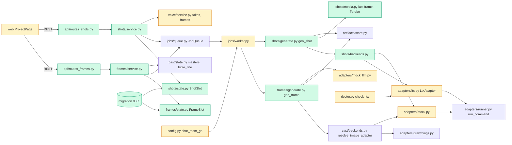

# Tech spec — Key frames and shots (M5): gen_frame, gen_shot and the ltx adapter

## Approach
Follow the Cast and Voice stage pattern exactly. Each new stage gets a package with a service module (builds the board body, enqueues jobs, owns actions), a state module (job-type constant, slot rows), a generate module (job handler), an uploads module, an API router and one migration.

- `src/reelforge/frames/` (new) is Stage 4. It mirrors `cast/` and `voice/`.
- `src/reelforge/shots/` (new) is Stage 5.
- Both register their handlers in `jobs/worker.py` `HANDLERS` and use the existing artifacts store (`ArtifactSpec`, `ArtifactInput`, take numbers, one active take).
- Both compute staleness on read, like `voice/service.py::build_lines`. That means `StoryChange` rows (`story/staleness.py::is_stale`) plus comparison of the inputs recorded in each take's `params` with the current inputs.
- One new job per frame and one per shot. Generate-all and Render-all are N jobs enqueued in story order. This reuses `JobQueue`, `GpuLease` and `preflight`, and gives per-item progress, cancel and retry for free.
- Reordering is rewriting `Job.priority` on queued shot jobs. Pause is a per-project in-memory set on `Worker` that `_dispatch` consults. No new queue table.

Frame jobs call `cast.backends.resolve_image_adapter` (mock: `ctx.adapter`) with `TaskSpec(kind="image", input_paths=[master, pack?])`. Shot jobs call a new `shots.backends.resolve_video_adapter`. On the mock backend this is `ctx.adapter` with `TaskSpec(kind="video")`. On the real backend it is `LtxAdapter` (`adapters/ltx.py`), which is extended from the check-only stub. `adapters/mock.py` gains a frames/size/audio-aware ffmpeg branch for `kind="video"`, so the mock goes through the same subprocess path (`run_command`) as the real adapter.

Prompts are assembled deterministically, with the LLM supplying only the scene sentence (frames) or the motion sentence (shots). The character look text (`CastSlot.bible_line`, falling back to the story `look`, the same value the Cast screen shows as `look_text`) is inserted verbatim by code. It is not left to the LLM.

Decisions that go beyond the product spec:
- Scene characters are detected by speaker first, then by name or key mentioned in `action`, `setting` or `line`. If none is found, the master is the first character of the story. "No character in this scene" is shown only when the story has no character.
- Continue shots use `generate --image <previous last frame>`. `extend` is only validated by doctor.
- A restart re-queues an interrupted shot (the existing `recover_orphans` behaviour) instead of failing it as "Interrupted".
- The uploaded clip size limit is the new setting `max_clip_mb` (default 100). The frame upload limit reuses `max_upload_mb`.

## Architecture



## Interface contract

### Settings and config (`reelforge.config`)
- `Settings.shot_mem_gb: float = 16.0`. It has the same validation as `image_mem_gb` (`gt=0`, `allow_inf_nan=False`) and the same precedence (CLI > `REELFORGE_SHOT_MEM_GB` > config.toml `[limits] shot_mem_gb` > default). A non-numeric or non-positive value raises `ConfigError` with `key == "shot_mem_gb"`.
- CLI: `reelforge doctor` and `reelforge serve` accept `--shot-mem-gb FLOAT`.
- `Settings.shot_quality: Literal["draft","final"] = "draft"`. Env `REELFORGE_SHOT_QUALITY`, toml `[runtime] shot_quality`.
- `Settings.shot_draft_size: str = "320x576"` and `Settings.shot_final_size: str = "448x768"`. Format `WxH` with both sides a multiple of 32, otherwise `ConfigError` with `key` equal to the field name. Env `REELFORGE_SHOT_DRAFT_SIZE` and `REELFORGE_SHOT_FINAL_SIZE`, toml `[runtime]`.
- `Settings.shot_timeout_s: float = 1800.0` (toml `[runtime]`) and `Settings.max_clip_mb: int = 100` (toml `[runtime]`, `ge=1`).
- `models.toml` `[models.video]` gains `steps = 8`. Model id, steps and size are never hard-coded elsewhere.

### LTX adapter (`reelforge.adapters.ltx`)
- `REQUIRED_FLAGS: dict[str, tuple[str, ...]]` with exactly:
  - `a2v`: `--prompt --output --audio --image --frame-rate --frames --width --height --model --seed --distilled --low-ram`
  - `generate`: `--prompt --output --image --frame-rate --frames --width --height --model --seed --distilled --low-ram --no-audio`
  - `extend`: `--prompt --output --video --extend-frames --distilled --low-ram --image`
- `parse_flags(help_text: str) -> set[str]` returns every `--long-option` token found in the text (regex `--[a-z0-9][a-z0-9-]*`).
- `LtxAdapter(project_path: Path | None, *, timeout_s: float = 1800.0, sample_interval_s: float = 2.0)`.
  - The executable is `<project_path>/.venv/bin/ltx-2-mlx`, run directly and never via `uv run`.
  - `check() -> HealthReport` (sync, name `"ltx"`). The existing failures stay (path not configured, project not found, no `.venv`). New ones:
    - Executable missing gives `ok=False`, `detail="ltx-2-mlx executable not found in <path>/.venv/bin"`.
    - Runs `[exe, "a2v", "--help"]`, `[exe, "generate", "--help"]` and `[exe, "extend", "--help"]` as argument lists and parses stdout+stderr.
    - Any required flag missing gives `ok=False`, `detail="ltx-2-mlx is missing required options: a2v: --frame-rate; extend: --image"`. The format is subcommand, colon, its missing flags in `REQUIRED_FLAGS` order joined by `, `; subcommands that miss nothing are omitted, the rest are joined by `; ` in the order a2v, generate, extend.
    - A `--help` that cannot run or exits non-zero gives `ok=False`, `detail="ltx-2-mlx could not run '<sub> --help'"`.
    - All present gives `ok=True`.
    - Results are cached per `(exe path, mtime_ns, size)`.
  - `async health() -> HealthReport` (wraps `check` in a thread). `async capabilities() -> {"video"}`.
  - `async run(task, out_dir, progress, cancel, *, ctx_job_id=None) -> list[ProducedFile]` runs one subprocess through `run_command` (timeout `timeout_s`, cancel kills the process tree, RSS sampled).
    - `task.params["mode"]` is `"a2v"` or `"generate"`.
    - `task.input_paths[0]` is the image (`--image`). For `a2v`, `input_paths[1]` is the audio (`--audio`).
    - `generate` always adds `--no-audio`.
    - Always passed: `--prompt`, `--output <out_dir>/out.mp4`, `--frame-rate <params.fps>`, `--frames <params.frames>`, `--width`, `--height`, `--model <task.model.id>`, `--seed`, `--distilled`, `--low-ram`.
    - `--steps N` is added only when `task.model.steps` is set and the subcommand's `--help` lists `--steps`.
    - Exit -9 or 137 raises `AdapterError("Killed, likely out of memory.")`. A timeout raises `AdapterError("Timed out")`. Cancel raises `AdapterError("cancelled")`. Any other non-zero exit raises `AdapterError("ltx-2-mlx failed: <last stderr line>")`.
- `reelforge.doctor.check_ltx(settings) -> CheckResult` keeps key `ltx`, its position in `CHECKS` and severity `blocking`. It returns `status="fail"` with `detail` set to the message above when `check()` fails.

### Job types and worker (`reelforge.frames.state`, `reelforge.shots.state`, `reelforge.jobs.worker`)
- `reelforge.frames.state.FRAME_JOB = "gen_frame"`. Payload: `{"stage": "frames", "scene_id": str, "batch_id": str, "index": int, "total": int}`. The job is heavy with `mem_need_gb = settings.image_mem_gb`. Insufficient memory fails with the existing image message ("... lower image_mem_gb in config.toml.").
- `reelforge.shots.state.SHOT_JOB = "gen_shot"`. Payload: `{"stage": "shots", "scene_id": str, "shot_type": "talking"|"action"|"continue", "quality": "draft"|"final", "batch_id": str, "index": int, "total": int}`. The job is heavy with `mem_need_gb = settings.shot_mem_gb`. Insufficient memory fails with `Not enough free memory for a shot: need {need:.1f} GB (shot_mem_gb), have {free:.1f} GB`.
- Every heavy job runs under the single GPU lease, with Ollama unloaded first (existing `_run_heavy`).
- `reelforge.shots.state.SHOT_OOM_MESSAGE = "Killed, likely out of memory."`. A shot job whose adapter raises an `AdapterError` or `TransientError` whose message contains "killed, likely out of memory" (case-insensitive) fails once, not retried, with `job.error == SHOT_OOM_MESSAGE`.
- Job `result` (a new key only when set):
  - Frame: `{"scene_id", "take_id", "inputs": [artifact ids, master first, then pack if any], "elapsed_s"}`.
  - Shot: `{"scene_id", "take_id", "shot_type", "quality", "width", "height", "frames", "render_s", "inputs": [...], "last_frame_id"}`.
- `Worker` gains `paused_projects: set[str]`. Queued `SHOT_JOB` rows of a paused project are not dispatched; running ones finish.

### Task specs seen by adapters (what `ctx.adapter` / RecAdapter records)
- Frame: `kind="image"`, `prompt`, `input_paths == [master_file] (+ [pack_file])`. The master is the approved cast master of the scene's character (speaker, else first character mentioned, else first story character). `params`: `{"strength": 0.6, "width": 576, "height": 1024}`.
- Talking shot: `kind="video"`, `input_paths == [key_frame_file, active_voice_take_file]`, `params["mode"] == "a2v"`.
- Action shot: `kind="video"`, `input_paths == [key_frame_file]` (no audio input, no audio argument), `params["mode"] == "generate"`.
- Continue shot: `kind="video"`, `input_paths == [previous_shot_last_frame_file]`, `params["mode"] == "generate"`.
- All shots: `params["frames"] ==` the scene's written-back `frames` (8k+1, from `scenes.frames`; if never written, `frames_for(scene.duration or 3.0)`), `params["fps"] == 24`, `params["width"]` and `params["height"]` from the quality size, `task.model == registry.get("video")`.

### Prompt helpers (`reelforge.frames.prompts`)
- `FRAMING_PHRASES: dict[str, str]` with keys `wide`, `medium`, `closeup`.
- `PRODUCT_PHRASE: str`, a request for the real pack in hand or on the table.
- `compose_frame_prompt(*, scene_sentence: str, look: str, framing: str, style: str, other_looks: list[tuple[str, str]], product: bool) -> str`. The result contains `look` verbatim, `FRAMING_PHRASES[framing]`, each other character's look verbatim, and `PRODUCT_PHRASE` only if `product`.

### Artifacts (read through `GET /media/{artifact_id}` and the `artifacts` table)
| kind | owner_type / owner_id | subdir | inputs (ArtifactInput) |
| --- | --- | --- | --- |
| `frame` | `scene` / scene id | `frames/<scene_id>` | master id, then pack id |
| `shot` | `scene` / scene id | `shots/<scene_id>` | frame id and voice take id (talking), frame id (action), previous last_frame id (continue) |
| `last_frame` (PNG) | `scene` / scene id | `shots/<scene_id>/last` | the shot take id it was cut from |
| `product_pack` | `project` / `product` | `product` | none, deduplicated by sha256 |

Uploads write the same kinds with `params.source == "upload"`. Files are stored as `take_NNN.<ext>`, never under the client's file name.

### HTTP (prefix `/api/v1/projects/{project_id}`)
Errors are `{"detail": str}`. Unknown project or scene gives 404. Frames endpoints return 409 "Approve the voices first." when the stage is below VOICES_APPROVED. Shots endpoints return 409 "Approve the key frames first." when it is below FRAMES_APPROVED.

**Frames**
- `GET /frames` returns `FramesOut`:
  ```
  {stage, approved_count, total, stale_count, jobs: [JobOut], frames: [Frame]}
  ```
  `jobs` holds the active (queued or running) frame jobs in story order, each with its payload `index` and `total`.
- Frame card (`Frame`):
  ```
  {scene_id, position, characters: [{key, name}],
   master: {key, name, artifact_id} | null,
   framing: "wide"|"medium"|"closeup",
   state: "no_frame"|"queued"|"rendering"|"ready"|"approved"|"stale"|"failed"|"continue_previous",
   message?: str, prompt: str, prompt_source: "llm"|"user"|"",
   look_removed: bool,
   takes: [{id, take_no, seed, active, approved, stale, source: "render"|"upload", image_url, inputs: [ids]}],
   notes: {second_character?: {master_name, other_name},
           product?: "included"|"missing",
           waiting_for_previous_shot?: true,
           needs_master?: str,
           no_character?: true},
   continue_previous: bool, job: JobOut | null}
  ```
  - `message` is the text of a failed job.
  - `look_removed` is true when the prompt no longer contains the master's look text.
  - `image_url` is `/media/<id>`.
  - `needs_master` carries the character name when no master is approved. Generate then returns 409 "Approve a master for <name> in Cast first".
- `POST /frames:generate` with `{"mode": "missing"|"stale"|"scenes", "scenes"?: [ids]}`:
  - Returns 202 `{"jobs": [JobOut], "skipped": [{"scene_id", "reason"}]}`, one job per scene in story order.
  - Scenes that already have a queued or running frame job are not duplicated.
  - Returns 409 "Nothing to generate." when no job is created.
  - A scene with `continue_previous` or no master is skipped with a reason.
- `POST /frames:cancel` cancels all active frame jobs and returns `{"cancelled": int}`.
- `POST /frames/{scene_id}:generate` returns 202 `JobOut`. It is the "Generate" and "Regenerate" button, and every call makes a new take with a new seed. If a job for the scene is queued or running, that job is returned (duplicate click ignored).
- Actions returning 200 `FrameActionOut = {project_stage, approved_count, total, frame: Frame, job?: JobOut}`:
  - `POST /frames/{scene_id}:approve` makes the active take approved. 409 "This scene has no frame yet." or 409 "This frame is out of date. Make a new frame first." if stale.
  - `POST /frames/{scene_id}:select-take` with `{"take_id"}`. 404 "take not found".
  - `POST /frames/{scene_id}:set-framing` with `{"framing"}`. The frame becomes stale, the LLM-written prompt is rewritten at the next generate, and a user-written prompt is kept.
  - `POST /frames/{scene_id}:save-prompt` with `{"prompt": str, "regenerate": bool = false}`. It stores `prompt_source="user"`. When `regenerate` is true it also enqueues a job and returns `job`.
  - `POST /frames/{scene_id}:continue-previous` with `{"enabled": bool}`.
- `POST /frames/{scene_id}:upload` is multipart field `file`. It returns 201 `FrameActionOut` and the upload becomes a new active take. Errors:
  - 415 "That file is not an image." (PNG/JPEG decided by content, extension ignored; empty files too).
  - 413 "That image is larger than {max_upload_mb} MB."
- Continue-previous and `FRAMES_APPROVED`:
  - A scene with `continue_previous` shows state `continue_previous`, and its key frame is the previous scene's active shot take's `last_frame`.
  - If that does not exist yet, `notes.waiting_for_previous_shot` is set.
  - Such a scene counts as approved for `FRAMES_APPROVED`.

**Shots**
- `GET /shots` returns `ShotsOut`:
  ```
  {stage, engine: {ok: bool, message: str},
   approved_count, total, stale_count, shots: [Shot], queue: Queue}
  ```
  On the mock backend `engine.ok` is true. On the real backend it is `LtxAdapter.check()`; when it fails, `message` is "Video engine check failed - see Settings & status".
- Shot card (`Shot`):
  ```
  {scene_id, position, shot_type: "talking"|"action"|"continue",
   shot_type_auto: str, quality: "draft"|"final", width, height,
   frames: int, shot_length_s: float, motion_prompt: str,
   state: "no_shot"|"queued"|"rendering"|"ready"|"approved"|"stale"|"failed",
   message?: str, oom?: true, can_retry_draft?: true,
   blockers: ["frame_not_approved"|"voice_not_approved"|"waiting_previous"],
   frame_url: str | null,
   takes: [{id, take_no, seed, active, approved, stale, source, quality, video_url, last_frame_id | null, inputs: [ids]}],
   job: JobOut | null}
  ```
  - Blocker texts for the UI are "Approve the key frame first", "Approve the voice take first" and "Waiting for the previous shot".
  - The auto type is talking when the scene has an approved voice take, else continue when `continue_from` is set, else action. A stored override wins.
  - `oom` is true when the newest job failed with `SHOT_OOM_MESSAGE`. `can_retry_draft` is set with `oom` when the shot is not already at Draft size.
- Queue:
  ```
  {paused: bool,
   rows: [{job_id, scene_id, position, shot_type, quality, width, height, status: "queued"|"running", estimate_s: int, estimate_text: "about N min", can_move: bool}],
   total_shots, total_s, total_text, running: {scene_id, index, total, elapsed_s} | null}
  ```
  - `total_text` is exactly `"{n} shots - about {m} min - keep the Mac plugged in"` ("1 shot" when n is 1). `m = max(1, ceil(sum(estimate_s)/60))`.
  - Each row's `estimate_text` is `about {max(1, ceil(estimate_s/60))} min`.
  - The estimate is the mean `render_s` of succeeded `gen_shot` jobs whose result has the same `shot_type`, `width` and `height`; otherwise the built-in `DEFAULT_ESTIMATE_S[(shot_type, quality)]` in `reelforge.shots.state`.
  - A running row has `can_move == false`.
- `POST /shots:render-all` with `{"mode": "missing"|"stale"}` returns 202 `{"jobs": [JobOut], "skipped": [...]}`. Jobs are enqueued in story order with a shared `batch_id`.
  - "missing" covers every shot without an active take.
  - Blocked shots are skipped with reason `frame_not_approved`, `voice_not_approved` or `waiting_previous`.
  - 409 "Nothing to generate." when nothing was enqueued.
  - 409 "Video engine check failed - see Settings & status" when the real engine check fails (no job is created).
- `POST /shots/{scene_id}:render` returns 202 `JobOut`. It makes a new take with a new seed, and an active job for the scene is returned instead (duplicate ignored). Same engine and blocker 409s: "Approve the key frame first.", "Approve the voice take first.", "Waiting for the previous shot."
- `POST /shots/{scene_id}:reroll` is the same, but 409 "This scene has no shot yet." when there is no take. It keeps the prompt and uses a new seed. Only that scene's takes change.
- `POST /shots/{scene_id}:retry-draft` sets the shot's quality to `draft`, enqueues a render and returns 202 `JobOut`.
- Actions returning 200 `ShotActionOut = {project_stage, approved_count, total, shot: Shot, job?: JobOut}`:
  - `POST /shots/{scene_id}:approve`. 409 "This scene has no shot yet." or 409 "This shot is out of date. Render it again first."
  - `POST /shots/{scene_id}:select-take` with `{"take_id"}`.
  - `POST /shots/{scene_id}:set-type` with `{"shot_type"}`.
  - `POST /shots/{scene_id}:set-quality` with `{"quality"}`. Changing type or quality on an existing take makes the shot stale.
  - `POST /shots/{scene_id}:save-prompt` with `{"prompt": str, "rerender": bool = false}`.
  - `POST /shots/{scene_id}:dequeue` removes the scene's queued job.
- `POST /shots/{scene_id}:upload-clip` is multipart field `file`. It returns 201 `ShotActionOut` with a new active take, and its last frame is extracted. Errors:
  - 415 "That file is not a video." (ffprobe must find a video stream).
  - 422 "The clip must be vertical 9:16." (width/height within 1% of 9/16).
  - 422 "The clip must be 20 seconds or shorter."
  - 413 "That clip is larger than {max_clip_mb} MB."
- Queue control, each returning 200 `Queue`:
  - `POST /shots/queue:move` with `{"job_id", "direction": "up"|"down"}`. 409 "That shot has already started." for a running job.
  - `POST /shots/queue:pause`, `POST /shots/queue:resume`.
  - `POST /shots/queue:cancel` cancels all queued rows and the running shot. The running subprocess is killed, the job ends `cancelled`, and no take is added.
- Existing `POST /api/v1/jobs/{id}/cancel` also works on any frame or shot job.

**Staleness and gates (observable through the boards)**
- Frame state `stale` when any of the following holds:
  - a `StoryChange` for the scene with kind `*` or `frame` is newer than the take;
  - the take's recorded `framing`, `look` or `master_id` differs from the current ones;
  - the take is an upload (only the first rule applies to uploads).
- Shot state `stale` when any of the following holds:
  - a `StoryChange` for the scene with kind `*` or `shot` is newer than the take;
  - the recorded `frame_id` differs from the scene's current key frame;
  - for talking, the recorded `audio_id` differs from the scene's current active voice take;
  - the recorded `frames`, `shot_type` or `quality` differs from the current ones.
- Changing one scene's `action` therefore stales only that scene's frame and shot. A new active voice take stales only that scene's talking shot. Nothing enqueues a job on its own.
- `approve` is refused while stale.
- `projects.stage` moves to `FRAMES_APPROVED` iff the stage was at least `VOICES_APPROVED` and every scene's frame is approved or `continue_previous`.
- It moves to `SHOTS_APPROVED` iff the frames condition holds and every shot has an approved active take.
- It drops back one stage when that stops being true. `ASSEMBLED` and `EXPORTED` are never touched.

**Doctor / settings status**: `GET /api/v1/doctor` (existing) check `ltx` as above.

### MockLlm (`reelforge.adapters.mock_llm.MockLlm.chat`)
- A schema with property `scene_sentence` returns `{"scene_sentence": "<Action text from the user message>"}`.
- A schema with property `motion_prompt` returns `{"motion_prompt": "<canned text>"}`.
- No other behaviour changes.

### UI (web, vitest queries by role and text)
Both screens follow `VoiceBoard`. The cards are `role="group"` with `aria-label="Scene <id>"`. Only one board is shown at a time. `ProjectPage` reads `?screen=voices|frames|shots` (default `voices`). The Voices footer button "Continue to key frames" (enabled at `VOICES_APPROVED`) opens `?screen=frames`.

- `web/src/frames/FrameBoard.tsx`: `FrameBoard({projectId}: {projectId: string})`.
  - Section `aria-label="Key frames"`, `h2` "Key frames", list `aria-label="Frames"`.
  - Buttons: "Generate all frames", "Regenerate stale items" (only if `stale_count > 0`), "Cancel" (while jobs are active), "Back to voices", and footer "Continue to shots" (disabled unless stage is `FRAMES_APPROVED` or later).
  - Texts: count `"{approved} of {total} frames approved"`, progress `"Generating frame {index} of {total} - {n} s elapsed"`.
  - Card, per scene:
    - Badge labels: "No frame yet", "Queued", "Rendering", "Ready", "Approved", "Needs update", "Continue from previous".
    - Controls: a framing `<select aria-label="Framing">` with options Wide, Medium, Closeup; `<textarea aria-label="Frame prompt">`; buttons "Save prompt", "Save and regenerate", "Generate" (no take), "Regenerate" (has take), "Approve" (disabled while stale), "Continue from previous" (toggle); file input labelled "Upload replacement"; a takes `<select aria-label="Takes">` ("Take 2 - Active"); an `` of the active take.
    - Notes:
      - "Built from <master>'s master. <Other> is described in the prompt, not copied. Use Upload replacement if the second character looks wrong."
      - "Product pack included"
      - "Product image missing" (amber)
      - "Waiting for the previous shot to be rendered"
      - "Approve a master for <name> in Cast first" (Generate disabled)
      - "No character in this scene"
      - "The character description was removed from the prompt."
      - Failure: "Couldn't generate this frame." plus the reason and a "Retry" button.
- `web/src/shots/ShotBoard.tsx`: `ShotBoard({projectId})`.
  - Section `aria-label="Shots"`, `h2` "Shots", list `aria-label="Shot cards"`.
  - Buttons: "Render all", "Regenerate stale items", "Back to key frames", and footer "Continue to assembly" (disabled unless stage is `SHOTS_APPROVED` or later).
  - Texts: count `"{approved} of {total} shots approved"`. When `engine.ok` is false, Render and Render all are disabled and "Video engine check failed - see Settings & status" is shown.
  - Queue panel (`aria-label="Render queue"`, shown when `queue.rows` is non-empty):
    - It shows the `total_text`, rows `"{position}. {scene_id} - {Type} - {Quality} - {estimate_text}"`, and a status line "Rendering shot {index} of {total} - {n} s elapsed".
    - Buttons per row: "Move up", "Move down", "Remove". Panel buttons: "Pause" (becomes "Resume") and "Cancel".
  - Card, per scene:
    - Header texts: "Talking"/"Action"/"Continue", "Draft"/"Final", "{frames} frames ({shot_length_s} s)" with two decimals (for example "81 frames (3.38 s)").
    - Badge labels: "No shot yet", "Queued", "Rendering", "Ready", "Approved", "Needs update".
    - Controls: `<select aria-label="Shot type">`, `<select aria-label="Quality">`, `<textarea aria-label="Motion prompt">`; buttons "Save prompt", "Save and re-render", "Render", "Play", "Approve", "Re-roll", "Compare takes"; file input labelled "Upload own clip"; takes select.
    - A looping inline `<video aria-label="Shot video">` appears once a take exists. Before that the key frame `` is shown.
    - Compare takes opens a dialog with two takes side by side, each with a looping video and a "Make active" button.
    - Notices:
      - "Approve the key frame first", "Approve the voice take first" (with a "Switch to Action" button), "Waiting for the previous shot".
      - OOM: "Killed, likely out of memory." plus the button "Retry at Draft size" (only if `can_retry_draft`). At Draft size it shows the hint "Close other apps and try again." without the button.
      - Other failure: "Couldn't render this shot." plus the reason and a "Retry" button.

## Data and state changes
- Migration `0005_frames_shots.py` (`down_revision = "0004"`).
  - New table `frame_slots`. Primary key `(project_id, story_key)` with FK to `projects` (ondelete CASCADE).
    - Columns: `framing` String(16) nullable, `prompt` Text default "", `prompt_source` String(8) default "", `prompt_basis` String(64) default "", `continue_previous` Boolean default false, `approved_artifact_id` String(26) nullable, `updated_at` nullable.
  - New table `shot_slots`. Same key.
    - Columns: `shot_type` String(16) nullable (override), `quality` String(8) nullable, `motion_prompt` Text default "", `prompt_source` String(8) default "", `prompt_basis` String(64) default "", `approved_artifact_id` String(26) nullable, `updated_at` nullable.
  - No changes to existing tables. The existing `scenes.frames`, `scenes.shot_type` and `scenes.continue_from` are read, not written, by M5.
  - ORM models `FrameSlot` and `ShotSlot` in `db/models.py`.
- Settings fields: `shot_mem_gb`, `shot_quality`, `shot_draft_size`, `shot_final_size`, `shot_timeout_s`, `max_clip_mb`.
- `models.toml`: `[models.video] steps = 8`.
- Job results are added only for the new job types, so `GET /jobs` keeps its M1 keys for every existing job.
- `web/openapi.json` and `web/src/api/schema.d.ts` are regenerated (`uv run python -m reelforge.api.openapi_export web/openapi.json`, then `pnpm --dir web gen:api`) in the same commit as the routes, because `tests/unit/test_openapi_drift.py` compares them.

## Tasks
1. **Settings for shots** — `src/reelforge/config.py`, `src/reelforge/cli.py`, `src/reelforge/models.toml` (modified).
   - Add the six settings with validators (`WxH` multiple of 32 for sizes) and the toml/env mapping.
   - Add `--shot-mem-gb` to `doctor` and `serve` and pass it to `_settings`.
   - Add `steps = 8` to `[models.video]`.
   - Document the new settings in `docs/manual-checks.md` (settings paragraph only).
2. **LtxAdapter with flag parsing** — `src/reelforge/adapters/ltx.py` (modified), `src/reelforge/doctor.py` (modified).
   - Add `REQUIRED_FLAGS`, `parse_flags`, executable lookup, cached `--help` checks, the message format, `run()` building the argument list and OOM/timeout/cancel mapping, and `capabilities()`.
   - `check_ltx` passes the adapter's `detail`.
3. **Mock video with frames, size and audio** — `src/reelforge/adapters/mock.py`, `src/reelforge/adapters/mock_llm.py` (modified).
   - In the `kind="video"` branch, when `params` has `frames`, ffmpeg writes exactly that many frames at `fps`, at `width`x`height`.
   - It muxes `input_paths[1]` as AAC when `params["mode"] == "a2v"`, and `-an` otherwise.
   - Produced `duration_s = frames/fps`. The old hook-driven branch stays for `params` without `frames`.
   - Add the `scene_sentence` and `motion_prompt` responses to `MockLlm`.
4. **Migration 0005 and slot models** — `src/reelforge/db/migrations/versions/0005_frames_shots.py` (new), `src/reelforge/db/models.py` (modified).
   - Add `frame_slots` and `shot_slots`, `FrameSlot` and `ShotSlot`.
5. **Frames core** — `src/reelforge/frames/__init__.py`, `state.py`, `prompts.py`, `product.py`, `generate.py`, `service.py`, `src/reelforge/shots/__init__.py`, `src/reelforge/shots/kinds.py` (new), `src/reelforge/jobs/worker.py` (modified).
   - `frames/state.py`: `FRAME_JOB`, slot get/update helpers (like `voice/slots.py`), framing resolution (slot, then `Scene.framing`, then closeup if the scene has a `line`, else medium).
   - `frames/prompts.py`: constants and `compose_frame_prompt`, plus the LLM message builder with a new prompt file `frames/prompts/scene.v1.md`.
   - `frames/product.py`: `resolve_product(ctx, project_id, story)` resolves `product.asset` against `data_root`, requires an image file under `data_root`, registers or finds the `product_pack` artifact by sha256, and returns it or None. It reuses `cast.uploads.sniff_image`.
   - `frames/service.py`: `characters_in_scene`, `master_for_scene` (reads `cast_state.get_slot(...).approved_artifact_id`), `build_frames`, frame staleness, `plan_generation`, `enqueue_frame(s)`, `recompute_stage`, and `last_frame_of` via `shots/kinds.py`.
   - `frames/generate.py`: `frame_generate`. It writes or reuses the prompt, builds the `TaskSpec`, writes the `frame` artifact with inputs, clears the approval, updates the result, recomputes the stage.
   - `worker.py`: register `FRAME_JOB`, and use the image_mem_gb message for it.
   - `shots/kinds.py`: the kind constants and `last_frame_for_take(ctx, shot_take_id)`, a query over `ArtifactInput`.
6. **Frames API and uploads** — `src/reelforge/api/routes_frames.py`, `src/reelforge/frames/uploads.py` (new), `src/reelforge/api/schemas.py`, `src/reelforge/api/app.py` (modified), `web/openapi.json`, `web/src/api/schema.d.ts` (regenerated).
   - All `/frames` routes: board, generate (bulk and single), cancel, approve, select-take, set-framing, save-prompt, continue-previous and upload.
   - Add the pydantic response models and register the router.
7. **Shot engine core** — `src/reelforge/shots/state.py`, `shots/backends.py`, `shots/media.py`, `shots/generate.py` (new), `src/reelforge/jobs/worker.py` (modified).
   - `shots/state.py`: `SHOT_JOB`, `SHOT_OOM_MESSAGE`, `DEFAULT_ESTIMATE_S`, slot helpers, effective type and quality, size resolution.
   - `shots/backends.py`: `resolve_video_adapter(ctx)` (mock gives `ctx.adapter`, real gives `LtxAdapter(settings.ltx_path, timeout_s=settings.shot_timeout_s, sample_interval_s=settings.sample_interval_s)`) and `engine_status(ctx)`.
   - `shots/media.py`: `probe_video(path)` (ffprobe via `run_command`) and `extract_last_frame(video, out_png)` (ffmpeg `-sseof -0.5 -update 1`, argument list).
   - `shots/generate.py`: `shot_generate`.
     - Re-validates blockers, builds the `TaskSpec` and runs the adapter.
     - Maps OOM to `SHOT_OOM_MESSAGE` without retry.
     - Writes the `shot` artifact with inputs and params `{frame_id, audio_id, frames, shot_type, quality, width, height, motion_prompt, source: "render"}`.
     - Extracts and stores `last_frame`, and writes the result including `render_s`.
   - Writes or reuses the motion prompt (LLM sentence plus the bible line inserted by code; appearance-only wording for talking).
   - `worker.py`: register `SHOT_JOB`, add the shot_mem_gb pre-flight message, and skip queued shot jobs of `paused_projects` in `_dispatch`.
8. **Shots service, API and gates** — `src/reelforge/shots/service.py`, `shots/uploads.py`, `src/reelforge/api/routes_shots.py` (new), `src/reelforge/api/schemas.py`, `src/reelforge/api/app.py`, `src/reelforge/voice/service.py` (modified), `web/openapi.json`, `web/src/api/schema.d.ts` (regenerated).
   - `shots/service.py`: `build_shots`, shot staleness, blockers, queue body and estimates, render and render-all, re-roll, retry-draft, approve, select-take, set-type, set-quality, save-prompt, dequeue, queue move/pause/resume/cancel (priority rewrite, `worker.paused_projects`), and `recompute_stage` covering both gates.
   - `shots/uploads.py` does the ffprobe checks.
   - `voice/service.py::recompute_stage` calls the shots stage recompute at its end (lazy import) so a new or re-approved voice take can drop `SHOTS_APPROVED`.
   - The frames and shots `GET` handlers run the recompute before building the body.
9. **Web: API client and Key frames screen** — `web/src/api/frames.ts`, `web/src/frames/FrameBoard.tsx`, `web/src/frames/FrameCard.tsx` (new), `web/src/api/client.ts`, `web/src/routes/ProjectPage.tsx`, `web/src/voice/VoiceBoard.tsx` (modified).
   - React Query hooks mirroring `api/voice.ts`: query key, refetch while jobs are active, mutations that invalidate the board, project and stages.
   - The `?screen=` switch; the Voices footer button navigates to frames.
10. **Web: Shots screen** — `web/src/api/shots.ts`, `web/src/shots/ShotBoard.tsx`, `ShotCard.tsx`, `QueuePanel.tsx`, `CompareTakes.tsx` (new), `web/src/routes/ProjectPage.tsx`, `web/src/frames/FrameBoard.tsx` (modified).
    - Queue panel, estimates, compare dialog, OOM retry, uploads, and the frames footer button opening `?screen=shots`.
11. **Manual checks entry** — `docs/manual-checks.md` (modified).
    - AC-15 checklist: one real key frame from a real master; one real talking and one real action shot at Draft; characters read as the same; the real `LtxAdapter` run once; memory table row for `shot_mem_gb`; second-input behaviour of Draw Things for the product pack.

## Implementation tests
- `tests/unit/test_config_shot.py`: defaults, the three precedence levels, invalid values and sizes, same rules as `image_mem_gb`.
- `tests/unit/test_ltx_adapter.py`:
  - `parse_flags`; fake `ltx-2-mlx` scripts (shell scripts printing a configurable `--help` per subcommand) for pass, missing flag, and missing executable; message format.
  - `run()` argv for a2v, generate and `--no-audio`; exit 137 mapping; timeout; cancel kills the child; cache invalidation on file change.
- `tests/unit/test_mock_video.py`: frame count, size, audio muxed or silent, checked with ffprobe.
- `tests/unit/test_migration_0005.py`: upgrade and downgrade, mirroring `test_migration_0004.py`.
- `tests/unit/test_frames_prompts.py`: look verbatim, framing phrase, second character, product phrase only when requested, `characters_in_scene` and master fallback.
- `tests/unit/test_frames_product.py`: asset under the data root, missing, outside the root, non-image, sha256 deduplication.
- `tests/unit/test_frames_api.py`: generate, regenerate, approve, stale rules, upload rejection and acceptance, continue-previous, stage gates, `FRAMES_APPROVED` reopen.
- `tests/unit/test_shots_generate.py`: task spec per type, 8k+1 frames, last frame stored with an `ArtifactInput` link, OOM mapping and no retry, quality size, memory message naming `shot_mem_gb`.
- `tests/unit/test_shots_queue.py`: estimates with and without history, total text rounding and singular, move, pause and resume, cancel kills the subprocess, duplicate ignored.
- `tests/unit/test_shots_api.py`: re-roll leaves other takes untouched, staleness cases, `SHOTS_APPROVED` gate, clip upload checks, engine-check 409 on the real backend with a fake script.
- `web/tests/unit/frameBoard.test.tsx`, `web/tests/unit/shotBoard.test.tsx`, `web/tests/unit/queuePanel.test.tsx`: text, disabled states, notes, retry buttons, queue controls.

## Risks and rollout
- Migration 0005 only adds tables. Roll forward is safe for projects at any stage. Existing M1 to M4 tests stay unchanged: no existing route or response shape is edited, and `doctor.CHECKS` order and key `ltx` are kept.
- `check_ltx` now fails when the directory and `.venv` exist but `.venv/bin/ltx-2-mlx` is missing or lacks flags. This is intended (AC-5). `HealthMonitor` polls doctor every 15 s, so `--help` results are cached by executable mtime and size.
- `DrawThingsAdapter.run` uses only `input_paths[0]` as `init_images`. The product pack is a second input recorded on the job and artifact, and it drives the prompt, but Draw Things does not receive its pixels. R3 forbids a second `init_images` entry. Whether the real pack renders correctly is covered by the manual check (task 11).
- `recompute_stage` on board reads (a GET with a stage side effect) mirrors the Voice stage's behaviour after actions. It is done on read so story edits that stale a scene drop the stage without an extra hook.
- A voice that becomes un-approved while the stage is `FRAMES_APPROVED` is not dropped to `CAST_APPROVED` by the voice stage. Only the talking shot goes stale, and the shots gate drops with it.
- Pause is in-memory (lost on restart, queued rows simply run). Reorder uses `Job.priority`, so queued shot jobs outrank default-priority frame jobs once reordered.
- Real `ltx-2-mlx` memory at Final size is unverified. The Draft retry path and `shot_mem_gb` cover it, and AC-15 records it.

## Open questions
- Scenes that name no character use the first story character as master (R1 says "first named character"). Confirm, or require blocking such scenes as the product spec's edge case suggested.
- Uploaded clips are capped at 100 MB (`max_clip_mb`) and replacement frames at the existing `max_upload_mb` (10 MB). Confirm both limits.
