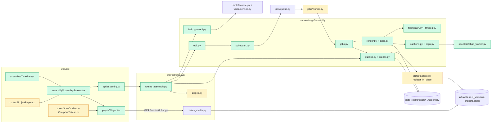

# Tech spec — Assembly stage - EDL, captions, export and player

## Approach

A new package `src/reelforge/assembly/` turns the approved shots, approved voice takes and story lines into an EDL (`edl.json`, shape from the Technical Spec "Assembly" section). The EDL is the only input to rendering. A resumable render engine (`assembly/render.py`) runs ten named steps; each step is one or more `ffmpeg` runs given as argument lists through the existing `adapters/runner.run_command`. Each ffmpeg run that uses filters reads a `-filter_complex_script` file written by a small typed builder (`assembly/filtergraph.py`). Step completion is persisted in `state.json` in the render folder, so the job requeued by `JobQueue.recover_orphans` after a kill resumes at the first incomplete step.

Two light jobs (`assemble_preview`, `assemble_final`) are registered in `jobs/worker.py` `HANDLERS` with `heavy=False`, so they take no GPU lease and load no model. They follow the pattern of `shots/generate.py` (`async def handler(ctx, job, progress, cancel)`; progress messages are step names). Routes follow `api/routes_shots.py` (`build_router(ctx)`, `JSONResponse`, small error class with `status`/`message`). The stage rename touches `api/stages.py`. The 1 s preview debounce is server side (`assembly/scheduler.py`) so any client gets the same behaviour. The existing range-capable `GET /media/{artifact_id}` (`api/routes_media.py`) already satisfies R13 (206, 416, 403 outside the data root); M6 reuses it by registering every output as an artifact, and adds tests, not code, for it.

Decisions that resolve the product-spec open questions:
- Stage value: `ASSEMBLED` is renamed `REEL_EXPORTED` at index 6 of `STAGE_ORDER`; `EXPORTED` stays at index 7 as an unused legacy value because the frozen unit test `tests/unit/test_api_projects.py` calls `stages_approved("EXPORTED")`. Nothing writes `EXPORTED`.
- Safe zone on a 1080x1920 frame: no caption pixel above y=250, below y=1670, or within 64 px of left/right. These are the product-spec proposals; they are constants in `assembly/captions.py`.
- Alignment: Whisper through mlx-audio (word timestamps), behind an `Aligner` protocol, because forced alignment in mlx-audio is not confirmed. The spike result is not available in the worktree; the real aligner is a manual check (docs entry). Mock backend uses a deterministic proportional aligner. A failed alignment falls back to line-level timing.
- Devanagari font: new settings `devanagari_font` (default `/System/Library/Fonts/Kohinoor.ttc`) and `devanagari_font_family` (default `Kohinoor Devanagari`).
- Shot audio is stripped (Technical Spec step 1). The audio bed is generated silence of the total length; dialogue clips come from voice takes only. A shot without an audio stream therefore cannot raise an error (R4).
- Reopening a version copies its EDL to the working copy; the next export is always the next version.
- Frame math is fixed so durations are exact: all EDL times are seconds rounded to 0.01 s, and rendering uses frames: `in_frame = round(in_s*24)`, `frames = round((out_s-in_s)*24)`, crossfade frames `round(t*24)`. `total_frames = sum(frames) - sum(crossfade frames)`; `total_duration_s = total_frames/24`.

## Architecture



## Interface contract

### Python modules (import paths and signatures)

`reelforge.assembly.edl`
- `FPS = 24`, `WIDTH = 1080`, `HEIGHT = 1920`.
- Pydantic v2 models (`extra="forbid"`):
  - `EdlShot(scene_id: str, artifact: str, source_duration_s: float, in_s: float, out_s: float, transition_in_s: float = 0.0)` — `artifact` is the shot take's artifact id. `transition_in_s` is the crossfade with the previous shot (0 = cut; ignored on the first shot; 0 to 0.5).
  - `EdlDialogue(scene_id: str, artifact: str, offset_s: float, duration_s: float, gain_db: float = 0.0)` — `artifact` is the voice take's artifact id; `offset_s` is the start on the reel timeline.
  - `EdlCaption(scene_id: str, speaker: str | None, line_no: int, text: str, start_s: float, end_s: float, style: str | None = None)` — `style` of None means "auto".
  - `EdlMusic(tracks: list[dict[str, Any]] = [], duck: bool = False)` — music slots; always empty in M6.
  - `EdlEndCard(enabled: bool = False, duration_s: float = 1.5, template: str = "default")`.
  - `Edl(version: int = 1, fps: int = 24, width: int = 1080, height: int = 1920, project_id: str, video: list[EdlShot], dialogue: list[EdlDialogue], captions: list[EdlCaption], caption_style: str = "auto", music: EdlMusic, end_card: EdlEndCard)`.
    - JSON field names are exactly these (so `edl.json` has keys `video`, `dialogue`, `captions`, `caption_style`, `music.tracks`, `end_card.enabled`).
    - Properties: `total_frames: int`, `total_duration_s: float`, `shot_start_s(index: int) -> float`.
- `edl_hash(edl: Edl) -> str` — sha256 hex of canonical JSON (sorted keys).
- `load_edl(path: Path) -> Edl`, `save_edl(edl: Edl, path: Path) -> None` (atomic write).
- `CAPTION_PRESETS: dict[str, str]` = `{"bold_pop": "Bold pop", "clean_subtitle": "Clean subtitle", "hindi_devanagari": "Hindi Devanagari"}`; valid `caption_style` values are those keys plus `"auto"`.

`reelforge.assembly.build`
- `build_edl(ctx: AppContext, project_id: str) -> Edl` — one `EdlShot` per scene in story order using the shot slot's approved take (`in_s=0`, `out_s` = take duration, `transition_in_s=0`); one `EdlDialogue` per scene whose line has an approved voice take (`offset_s` = start of that scene's shot, `duration_s` = take duration, clipped so it ends within the reel); one `EdlCaption` per such line (`text` = story line text, `start_s`/`end_s` = dialogue start/end, `line_no` = 1-based order among captions, `speaker` = character display name); `music.tracks == []`; `end_card.enabled is False`; `caption_style == "auto"`. Raises `AssemblyError(409, "Approve all shots before exporting.")` when any scene has no approved shot take.
- `working_edl_path(ctx, project_id) -> Path` = `<data_root>/<project.data_dir>/assembly/edl.json`.

`reelforge.assembly.state` (shared small types)
- `class AssemblyError(Exception)` with `.status: int`, `.message: str`.
- `class StepError(AdapterError)` with `.step: str`, `.reason: str`; `str(exc) == reason`.

`reelforge.assembly.render`
- `PREVIEW_STEPS: list[str]` = `["Preparing shots", "Joining video", "Placing dialogue", "Mixing audio", "Measuring loudness", "Normalising loudness", "Burning captions", "Encoding"]`; `FINAL_STEPS` = `PREVIEW_STEPS + ["Verifying", "Writing cover and credits"]`.
- `@dataclass class RenderHooks: before_step: Callable[[str], None] | None = None; after_step: Callable[[str], None] | None = None` — called around each step (after_step is called after the step is persisted as done). Tests raise a `BaseException` subclass from them to simulate a kill.
- `@dataclass class RenderResult: output: Path; filtergraph: Path; captions_burned: bool; step_runs: dict[str, int]`.
- `async def render_edl(ctx: AppContext, edl: Edl, out_dir: Path, *, profile: Literal["preview", "final"], progress: ProgressCb, cancel: CancelToken, hooks: RenderHooks | None = None) -> RenderResult` — runs the first eight steps (the `PREVIEW_STEPS` names, for both profiles). Outputs `out_dir/preview.mp4` (540x960, libx264 veryfast crf 28, AAC) or `out_dir/final.mp4` (1080x1920, libx264 High crf 18 yuv420p faststart, AAC 192k 48 kHz stereo), and next to it `preview.filtergraph.txt` / `final.filtergraph.txt`. `progress(pct, "<Step name> (<i> of <n>)")` is called at each step start; pct = completed steps / n * 100.
- `out_dir/state.json` after every step: `{"edl_hash": str, "profile": str, "steps": {"<Step name>": {"done": bool, "runs": int}}}`. A step with `done: true` and its output file present is never run again; `runs` counts executions. Partial files are written as `*.part` and renamed only when the step succeeds. A `state.json` whose `edl_hash` differs from the EDL's is discarded and the folder is restarted.
- Errors raise `StepError` with these exact reasons: missing media file `"A shot file is missing: <scene_id>"` at "Preparing shots"; ffmpeg or the `subtitles` filter missing `"ffmpeg is not available or lacks the subtitles filter. Run Settings & status to check."`; font missing `"Devanagari font not found at <path>. Set it in Settings."` at "Burning captions".
- Mock-backend rule: when `ctx.settings.backend == "mock"` and the ffmpeg build lacks the `subtitles` filter, "Burning captions" skips the burn, `captions_burned` is False, and no error is raised. On the real backend it fails as above.

`reelforge.assembly.ffmpeg`
- `def has_filter(name: str) -> bool` — True when `ffmpeg -filters` lists the filter (cached). Tests use it to skip burn-in checks on builds without libass.

`reelforge.assembly.filtergraph`
- `class Filter(name: str, args: list[str] | dict[str, str | int | float] | None = None)`, `class Chain(inputs: list[str], filters: list[Filter], outputs: list[str])`, `class FilterGraph(chains: list[Chain])` with `to_script() -> str` (chains joined by `;\n`, labels as `[label]`, option values escaped for ffmpeg).
- `build_encode_graph(...)`, `build_join_graph(...)`, `build_dialogue_graph(...)`, `build_mix_graph(...)`, `build_loudnorm_graph(...)`: internal helpers used by `render_edl`; their signatures are not part of the contract.

`reelforge.assembly.captions`
- `SAFE_ZONE = SafeZone(top=250, bottom=250, left=64, right=64)` (frozen dataclass; ints, pixels on 1080x1920).
- `resolve_style(caption_style: str, caption: EdlCaption) -> str` — caption's own style, else the EDL style, else when `"auto"`: `"hindi_devanagari"` if the text contains characters in U+0900-U+097F, otherwise `"bold_pop"`.
- `build_ass(edl: Edl, words: dict[str, list[WordTiming]], *, devanagari_font_family: str) -> str` — full `.ass` text. `PlayResX=1080`, `PlayResY=1920`; three styles named `Bold pop`, `Clean subtitle`, `Hindi Devanagari`; every style has `MarginL=64`, `MarginR=64`, `MarginV=250`, Alignment 2 (bottom centre). One `Dialogue:` event per caption with non-empty text, using the resolved style, from `start_s` to `end_s`; the `Bold pop` style uses `\k` karaoke tags per word when `words[scene_id]` is non-empty, otherwise the plain line. Empty caption text produces no event.
- `@dataclass(frozen=True) class WordTiming: text: str; start_s: float; end_s: float` (seconds relative to the start of the audio clip).

`reelforge.assembly.align`
- `class Aligner(Protocol): async def align(self, audio: Path, text: str, language: str) -> list[WordTiming]` — raises `AlignmentError` on failure.
- `class ProportionalAligner` (mock backend): splits the clip duration across whitespace-separated words by character count; deterministic; never fails.
- `class MlxWhisperAligner(settings)`: runs `adapters/align_worker.py` in the mlx-audio environment; model id from `models.toml` key `align`.
- `AppContext.aligner: Aligner` — `AppContext.create(..., aligner: Aligner | None = None)`; default is `ProportionalAligner` when `settings.backend == "mock"`, else `MlxWhisperAligner`. Tests inject a stub.
- A line whose alignment raises, or whose result is empty, gets line-level timing in the `.ass` (no `\k` tags).

`reelforge.assembly.edit`
- `apply_edit(ctx, project_id, op: dict[str, Any]) -> tuple[Edl, list[str]]` — applies one edit to the working EDL, saves it, returns the new EDL and notes (may be empty). Raises `AssemblyError`. Operations (`op["op"]`):
  - `reorder` `{scene_ids: [..]}` — must be a permutation of the current scenes; each dialogue clip keeps its offset relative to its shot start and moves with it.
  - `trim` `{scene_id, in_s, out_s}` — `0 <= in_s < out_s <= source_duration_s`; `out_s - in_s < 0.5` raises 422 `"A shot must be at least 0.5 s long."`. Values are rounded to 0.01 s. Dialogue beyond the new total is trimmed (note `"Dialogue was trimmed to fit."`).
  - `swap_take` `{scene_id, take_id}` — `take_id` must be a shot take of that scene (404 `"take not found"`); `in_s`=0, `out_s`=new take duration, `source_duration_s` updated; dialogue absolute offsets are kept; overflow trimmed with the note above.
  - `set_transition` `{scene_id, seconds}` — 0 to 0.5; capped to half of the shorter adjacent trimmed length with note `"Crossfade shortened to fit"`.
  - `nudge_dialogue` `{scene_id, offset_s}` — absolute offset; 422 `"Dialogue cannot start before 0 or after the end of the reel."` if outside `[0, total_duration_s]`.
  - `set_caption_text` `{scene_id, text}` — changes only `captions[].text` in the EDL; creates no voice take and no job except the debounced preview.
  - `set_caption_style` `{style}` — one of `auto`, `bold_pop`, `clean_subtitle`, `hindi_devanagari` (422 otherwise).

`reelforge.assembly.scheduler`
- `class PreviewScheduler(ctx)`; `ctx.previews: PreviewScheduler`. `touch(project_id)` (called after every edit) restarts a timer of `settings.preview_debounce_s` seconds; when it fires it snapshots the working EDL to `assembly/edls/<hash>.json`, cancels any still-queued `assemble_preview` job of the project, and enqueues one new `assemble_preview` job with payload `{"stage": "assembly", "kind": "preview", "edl_hash": <hash>}` (a running job is left running). `enqueue_now(project_id) -> Job` skips the timer.

`reelforge.assembly.publish`
- `collect_credits(ctx, project_id, edl) -> list[dict]` — one `{"model": <models.toml id>, "version": <revision>, "licence": <licence text>}` per distinct model among the artifacts used (shot takes, their input chains, voice takes), plus the `align` model when the real aligner timed a caption.
- `licence_warnings(credits) -> list[dict]` — the entries whose licence is empty or contains a non-commercial marker (reuse the markers in `cast/licence.py`).
- `publish_version(ctx, project_id, ...) -> ReelVersion` — see Data section; internal.

`reelforge.config.Settings` new fields: `preview_debounce_s: float = 1.0` (ge 0), `devanagari_font: Path = Path("/System/Library/Fonts/Kohinoor.ttc")`, `devanagari_font_family: str = "Kohinoor Devanagari"`. Env: `REELFORGE_PREVIEW_DEBOUNCE_S`, `REELFORGE_DEVANAGARI_FONT`, `REELFORGE_DEVANAGARI_FONT_FAMILY`. config.toml keys under `[runtime]`: `preview_debounce_s`, `devanagari_font`, `devanagari_font_family`.

`reelforge.api.stages`: `STAGE_ORDER` = `[DRAFT, STORY_APPROVED, CAST_APPROVED, VOICES_APPROVED, FRAMES_APPROVED, SHOTS_APPROVED, REEL_EXPORTED, EXPORTED]`; `stages_approved("REEL_EXPORTED") == 6`; `derive_stages` marks "Assembly" `approved` at `REEL_EXPORTED`, and shows `rendering` with `progress` while an `assemble_*` job (payload `stage == "assembly"`) is running, `queued`/`failed` likewise.

Job types (registered in `jobs.worker.HANDLERS`): `"assemble_preview"` and `"assemble_final"` (constants `PREVIEW_JOB`, `FINAL_JOB` in `reelforge.assembly.jobs`). Both enqueued with `heavy=False`, `mem_need_gb=0`, so no GPU lease is taken. Progress message is `"<Step name> (<i> of <n>)"`, n = 8 (preview) or 10 (final). Result (stored in `job.result` when finished): preview `{"edl_hash", "artifact_id", "filtergraph_artifact_id", "captions_burned", "step_runs"}`; final `{"edl_hash", "version", "reel_artifact_id", "step_runs"}`. On failure the handler first sets `result = {"failed_step": "<Step name>"}`, then raises, and `job.error` is the reason text.

### HTTP

Prefix `/api/v1/projects/{project_id}`. Error bodies are `{"detail": "<message>"}`. All 404 `"project not found"` for an unknown project; all 409 `"Approve the shots first."` when the project stage is below `SHOTS_APPROVED`.

- `GET /assembly` → 200 `AssemblyOut`:
  ```
  {
   "stage": str,                       // project stage
   "blocked_reason": str | null,       // "Approve all shots before exporting." when any scene lacks an approved shot take
   "edl": Edl | null,                  // working copy; null until built
   "edl_hash": str | null,
   "shots": [{"scene_id": str, "takes": [{"id": str, "take_no": int, "active": bool, "video_url": str}]}],
   "caption_status": {"<scene_id>": "words" | "line" | "pending"},
   "preview": {"state": "none"|"up_to_date"|"out_of_date"|"pending"|"rebuilding"|"failed",
               "step": str|null, "progress": int|null, "url": str|null, "job_id": str|null,
               "error": str|null, "rebuild_in_s": float|null},
   "export":  {"state": "idle"|"running"|"failed", "step": str|null, "step_index": int|null,
               "step_total": int|null, "progress": int|null, "job_id": str|null,
               "failed_step": str|null, "error": str|null},
   "versions": [{"version": int, "label": "Reel v1", "reel_url": str, "cover_url": str,
                 "created_at": str, "missing": bool}],
   "licence_warnings": [{"model": str, "version": str, "licence": str}],
   "caption_presets": [{"id": str, "label": str}]
  }
  ```
  `preview.state`: `out_of_date` = the latest finished preview is for a different EDL hash and no rebuild is scheduled; `pending` = a debounce timer is running (`rebuild_in_s` set) or a preview job is queued; `rebuilding` = running; `failed` = the last preview job failed and no newer one exists; `up_to_date` = a preview exists for the current hash; `url` is the last good preview (`/media/<artifact_id>`) even when out of date.
- `POST /assembly:build` body `{"force": bool = false}` → 200 `AssemblyOut`. Creates the working EDL (`assembly/edl.json`) when absent, or rebuilds it from the approved takes when `force` is true. Schedules a preview via `ctx.previews.touch`.
- `GET /assembly/edl` → 200 the working `Edl` JSON; 404 `"edl not built"`.
- `POST /assembly:edit` body = one operation object as in `apply_edit` (field `op`) → 200 `{"assembly": AssemblyOut, "notes": [str]}`; 404 `"edl not built"`; 409/422/404 per operation. Calls `ctx.previews.touch`. Never enqueues `assemble_final`.
- `POST /assembly:preview` → 202 `JobOut` (the new or the already queued `assemble_preview` job). No debounce.
- `POST /assembly:export` body `{"accept_licence_warning": bool = false}` → 202 `JobOut` of type `assemble_final`. 409 `{"detail": "Approve all shots before exporting."}` when blocked. 409 `{"detail": "Licence check before export", "licence_warnings": [...]}` when warnings exist and `accept_licence_warning` is false (nothing enqueued). If an `assemble_final` job is queued or running for the project, returns 202 with that job and creates no second one. The export renders the EDL snapshot (`assembly/edls/<hash>.json`) taken at request time.
- `POST /assembly:open-version` body `{"version": int}` → 200 `AssemblyOut`; copies that version's `edl.json` over the working copy; 404 `"This version's files are missing."` if the folder or file is gone; 404 `"version not found"` if no such row.
- Media: unchanged `GET /media/{artifact_id}`: `Accept-Ranges: bytes`; ranged request → 206 with `Content-Range`; unsatisfiable → 416; malformed range → 200 whole file; path resolving outside the data root (also via `..` or symlink) → 403 with no file content. Every preview, final, cover, credits, edl and filtergraph file is an artifact (kinds `preview`, `final`, `cover`, `credits`, `edl`, `filtergraph`).

### Files written (paths relative to `<data_root>/<project.data_dir>/assembly/`)
- `edl.json` working EDL; `edls/<hash>.json` snapshots.
- `work/preview-<job_id>/` and `work/final-<job_id>/`: `state.json`, intermediates, `captions.ass`, `<out>.mp4`, `<out>.filtergraph.txt`.
- `v001/`, `v002/`, ... per exported version: `final.mp4`, `final.filtergraph.txt`, `cover.jpg`, `credits.json`, `edl.json`, `captions.ass`. `credits.json` is a JSON list of `{"model", "version", "licence"}`. The `reel_versions` row has `version` (1, 2, ...), `edl_artifact_id`, `final_artifact_id`, `credits` (same list).
- On success of `assemble_final`: `projects.stage` becomes `REEL_EXPORTED` (only from `SHOTS_APPROVED` or already `REEL_EXPORTED`) and a `stage.changed` event is published.

### UI (vitest, accessible names)
- `Player` (`web/src/player/Player.tsx`): `<Player src: string, label: string, loop?: boolean, muted?: boolean, autoPlay?: boolean, width?: number, fps?: number = 24, showSafeZone?: boolean, controls?: boolean = true />`. The `<video>` has `aria-label={label}`. Controls (buttons, accessible names exact): `Play` / `Pause`, `Previous frame`, `Next frame`, `Loop` (toggle, `aria-pressed`), `Speed` (select with options `0.5x`, `1x`, `1.5x`, `2x`), `Scrub` (range input), `Mute` / `Unmute`, `Safe-zone overlay` (toggle, `aria-pressed`, off by default; when on, an element with `data-testid="safe-zone-overlay"` is present). Frame step sets `currentTime` by exactly `1/24` and pauses; ArrowLeft/ArrowRight on the focused `role="group"` named `<label> player` do the same. While loading: text `Loading video...`; on error: text `Couldn't load this video.` and a `Retry` button that reloads the source.
- `ShotCard` and `CompareTakes` render `Player` with labels `Shot video`, `Active video`/`Compare video` (labels unchanged from today so frozen tests still find them).
- `AssemblyScreen` (`web/src/assembly/AssemblyScreen.tsx`): `<AssemblyScreen projectId: string, onBack: () => void />`, shown at `?screen=assembly`. Button `Back to Shots`. `ShotBoard` gets an optional `onContinue` prop and shows a button `Continue to Assembly` once every shot is approved.
  - Version selector: `<select aria-label="Version">` with options `Editing: working copy`, `Reel v1`, `Reel v2`, ...; selecting a version calls `:open-version`; a version with `missing` shows `This version's files are missing.`
  - Preview badge text: `Preview up to date`, `Out of date - rebuilding in 1 s`, `Rebuilding preview: <step name> (NN%)`, `Preview failed - Retry`; button `Rebuild preview`.
  - Timeline: per shot, buttons `Move <scene_id> earlier` / `Move <scene_id> later`, number inputs `Trim in for <scene_id>` and `Trim out for <scene_id>` (step 0.01), select `Take for <scene_id>`, number input `Crossfade into <scene_id>` (0 to 0.5); per dialogue clip, buttons `Nudge <scene_id> dialogue earlier` / `Nudge <scene_id> dialogue later` (step 1/24 s) and number input `Dialogue offset for <scene_id>`. Edit errors show in a `role="alert"`; notes (`Crossfade shortened to fit`, `Dialogue was trimmed to fit.`) show as plain text.
  - Captions: select `Caption style` (options `Bold pop`, `Clean subtitle`, `Hindi Devanagari`, and `Auto`); per line a text input `Caption for <speaker> line <n>` with placeholder `No caption for this line`, saved on blur; `Aligning captions...` while `caption_status` has `pending` and a preview is rebuilding; `Word timing unavailable - showing the whole line` for `line`.
  - Export: button `Export final` (disabled while `preview.state` is `rebuilding`, an export is running, or `blocked_reason` is set; the reason is shown as text). Progress text `Exporting: <step> (<i> of <n>)`. If `licence_warnings` is not empty, clicking opens `role="dialog"` named `Licence check before export` listing `<model> <version> - <licence or 'Licence not filled in'>`, message `Some models used in this reel are non-commercial or have no licence recorded. Exporting is allowed, but check you may publish this reel.`, buttons `Export anyway` (posts `accept_licence_warning: true`) and `Cancel` (posts nothing). Success text `Exported reel v<n>`; failure `Export failed at <step>. <reason>` with a `Retry` button.

## Data and state changes

- No Alembic migration: `reel_versions` (version, edl_artifact_id, final_artifact_id, credits) and `artifacts` already hold everything. Version number = `max(version)+1` for the project, computed inside one transaction with the row insert.
- `artifacts/store.py`: new `ArtifactStore.register_in_place(spec: ArtifactSpec, path: Path, *, kind_active: bool = True) -> Artifact` registers a file that already sits under the project folder (computes sha256, adds the row and `ArtifactInput` rows, publishes `artifact.created`; does not move the file and writes no sidecar; does not deactivate other rows). Needed because `write()` renames outputs to `take_NNN.ext`, which would break "filter-graph script named after the output".
- `models.toml`: new entry `[models.align]` (Whisper via mlx-audio; license `MIT`). Existing registry tests accept extra keys.
- `config.py` settings above; `api/schemas.py` stage `Literal` updated; `web/openapi.json` and `web/src/api/schema.d.ts` regenerated (`uv run python -m reelforge.api.openapi_export web/openapi.json`, `pnpm --dir web gen:api`) in every task that changes routes or schemas (the drift test enforces this).
- New `adapters/align_worker.py` (standalone script like `tts_worker.py`): `--audio`, `--text`, `--language`, `--model`, prints JSON `[{"text","start_s","end_s"}]`.
- Alignment cache: `assembly/align/<sha256(take sha + text + aligner id)>.json` (a words list, or `{"failed": true}`).
- Disk: preview work folders other than the latest successful one are deleted after a preview succeeds; the final work folder is deleted after publishing.

## Tasks

1. **Settings, model entry and stage rename** — `src/reelforge/config.py` (modified: three settings, `[runtime]` toml keys), `src/reelforge/models.toml` (modified: `align`), `src/reelforge/api/stages.py` (modified: `ASSEMBLED` -> `REEL_EXPORTED`), `src/reelforge/voice/service.py` (modified: `UNLOCKED_STAGES`), `src/reelforge/api/schemas.py` (modified: stage literal), `web/src/routes/ProjectPage.tsx`, `web/src/voice/VoiceBoard.tsx`, `web/src/frames/FrameBoard.tsx` (modified: stage name sets), `web/openapi.json`, `web/src/api/schema.d.ts` (regenerated). Add unit tests for settings and `derive_stages`/`stages_approved`.
2. **EDL schema, frame math and EDL build** — `src/reelforge/assembly/__init__.py`, `assembly/edl.py`, `assembly/state.py` (`AssemblyError`, `StepError`), `assembly/build.py` (new). `build_edl` reuses `shots/service.shot_facts`/`build_shots`, `voice/service.line_inputs`/`takes_by_scene`, `shots/kinds`. Unit tests for hash stability, frame math, empty music slots, end card off.
3. **Typed filter-graph builder** — `assembly/filtergraph.py` (new): `Filter`, `Chain`, `FilterGraph`, escaping, and the helpers used by the render steps (per-shot normalise with scale-to-cover and centre crop, concat/xfade join, `adelay`+`amix` dialogue, `loudnorm` pass 1 and pass 2 with measured values, encode graph with `subtitles` when captions exist). Pure functions; unit tests on the produced scripts, including that preview and final scripts differ only in size/encoding values.
4. **ffmpeg wrapper and render state** — `assembly/ffmpeg.py` (new: `run_ffmpeg(ctx, argv_tail, cancel)` built on `adapters/runner.run_command`, never a shell; `has_filter`; `probe(path)` JSON via `ffprobe`), `assembly/render_state.py` (new: `RenderState` load/save atomic, `run_step(name, fn)` that skips done steps whose outputs exist, counts runs, calls hooks). Unit tests for skip/resume and `.part` handling.
5. **Render engine: video, audio and encode** — `assembly/render.py` (new): `render_edl` with the eight steps. "Burning captions" in this commit writes no `.ass` and burns nothing when `edl.captions` is empty (captions come in task 7). Silent shots, `adelay` placement and two-pass `loudnorm` implemented here. Integration tests on mock-backend shots (real `ffmpeg`): size, fps, codec, duration vs EDL, dialogue onset within 1/24 s, loudness within 1 LU of -14 and true peak <= -1 dBTP, filtergraph script next to output, kill-and-resume at every step with run counters.
6. **Caption `.ass` builder** — `assembly/captions.py` (new): `SAFE_ZONE`, `resolve_style`, `build_ass`, `WordTiming`. Unit tests: styles, margins, karaoke tags, Devanagari auto style, empty text produces no event, text edit changes the `.ass` text.
7. **Alignment and caption burn-in** — `assembly/align.py` (new), `adapters/align_worker.py` (new), `src/reelforge/context.py` (modified: `aligner`), `assembly/render.py` (modified: "Burning captions" aligns every caption with the cache, builds `captions.ass`, checks the font and the `subtitles` filter, applies the mock-backend rule, and the encode graph includes `subtitles=captions.ass:fontsdir=...`). Unit tests with a stub aligner (word timing, failure falls back to line timing, cache hit skips the aligner), font-missing error; integration tests skipped when `not has_filter("subtitles")`.
8. **Store registration, preview job and scheduler** — `artifacts/store.py` (modified: `register_in_place`), `assembly/jobs.py` (new: `PREVIEW_JOB`, `FINAL_JOB`, `assemble_preview` handler which loads `assembly/edls/<hash>.json`, renders into `work/preview-<job_id>`, registers `preview` and `filtergraph` artifacts, prunes older preview folders, sets `job.result`), `assembly/scheduler.py` (new), `src/reelforge/jobs/worker.py` (modified: register `assemble_preview` in `HANDLERS`), `src/reelforge/context.py` (modified: `previews`). Tests: job is light (no lease row, `heavy` false), per-step progress messages, scheduler debounce (several `touch` calls produce one job; a touch during a running job queues exactly one more), restart recovery resumes.
9. **Assembly read, build and edit routes** — `assembly/edit.py` (new), `assembly/status.py` (new: builds `AssemblyOut` including preview/export state, caption status, versions), `src/reelforge/api/routes_assembly.py` (new: `GET /assembly`, `POST /assembly:build`, `GET /assembly/edl`, `POST /assembly:edit`, `POST /assembly:preview`), `src/reelforge/api/schemas.py` (modified), `src/reelforge/api/app.py` (modified: include router), `web/openapi.json`, `web/src/api/schema.d.ts` (regenerated). Tests: locked below `SHOTS_APPROVED`; every edit op incl. error messages and notes; an edit enqueues exactly one `assemble_preview` and never `assemble_final`; caption edit creates no voice take row or audio file.
10. **Export: verify, cover, credits, publish** — `assembly/publish.py` (new: `collect_credits`, `licence_warnings`, `verify_output` via `ffprobe` with named failing check, `extract_cover`, `publish_version` writing `vNNN/` through a `.part` folder renamed atomically, then `ReelVersion` row, `register_in_place` of all files, stage update + event), `assembly/jobs.py` (modified: `assemble_final` handler adding "Verifying" and "Writing cover and credits", failure result with `failed_step`), `src/reelforge/jobs/worker.py` (modified: register `assemble_final`), `routes_assembly.py` (modified: `POST /assembly:export`, `POST /assembly:open-version`), OpenAPI regenerated. Tests: v1 then v2 with v1 files and mtimes untouched, licence 409 and `accept_licence_warning`, duplicate export returns the same job, failed verification creates no version, killed final resumes and publishes once, reopen version loads its EDL, `credits.json` content, mock pipeline with sockets blocked (zero outbound connections).
11. **Media serving tests for exported files** — `tests/unit/test_assembly_media.py` (new): 206/416/200, outside-root artifact path -> 403, symlink escape -> 403, for a reel and cover. No source change expected; if a gap shows, fix `api/routes_media.py` minimally (add `.jpg` to `MIME_OVERRIDES`).
12. **Player component** — `web/src/player/Player.tsx` (new), `web/src/player/SafeZoneOverlay.tsx` (new), `web/src/theme.css` (modified: phone frame, overlay). Unit tests: frame step by 1/24, keyboard arrows, loop/speed/mute/safe-zone toggles, loading and error with Retry.
13. **Reuse Player for shots** — `web/src/shots/ShotCard.tsx`, `web/src/shots/CompareTakes.tsx` (modified). Existing `shotBoard.test.tsx` expectations (`Shot video` label, looping) must still pass; add a test that the shot card exposes the frame-step controls.
14. **Assembly API client and screen shell** — `web/src/api/assembly.ts` (new: `useAssembly` polling every 1000 ms while a preview or export is active, `useBuildAssembly`, `useAssemblyEdit`, `useRebuildPreview`, `useExport`, `useOpenVersion`; extend `queryKeys`), `web/src/api/client.ts` (modified: key), `web/src/assembly/AssemblyScreen.tsx` (new: player on `preview.url`, version selector, preview badge, builds the EDL on first open), `web/src/routes/ProjectPage.tsx` (modified: `?screen=assembly`), `web/src/shots/ShotBoard.tsx` (modified: `onContinue` / `Continue to Assembly`). Unit tests with mocked fetch.
15. **Timeline and caption editor** — `web/src/assembly/Timeline.tsx`, `web/src/assembly/CaptionEditor.tsx` (new); `AssemblyScreen.tsx` (modified). Unit tests per control (reorder, trim errors shown, swap take, crossfade, nudge, caption blur save, style select, placeholder).
16. **Export panel, licence dialog, versions** — `web/src/assembly/ExportPanel.tsx`, `web/src/assembly/LicenceDialog.tsx` (new); `AssemblyScreen.tsx` (modified: final plays in the player, version switching). Unit tests: dialog only with warnings, Cancel posts nothing, progress and failure text with Retry, disabled states.
17. **Manual check entry** — `docs/manual-checks.md` (modified): dated M6 section with the Grumpy Uncle steps (real alignment with Whisper, Devanagari font, `subtitles` filter present via `ffmpeg -filters`, export plays in the app, dialogue in sync) and a blank result column for the reviewer.

## Implementation tests

Added with the code, separate from the frozen acceptance tests:
- `tests/unit/test_assembly_edl.py` (task 2), `test_assembly_filtergraph.py` (3), `test_assembly_render_state.py` (4), `test_assembly_render.py` (5, real ffmpeg on mock shots, uses `shutil.which` skip), `test_assembly_captions.py` (6), `test_assembly_align.py` (7), `test_assembly_jobs.py` and `test_assembly_scheduler.py` (8), `test_assembly_routes.py` and `test_assembly_edit.py` (9), `test_assembly_publish.py` (10), `test_assembly_media.py` (11).
- `web/tests/unit/player.test.tsx`, `assemblyScreen.test.tsx`, `timeline.test.tsx`, `captionEditor.test.tsx`, `exportPanel.test.tsx`.
- Do not edit any frozen M1 to M5 test. If the stage rename breaks one, stop and raise it for a Gate 2 revision.

## Risks and rollout

- The ffmpeg on the reference dev machine (Homebrew 9.0.2 build) has no `subtitles`, `ass` or `drawtext` filter (no libass). On such a build the mock-backend pipeline skips the burn-in (`captions_burned: false`) and burn-in assertions must be skipped with `has_filter("subtitles")`. The real backend fails with the specified message. The reference Mac needs `brew install ffmpeg` with libass (or a tap build) before AC-5 and AC-12 can be checked. `doctor` is not changed in M6 because adding `subtitles` to `REQUIRED_FILTERS` would turn the existing doctor check red on such builds.
- Intermediate files are encoded near-lossless (libx264 crf 12, ultrafast) and re-encoded once in the final "Encoding" step, where captions are burned.
- The real Whisper aligner and its model id are unverified until the manual check. The `Aligner` protocol keeps the choice local to `assembly/align.py` and `adapters/align_worker.py`.
- Server-side debounce uses an event-loop timer; it is lost on process restart (the next edit or "Rebuild preview" restores it). Queued jobs survive restarts through `recover_orphans`.
- Stage downgrade: `frames/service.recompute_stage` only manages stages up to `SHOTS_APPROVED`, so un-approving a shot after export leaves `REEL_EXPORTED`; the screen shows the blocked reason and disables Export instead. The Assembly "Stale" badge from the product spec is therefore not produced by `derive_stages` in M6 (the screen shows the message only).
- Existing `GET /media/{artifact_id}` returns 403 (not 404) for out-of-root paths; the product spec text says 404-style, the acceptance criterion says 4xx. Kept as is to avoid changing a frozen M1 behaviour.

## Open questions

- The ffmpeg on the dev machine lacks libass: is it acceptable that the mock backend skips caption burn-in when the `subtitles` filter is absent (real backend fails), or should the dev environment be required to have libass?
- Is Whisper via mlx-audio acceptable as the aligner, pending the manual spike on the reference Mac (a forced aligner can replace it behind `Aligner`)?
- Is `Kohinoor.ttc` (family "Kohinoor Devanagari") the wanted macOS default Devanagari font?
