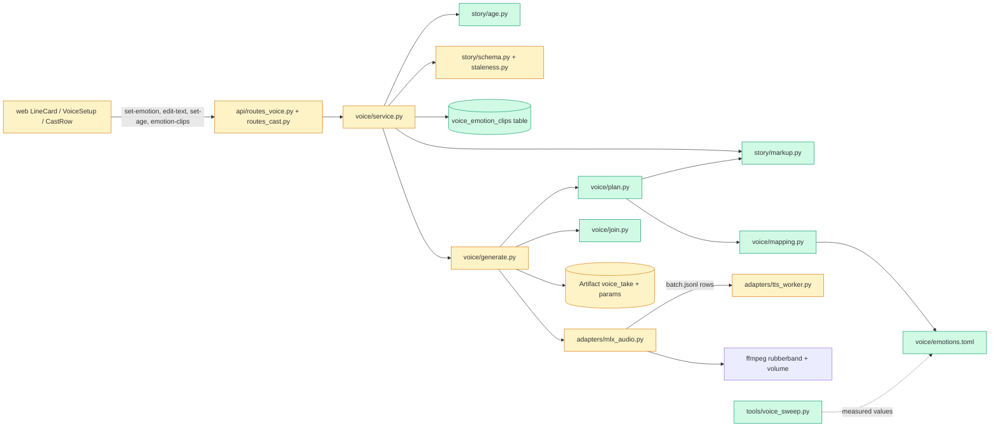

# Tech spec — Add voice emotion, character age and working speed to OmniVoice takes

## Approach
Emotion and age are stored in the **story** (`story/schema.py`): `Scene.emotion` (picker value) and `Character.age`; phrase markup stays inside `Scene.line`. This reuses the story versioning and the existing stale chain: `diff_stories` already records a `story_changes` row for a changed scene field, and `voice_changed()` in `voice/service.py` already marks all of a speaker's scenes stale (kinds `voice_take`, `shot`). So an emotion edit stales one line and its shot, and an age edit stales one character's lines, with no auto-regeneration.

Four new pure modules hold the new logic so one code path serves generation, the "How this will sound" panel and staleness: `story/markup.py` (emotion markup parse, display text), `story/age.py` (age check, band), `voice/mapping.py` (the single emotion table, loaded from a TOML file at every use so edits apply to the next take) and `voice/plan.py` (turns line text, emotion, speed, age, voice and mapping into a list of phrase plans). `voice/generate.py` sends one batch row per phrase, joins phrases with silence (`voice/join.py`) and records the applied values in the take params. A take is stale when its recorded values differ from the current plan (mapping, phrase gap, clip) in addition to the existing change-row rule.

Speed: the real defect is in the worker (`speed` goes into `**kwargs`; OmniVoice currently relies on ffmpeg `atempo` through `plan_speed`). The frozen tests pin `plan_speed("omnivoice", x) == (1.0, x)` and a batch row `speed == 1.0` for OmniVoice, so `plan_speed` and the row's `speed` stay. New row keys `target_speed` and `duration_scale` make the worker compute `duration_s = estimate x duration_scale / target_speed` for OmniVoice, and `run_batch` stops applying `atempo` for OmniVoice (Kokoro unchanged). When the factor is exactly 1.0 no `duration_s` is passed, so speed 1.0 with no emotion is unchanged. `postprocess_wav` gains rubberband pitch/tempo and a gain stage after loudness normalisation (so gain dB survives the -16 LUFS step). Age and per-emotion clips follow the owner's answers in `answers.md`: picker emotion overrides phrase markup, typed `[sigh]` tags go to the model but never to display, age is always sent for cloned voices (no spike gate), clip transcript is editable, and the phrase gap is a per-project setting.

Files followed: `voice/generate.py` and `voice/service.py` (batch, take, stale and board patterns), `voice/uploads.py` and `service.screen_clip` (clip checks), `adapters/mlx_audio.py` (`postprocess_wav`, `run_command`, argument lists), `adapters/tts_worker.py` (mock and real synth), `story/service.py` `_edit_scene` pattern, `api/routes_voice.py` (`:action` routes), `web/src/voice/*` and `web/src/api/voice.ts`.

## Architecture


## Interface contract

### Python modules (importable)
- `reelforge.story.markup`
  - `EMOTIONS: tuple[str, ...] == ("happy", "sad", "fear", "anger")`.
  - `check_emotion(value: str | None) -> str | None` — returns the value or `None`; raises `ValueError('Unknown emotion "joy". Use one of: happy, sad, fear, anger.')`.
  - `@dataclass(frozen=True) Segment(text: str, emotion: str | None)`.
  - `parse_segments(raw: str) -> list[Segment]` — splits `Tum kahan ho? <sad>Mujhe akela chhod diya.</sad>` into unmarked and marked segments in order (whitespace-only segments dropped). Raises `ValueError` with the unknown-emotion message for any other tag-like `<name>` (for example `<joy>`), and `ValueError("Emotion markup is not valid: close every <emotion> tag and do not nest them.")` for unclosed, nested or empty (`<sad></sad>`) markup. Typed `[...]` tags are kept in segment text.
  - `display_text(raw: str) -> str` — markup and every `[...]` tag removed, whitespace collapsed, stripped.
  - `speech_text(raw: str) -> str` — markup removed, `[...]` tags kept.
- `reelforge.story.age`
  - `AGE_ERROR == "Age must be a whole number from 1 to 120."`
  - `check_age(value: object) -> int | None` — `None` stays `None`; int 1..120 returned; bool, float, str, 0, 121, negative raise `ValueError(AGE_ERROR)`.
  - `age_band(age: int) -> str` — `child` (<=12), `teenager` (13-19), `young adult` (20-39), `middle-aged` (40-59), `elderly` (>=60).
- Story schema (`reelforge.story.schema`): `Scene.emotion: str | None = None` (validated by `check_emotion`), `Character.age: int | None = None` (validated by `check_age`). A story PUT with an invalid emotion, age or markup in `line` is rejected through the existing story validation error response (status 422) and nothing is saved; the error text contains the messages above.
- `reelforge.voice.mapping`
  - `load_mapping(path: Path) -> Mapping`; `Mapping.rule(emotion: str) -> EmotionRule | None`; `Mapping.phrase_gap_ms: int`; `Mapping.kokoro_age(band: str) -> KokoroAge | None`.
  - `EmotionRule(tags: list[str], tag_position: Literal["prefix","suffix"], pitch: str, duration_scale: float, generation: dict[str, float], post: PostSettings)`; `PostSettings(semitones: float = 0.0, gain_db: float = 0.0, pause_s: float = 0.0, tempo: float = 1.0)`.
  - Mapping file format (TOML), the single table, packaged at `src/reelforge/voice/emotions.toml`, seeded from section 9 of `docs/voice-levers.md`:
    ```toml
    [phrase]
    gap_ms = 150
    [emotion.sad]
    tags = ["[sigh]"]
    tag_position = "prefix"
    pitch = "low pitch"          # an OmniVoice instruct pitch value, or ""
    duration_scale = 1.25
    [emotion.sad.generation]     # optional, passed to model.generate
    guidance_scale = 2.0
    [emotion.sad.post]
    semitones = -2.0
    gain_db = -3.0
    pause_s = 0.0
    [kokoro_age.elderly]         # experimental
    prefer = ["hm_omega", "hf_alpha"]
    semitones = -1.0
    ```
    One `[emotion.<name>]` table per emotion in `EMOTIONS`. Tests must never assert specific values from the packaged file, only direction (happy `post.semitones` higher than sad; fear `duration_scale` lower than sad) and that a rewritten file changes the next take.
- `reelforge.config.Settings.emotion_mapping_path: Path` (default the packaged `emotions.toml`; config.toml key `emotion_mapping_path` under `[paths]`). The file is re-read on every generation and board build, so a test edits the file at that path and the next take uses it.
- `reelforge.adapters.mlx_audio`
  - `postprocess_wav(src: Path, dst: Path, *, atempo: float | None = None, semitones: float = 0.0, tempo: float = 1.0, gain_db: float = 0.0, timeout_s: float = 120.0, cancel: CancelToken | None = None) -> float` (async, returns duration; existing arguments keep their behaviour). Pitch/tempo run `rubberband=pitch=<2^(st/12)>:tempo=<t>`; gain is added to the `volume` filter after loudness normalisation. All through `run_command` argument lists. When `semitones != 0` or `tempo != 1.0` and the filter is absent, raises `AdapterError('ffmpeg is missing the "rubberband" filter, needed for pitch and tempo changes. Install ffmpeg-full.')`; nothing is skipped.
  - `ffmpeg_has_filter(name: str) -> bool` — runs `ffmpeg -hide_banner -filters`; no cache (tests may monkeypatch it to return `False`).
  - `VoiceLine` gains optional fields (defaults keep current constructors valid): `instruct: str | None = None`, `duration_scale: float = 1.0`, `semitones: float = 0.0`, `tempo: float = 1.0`, `gain_db: float = 0.0`, `generation: dict[str, float] = {}`. `VoiceResult` gains `duration_requested_s: float | None = None`.
  - `plan_speed` is unchanged (frozen). `run_batch` for `omnivoice` writes row `speed: 1.0` (as now) and no longer applies `atempo`.
- Worker batch rows (`batch.jsonl`, visible through the existing `wrap_worker` log): existing keys unchanged plus `instruct: str | None`, `duration_scale: float`, `target_speed: float` (the effective speed for OmniVoice, `1.0` for Kokoro), `gen: dict`. One row per phrase: id is the scene id for a single-phrase line and `<scene id>#<n>` (n from 1) for a multi-phrase line. Row `text` has markup removed and the mapping tag inserted; user-typed `[...]` tags are kept. Progress lines gain optional `duration_requested_s`. The mock worker honours `duration_scale / target_speed` (tone length), so `duration_s` follows speed and emotion; at factor 1.0 it is byte-identical to today. A target outside 0.3 to 60 s fails that row with `Duration target <x> s is outside what the model accepts (0.3 to 60 s).`

### HTTP (all under `/api/v1/projects/{project_id}`)
- `POST /voices/lines/{scene_id}:set-emotion` body `{"emotion": "happy"|"sad"|"fear"|"anger"|null}` → 200 `VoiceLineActionOut` (`line` as below). Unknown value → 422 `{"detail": "Unknown emotion \"joy\". Use one of: happy, sad, fear, anger."}`, nothing saved. Marks that line's voice take and shot stale only; no job starts.
- `POST /voices/lines/{scene_id}:edit-text` (existing) now also accepts markup. Invalid markup or unknown tag → 422 with the messages above, nothing saved. Text with no speakable text left after removing markup and `[...]` tags → 422 `The line can't be empty.`
- `GET /voices` line object (existing keys unchanged), new keys omitted when empty:
  - `text`: display text (no markup, no `[...]`). `edit_text`: the raw story line, present only when it differs from `text`. `emotion`: picker value.
  - `effective`: present unless delivery is default (no emotion, speed 1.0, no age): `{"emotion_applied": bool, "speed": float, "age_band"?: str, "gap_ms"?: int (multi-phrase only), "phrases": [{"text": str, "emotion": str|null, "tags": [str], "tag_position": str, "pitch": str, "duration_scale": float, "duration_factor": float, "generation": {}, "post": {"semitones": float, "gain_db": float, "pause_s": float}, "reference": "neutral"|"emotion", "reference_label": "Neutral reference"|"Sad reference clip"}]}`. `emotion_applied` is `false` for Kokoro voices (emotion levers are not applied).
  - `takes[i].settings`: the take's recorded applied values (same shape as `effective` plus `duration_requested_s`), omitted for takes with no recorded values. `settings_changed: true` on the line when its active take's recorded values differ from `effective`.
  - `takes[i].stale` is also `true` when the take's recorded mapping values for its emotions differ from the current mapping, when its recorded `gap_ms` differs (multi-phrase takes), or when it used an emotion clip that was since removed or replaced. Takes with no emotion are never stale from a mapping change.
- `GET /voices` `characters[]` items gain `age` (int) and `age_band` (str), omitted when no age. The `voice` object gains `emotion_clips: {"happy": {"url": "/media/<id>", "transcript": str, "clip_seconds": float}, ...}` for cloned voices, omitted when empty.
- `GET /voices/settings` → `{"phrase_gap_ms": int, "default_phrase_gap_ms": int}`; `PUT /voices/settings` body `{"phrase_gap_ms": int}` (0 to 1000, else 422 `phrase_gap_ms must be between 0 and 1000.`) → same shape. Stored per project; used by the next multi-phrase take; multi-phrase takes made with another gap become stale.
- `POST /cast/{key}:set-age` body `{"age": <int|null>}` → 200 `{"project_stage", "approved_count", "total", "character": <cast item with "age", "age_band">}`. Invalid → 422 `{"detail": "Age must be a whole number from 1 to 120."}`. Changing the age marks all and only that character's voice takes stale (and their shots) and starts no job; setting the same age changes nothing. The cast `GET /cast` items gain `age` and `age_band`, omitted when none.
- Emotion clips (cloned voices only; other modes → 409 `Emotion clips are only for cloned voices.`; unknown emotion → 422 unknown-emotion message):
  - `POST /voices/characters/{key}/emotion-clips/{emotion}:upload` multipart `file`, form `transcript` (required, non-blank else 422 `A transcript is required.`) → 201 `VoiceOut`. Content and size checked by `screen_clip` (non-audio → 415 `That file isn't an audio clip.`; over limit → 413 `That clip is larger than <n> MB.`).
  - `POST /voices/characters/{key}/emotion-clips/{emotion}:from-take` body `{"scene_id": str, "take_id": str, "transcript": str | null}` (null uses the take's display text) → 201 `VoiceOut`; take must belong to a line spoken by `key` (else 404 `take not found`).
  - `POST /voices/characters/{key}/emotion-clips/{emotion}:remove` → 200 `VoiceOut`. Replacing or removing a clip marks stale only takes whose recorded params used that clip, and their scenes' shots.
- Take generation with a clip: for a line phrase whose emotion has a clip on a cloned voice, the worker row's `ref_audio` is the clip file and `ref_text` its transcript, and the take's `input_artifact_ids` contains the clip artifact id; other phrases keep the neutral reference. A missing clip file fails the line with `The <emotion> reference clip for <name> is missing. Upload it again or remove it.` (no silent neutral fallback).

### Take data (`Artifact` rows, kind `voice_take`, readable through `ctx.session_factory` and `ctx.store`)
`params` keeps today's keys `text` (raw story line), `speed`, `voice`, `source`. New keys, added only when applicable (a no-emotion, no-age, speed 1.0 take has exactly today's params):
- `duration_requested_s` (float; when `duration_s` was passed to the model, summed over phrases).
- `age_band` (str; when the character has an age).
- `gap_ms` (int; multi-phrase only).
- `phrases`: list when any phrase has an emotion or the line has more than one phrase; each `{"text", "emotion", "tags", "tag_position", "pitch", "instruct", "duration_scale", "generation", "post": {"semitones","gain_db","pause_s"}, "duration_requested_s", "reference": "neutral"|"emotion", "reference_artifact_id"}`.
- `voice` gains `reference_kind` and `emotion` when an emotion clip was used.
- Instruct for OmniVoice: comma-joined `[pitch value from the mapping, age band]` (one value per category), appended to the preset description for preset voices; for cloned voices the same string alone (age always included when set). Kokoro: no `instruct`; age picks the preset via `Mapping.kokoro_age` plus its `semitones` post shift (marked experimental in the UI).

### CLI
- `python tools/voice_sweep.py --ref PATH --ref-text TEXT --out PATH [--model ID]` — real model, reference Mac only; runs inside the mlx-audio environment (`<mlx_audio_path>/.venv/bin/python tools/voice_sweep.py ...`); writes a Markdown table with columns `lever | value | duration (s) | median pitch (Hz) | pitch spread | loudness (LUFS) | brightness (Hz)` to `--out` and prints it. The module exposes `measure(path: Path) -> dict[str, float]` with keys `duration_s`, `median_pitch_hz`, `pitch_spread`, `loudness_lufs`, `brightness_hz` (importable by file path in tests; imports no `reelforge`).

### UI (web, vitest)
- Line card (`web/src/voice/LineCard.tsx`): a `select` labelled `Emotion` with options `None`, `Happy`, `Sad`, `Fear`, `Anger` (value `""`, `happy`, `sad`, `fear`, `anger`); change calls `set-emotion`. A `<details>` whose `<summary>` is `How this will sound`, closed by default; content: `Default delivery. No emotion settings applied.` when `effective` is absent; otherwise per phrase the emotion, tags and position, pitch, duration scale, generation settings, post (semitones, gain dB, pause), age band and the reference label; `Settings changed since this take` when `settings_changed`; `Emotion is not applied for this voice.` when `emotion_applied` is false. The paragraph shows `line.text`; the edit box starts with `line.edit_text ?? line.text`. Play, Approve and Re-take unchanged.
- When the speaker's voice is cloned and the line has an active take, buttons `Use this take as the Happy reference` (and Sad, Fear, Anger); clicking shows a text field labelled `Reference transcript` (prefilled with the display text) and a `Save reference` button.
- `VoiceSetup` (`web/src/voice/VoiceSetup.tsx`) new optional props `age?: number | null`, `ageBand?: string`, `modelKey?: string`, `emotionClips?: Record<string, {url: string; transcript: string; clip_seconds: number}>`, `onUploadEmotionClip?: (emotion: string, file: File, transcript: string) => void`, `onRemoveEmotionClip?: (emotion: string) => void`. Shows `Age 67 (elderly)` or `No age set`; an `Experimental` badge beside it when `modelKey === "kokoro"`. For cloned mode a section headed `Emotion reference clips` with a row per Happy, Sad, Fear, Anger: empty text `No clip. The neutral reference and emotion settings are used.`, or an audio element, the transcript and a button `Remove <Emotion> clip`; per row a file input labelled `Upload clip for <Emotion>`, a text input labelled `Transcript for <Emotion>` and a button `Upload clip`. Not shown for preset or recorded modes.
- Cast row (`web/src/cast/CastRow.tsx`): number input labelled `Age (years)` and button `Save age`; shows `Age 67 (elderly)` or `No age set` and the 422 message on error.
- All new props and fields are optional so the frozen web tests render unchanged.

## Data and state changes
- Story YAML: optional `scenes[].emotion` and `characters.<key>.age`; JSON schema (`story_json_schema`) gains both. No DB column for either.
- New table `voice_emotion_clips` (migration `0006_emotion_clips.py`, revision `0006`, down `0005`): `project_id` (FK projects, cascade), `story_key` (str 64), `emotion` (str 16), `artifact_id` (str 26), `transcript` (text), `clip_seconds` (float), `updated_at`; primary key `(project_id, story_key, emotion)`. Model `VoiceEmotionClip` in `db/models.py`. Clips are `Artifact` rows of kind `voice_emotion_reference` (owner type `character`, owner id key, params `{"emotion", "transcript", "source": "upload"|"take"}`, `input_artifact_ids` = `[take_id]` for a take-made clip).
- Per-project phrase gap: row in the existing `settings` table, key `phrase_gap_ms:<project_id>`, JSON int.
- Config: `Settings.emotion_mapping_path` (default packaged file). New packaged data file `src/reelforge/voice/emotions.toml` (check `pyproject.toml` includes it in the wheel).
- `StoryCharacter` (cast/state.py) gains `age: int | None`.
- Staleness: `story/staleness.py` treats a scene change confined to `{"line", "emotion"}` as `LINE_KINDS` (so emotion edits do not stale the frame).
- Prompt: `story/prompts/structure.v1.md` gains the optional `age` key and "if the story gives no age, propose one from `look`"; `_apply_server_fields` in `story/structure.py` drops a proposed age that fails `check_age` instead of failing the story, and never overwrites an age already present.

## Tasks
1. **Measurement script** — `tools/voice_sweep.py` (new): one-lever-at-a-time sweep on the cloned uncle voice (`duration_s`, each `instruct` value, `guidance_scale`, `class_temperature`, `position_temperature`, `t_shift`, `num_steps`, each nonverbal tag, plus a no-lever baseline); `measure()` uses `ffmpeg`/`ffprobe` argument lists and numpy autocorrelation, scrubs `sys.path` before importing `mlx_audio` (per the standards gotcha). `docs/voice-levers.md` (modified): add "How to run the sweep" under section 11. The sweep itself is run by the owner before mapping values are frozen (AC-13); results are pasted into the Status column and experiment log as a separate docs commit after the run. Tests: `tests/unit/test_voice_sweep_measure.py`.
2. **Markup and age modules, schema fields** — `src/reelforge/story/markup.py` (new), `src/reelforge/story/age.py` (new), `src/reelforge/story/schema.py` (modified: `Scene.emotion`, `Character.age`, validator that runs `parse_segments` on `line`), `src/reelforge/story/staleness.py` (modified: `{"line","emotion"}` is `LINE_KINDS`), `src/reelforge/story/prompts/structure.v1.md` and `src/reelforge/story/structure.py` (modified: age proposal as above), `src/reelforge/adapters/mock_llm.py` (modified: canned story may carry an `age`). Existing stories without the fields load unchanged.
3. **Mapping table and plan** — `src/reelforge/voice/emotions.toml` (new, seeded from section 9), `src/reelforge/voice/mapping.py` (new), `src/reelforge/voice/plan.py` (new: `plan_line(raw, picker_emotion, *, mapping, voice_model, speed, age, has_clip) -> LinePlan` with `PhrasePlan`s; picker emotion overrides markup per `answers.md`; Kokoro returns phrases without emotion levers), `src/reelforge/config.py` (modified: `emotion_mapping_path`, `[paths]` key, expanded in `_expand`), `pyproject.toml` (modified only if package data needs the toml).
4. **Audio post-processing** — `src/reelforge/adapters/mlx_audio.py` (modified: `ffmpeg_has_filter`, rubberband and gain in `postprocess_wav`, error message), `src/reelforge/voice/join.py` (new: `join_wavs(paths: list[Path], gaps_s: list[float], dst: Path) -> float` using `wave`, 48 kHz mono 16-bit, silence exact to the sample).
5. **Worker and adapter pace** — `src/reelforge/adapters/tts_worker.py` (modified: row keys, `duration_s` from `duration_scale / target_speed`, `instruct` and `gen` pass-through, `_mock_synth` honours the factor, `duration_requested_s` event key, range error; real loader uses the installed OmniVoice `estimate_duration(text, "Nice to meet you.", 25) * 1.15` as the base, imported lazily inside the real loader), `src/reelforge/adapters/mlx_audio.py` (modified: `VoiceLine`, `VoiceResult` fields, row building, omnivoice skips `atempo`, per-row post params). Verify once on the reference Mac that `generate(..., duration_s=...)` is accepted and that speed now changes length; say so in the PR body.
6. **Voice board text and emotion field** — `src/reelforge/voice/service.py` (modified: `LineInput.raw_text`, `LineInput.text` = display text, `LineInput.emotion`; `build_lines` emits `text`, `edit_text`, `emotion`; `_take_out` compares `params["text"]` with the raw text; `set_emotion`; `edit_text` validation), `src/reelforge/api/routes_voice.py` and `src/reelforge/api/schemas.py` (modified: `:set-emotion`, request model), `src/reelforge/frames/service.py`, `src/reelforge/frames/generate.py` (modified: use `display_text` of `scene.line` for mentions and prompt basis), `src/reelforge/assembly/build.py` untouched (it reads `LineInput.text`, now display text, so captions are clean). Regenerate `web/src/api/schema.d.ts` with the existing `gen:api` flow.
7. **Generation with emotion phrases** — `src/reelforge/voice/generate.py` (modified: build the plan per line, one `VoiceLine` per phrase with `instruct`, `duration_scale`, `semitones`, `gain_db`, `generation`, tag-inserted text; collect phrase results; `join_wavs` with `pause_s` plus the gap, then `service.write_take` with the new params; a failed phrase fails the line), `src/reelforge/voice/service.py` (modified: `write_take` accepts the extra params, `plan_line` helper that reads the mapping and phrase gap, `Setting` key helpers), `src/reelforge/api/routes_voice.py` (modified: `GET/PUT /voices/settings`).
8. **Effective settings and stale by recorded values** — `src/reelforge/voice/service.py` (modified: `effective` and `takes[i].settings`, `settings_changed`, stale rule comparing recorded phrase rules, gap and clip against the current plan), `src/reelforge/api/schemas.py` (modified: documentation models). Regenerate `schema.d.ts`.
9. **Character age backend** — `src/reelforge/voice/service.py` (modified: `set_character_age` using the `_edit_scene` pattern generalised to characters with `record=False`, then `voice_changed` only when the age changed; `characters_body` adds `age`, `age_band`), `src/reelforge/cast/state.py` and `src/reelforge/cast/service.py` (modified: `StoryCharacter.age`, `build_item` adds `age`, `age_band`), `src/reelforge/api/routes_cast.py` and `src/reelforge/api/schemas.py` (modified: `:set-age`).
10. **Age in generation** — `src/reelforge/voice/plan.py` (modified: age band into `instruct` for OmniVoice preset and cloned voices, one value per category, appended to the preset description), `src/reelforge/voice/generate.py` (modified: Kokoro age preset choice and post shift, `age_band` recorded; stale compare of `age_band`), `src/reelforge/voice/emotions.toml` (modified: `[kokoro_age.*]` tables).
11. **Per-emotion clips backend** — `src/reelforge/db/models.py` (modified: `VoiceEmotionClip`), `src/reelforge/db/migrations/versions/0006_emotion_clips.py` (new), `src/reelforge/voice/slots.py` (modified: clip CRUD, `voice_out` adds `emotion_clips`, library sync leaves clips untouched), `src/reelforge/voice/service.py` (modified: `upload_emotion_clip` reusing `screen_clip`, `clip_from_take`, `remove_emotion_clip`, `clip_changed` writing `StoryChange` rows for scenes whose active take used the clip), `src/reelforge/voice/generate.py` (modified: pick clip as `ref_audio`/`ref_text`, inputs, missing-file failure), `src/reelforge/api/routes_voice.py` and `src/reelforge/api/schemas.py` (modified: three routes).
12. **Voice screen UI** — `web/src/api/voice.ts` (modified: types, `useSetEmotion` via the existing `useLineAction`, reference-from-take mutation), `web/src/voice/LineCard.tsx` (modified: Emotion picker, "How this will sound" panel, edit box text, take-as-reference buttons), `web/src/voice/VoiceBoard.tsx` (modified: pass `cloned`, `phrase_gap_ms` control with label `Silence between phrases (ms)`).
13. **Age and clips UI** — `web/src/api/cast.ts` and `web/src/api/voice.ts` (modified: `useSetAge`, clip upload and remove mutations), `web/src/cast/CastRow.tsx` (modified: age field), `web/src/voice/VoiceSetup.tsx` (modified: age line, Experimental badge, Emotion reference clips section).
14. **Manual check and docs** — `docs/manual-checks.md` (modified: "M6b Voice emotion, age and speed" table: speed audibly works, Grumpy Uncle lines regenerated with emotion and age, delivery audibly different and acceptable, per-emotion clip used; leaves the Result column empty for the owner), `docs/voice-levers.md` (modified: section 9 and 10 point at `emotions.toml`; cloned age is always sent).

## Implementation tests
Acceptance tests are separate and frozen. The implementer adds, with each task:
- Task 2: `tests/unit/test_markup.py` (segments, unknown tag, unclosed, nested, empty, `[sigh]` kept for `speech_text` and stripped for `display_text`), `tests/unit/test_age.py` (boundaries 12/13, 19/20, 39/40, 59/60, bad values), schema tests for `emotion` and `age`, `diff_stories` kinds for an emotion change, structuring drops a bad proposed age.
- Task 3: `tests/unit/test_voice_mapping.py` (load, missing emotion table error, `Mapping` re-read after file edit), `tests/unit/test_voice_plan.py` (picker overrides markup, single emotion one phrase, two phrases, tag position, Kokoro no emotion).
- Task 4: `tests/unit/test_postprocess_fx.py` (pitch up/down measured by zero-crossing or autocorrelation on a sine, gain dB, missing filter message via monkeypatched `ffmpeg_has_filter`; skipped when the real ffmpeg lacks rubberband), `tests/unit/test_join.py` (gap length to the sample).
- Task 5: extend `tests/unit/test_tts_worker.py` style tests: `duration_scale / target_speed` length ratio, factor 1.0 identical bytes, range error, rows via `wrap_worker`.
- Tasks 6 to 11: API tests under `tests/unit/` for each route (status, message, stale scope, no job enqueued), an offline end-to-end mock run (`AC-11`) with the network guard used by `test_ac12_network_guard.py`.
- Tasks 12 and 13: vitest component tests next to `web/tests/unit/voiceBoard.test.tsx`, `voiceSetup.test.tsx` and `cast_screen.test.tsx` for the new controls and texts.

## Risks and rollout
- Frozen tests pin `plan_speed`, the row `speed` of 1.0 for OmniVoice and the M4 take params; the design keeps all three. Check by running the M1 to M6 acceptance tests after tasks 5, 7 and 10.
- `rubberband` needs ffmpeg-full on the test machine; tests that need it must skip with a clear reason where it is missing, while the missing-filter path is tested with a monkeypatch.
- The real OmniVoice `duration_s` and `estimate_duration` import path are unverified in this environment; task 5 includes a one-time reference Mac check. Emotion and mapping values are seeds until the owner runs task 1's sweep; only `emotions.toml` changes afterwards, with no code change.
- Migration `0006` must run after `0005`; existing projects have no clip rows and no age or emotion, and load unchanged.
- Answer 3 removes the spike gate on cloned-voice age, so the product-spec message "A cloned voice follows its reference clip. Age is not applied." is not built. The listening check (AC-14) records whether age audibly affects cloned voices.
- AC-14 and AC-13 (real model) are manual. A take whose mapping changed shows as stale but its shot is not marked by a change row until it is regenerated; the shot frame count follows the new take length on approval, as in M4 and M5.

## Open questions
- none
