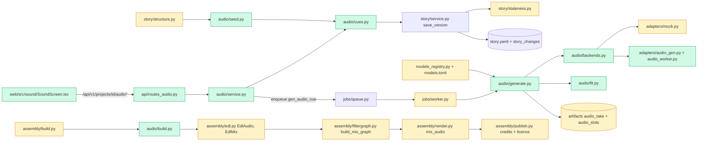

# Tech spec — Add music, sound effects, ambience and silence cues to the reel mix

## Approach
Cues live in `story.yaml` as a new optional `Story.audio` list (`story/schema.py`), validated in the same cross-field validator that already reports `(path, message)` pairs. Cue edits from the Sound screen go through new cue routes that rewrite `story.yaml` with the existing `story.service.save_version(..., keep_stage=True)`. The existing `diff_stories` / `StoryChange` / `stale_items` machinery gives staleness: a cue is a new owner type `audio_cue`, and its take is an `Artifact` of kind `audio_take`. A take-affecting edit writes a `StoryChange` with kinds `["audio_take"]`. A mix-only edit (gain, fades, duck) writes kinds `["audio_mix"]`, which does not match the take. Takes follow the shots pattern (`shots/generate.py`, `shots/service.py`, `shots/state.py`, `shots/uploads.py`, `shots/backends.py`). A `gen_audio_cue` job renders one cue through the mock adapter (`adapters/mock.py`) or a real adapter, post-processes the result to the exact cue length with ffmpeg argument lists, and stores it with `ctx.store.write`. The picked take and per-project mix settings live in one new table, `audio_slots`, plus one `settings` row per project.

The EDL (`assembly/edl.py`) gains `audio` and `mix` sections. The filter graph (`assembly/filtergraph.py`) gets a cue-aware `build_mix_graph`. With no cues it emits the exact current graph, so the frozen M6 tests stay green. Ducking and silence are volume-expression envelopes driven by the EDL dialogue timings. They are not sidechain compression, because the owner asked for a configured dB drop with 150 ms attack and 400 ms release. Loudness stays on the existing two-pass loudnorm in `assembly/render.py`.

The preview mix reuses the assembly preview job (`ctx.previews.enqueue_now`) and creates no `vNNN` folder. Credits and the licence check extend `assembly/publish.py`. The structuring step gets a deterministic keyword seeder (`audio/seed.py`) instead of an LLM prompt change, so it works on the mock backend and cannot alter the frozen LLM tests.

The Sound screen is a new UI step in `ProjectPage.tsx`. The API stage list in `api/stages.py` is **not** changed, because frozen M1 and stage tests pin it.

The spike (`tools/audio_spike.py`) is the first task. Everything mock-backed does not depend on its result. Only the last task, with the real adapters and final `models.toml` ids, waits on the owner's manual AC-13. Until then `models.toml` carries placeholder entries.

## Architecture


## Interface contract

### Story schema (`reelforge.story.schema`)
- `Story.audio: list[Cue] | None = None`. The type is strict, so unknown fields are rejected. `Story.music` is unchanged. When `audio is not None` the music block is ignored everywhere (mix, staleness, UI). A story with only `music` loads as before, and a story with both loads.
- `Cue` fields:
  - `id: str`
  - `kind: str`
  - `start: CueTime`
  - `end: CueTime | None = None`
  - `duration: float | None = None`
  - `prompt: str | None = None`
  - `source: str = "generate"`
  - `gain_db: float | None = None`
  - `fade_in_s: float | None = None`
  - `fade_out_s: float | None = None`
  - `duck: bool | None = None`
  - `state: Literal["suggested"] | None = None`. Only `suggested` is ever stored. `draft`, `ready` and `stale` are computed.
- `CueTime`: `{scene: str, at: "scene_start" | "scene_end" = "scene_start", offset: float = 0.0}`. In YAML, `start: { scene: s3, offset: 1.5 }` or `end: { scene: s3, at: scene_end }`.
- A `silence` cue ignores `prompt`, `source` and `duck` if given. `duck` is only meaningful for music.
- Cross-field validation raises `CrossFieldIssues`, so a failed story save returns 422 with `errors[].path = "audio[<i>]"` and these exact messages (`<id>` is the cue id, times in seconds with one decimal):
  - `Cue "gong1": unknown scene "s99".`
  - `Cue "gong1": start must not be negative.` The same wording applies to `end` and `duration`.
  - `Cue "gong1": end (2.0 s) is before start (3.0 s).` A zero-length cue gives `Cue "gong1": end (3.0 s) is not after start (3.0 s).`
  - `Cue "gong1": unknown kind "boom"; use music, sfx, ambience or silence.`
  - `Cue "gong1": id is used more than once.`
  - `Cue "gong1": give either end or duration.`
  - `Cue "gong1": prompt is empty.` Raised only at generation time, not at story validation.
- Times are resolved with the story timeline. Each scene's start is the sum of the earlier scenes' `duration`, using `target_seconds / len(scenes)` for a scene without a duration. `scene_end` is the scene start plus its duration.

### Python modules the tests import
- `reelforge.story.audio`
  - `story_timeline(story: Story) -> dict[str, tuple[float, float]]` — scene id to (start_s, end_s).
  - `resolve_cue(story: Story, cue: Cue, timeline: dict[str, tuple[float, float]] | None = None) -> tuple[float, float]` — absolute (start_s, end_s).
  - `KIND_DEFAULT_GAIN_DB = {"music": -12.0, "sfx": -6.0, "ambience": -18.0}`
- `reelforge.audio.state`
  - `AUDIO_JOB = "gen_audio_cue"`
  - `class AudioError(Exception)` with `.status: int` and `.message: str`.
  - `NEEDS_APPROVAL = "Approve this cue before generating it."`
  - `NOT_AUDIO = "That file is not an audio clip."`
  - `DEFAULT_MIX = {"duck_db": 9.0, "attack_s": 0.15, "release_s": 0.4, "silence_fade_s": 0.08}`
  - `get_mix_settings(ctx, project_id) -> dict[str, float]`
  - `put_mix_settings(ctx, project_id, **values) -> dict[str, float]`
- `reelforge.audio.fit`
  - `async fit_to_length(src: Path, dst: Path, seconds: float, *, crossfade_s: float = 1.0) -> None` — writes a 48 kHz stereo WAV of exactly `seconds` (within 1 ms). A source that is too short is looped with `acrossfade` of `crossfade_s`. A source that is too long is trimmed. It uses an ffmpeg argument list.
- `reelforge.audio.build`
  - `build_audio_section(ctx, project_id, edl) -> tuple[list[EdlAudio], EdlMix, int]` — the cues with absolute times, the mix settings, and the count of cues left out because they have no picked take.
  - `refresh_audio(ctx, project_id) -> Edl | None` — replaces the working EDL's `audio` and `mix`. It returns None and does nothing when no working EDL exists.
- `reelforge.assembly.edl`
  - `class EdlAudio(_Strict)`: `cue_id: str`, `kind: Literal["music","sfx","ambience","silence"]`, `artifact: str | None` (None for silence), `start_s: float`, `end_s: float`, `gain_db: float`, `fade_in_s: float`, `fade_out_s: float`, `duck: bool`. Cue times are absolute reel seconds taken from the EDL shot starts. `scene_end` is the shot start plus the shot length.
  - `class EdlMix(_Strict)`: `duck_db: float = 9.0`, `attack_s: float = 0.15`, `release_s: float = 0.4`, `silence_fade_s: float = 0.08`.
  - `Edl.audio: list[EdlAudio] = []` and `Edl.mix: EdlMix`.
  - `edl_hash` and `save_edl` omit `audio` and `mix` when `audio` is empty, so existing hashes and files are unchanged.
- `reelforge.assembly.filtergraph`
  - `build_mix_graph(edl: Edl) -> FilterGraph`. With `edl.audio` empty it returns exactly today's graph.
  - Otherwise input 0 is the dialogue WAV and inputs 1..N are the cue files, in order of `edl.audio` entries that have an artifact. The output label is `mix`. Each cue is trimmed to its length, scaled by its gain, faded, and delayed to its start.
  - A music cue with `duck` gets the ducking volume expression: drop of `mix.duck_db` dB, with attack and release from `mix`, driven by `edl.dialogue` offsets and durations.
  - All silence cues together gate the music, sfx and ambience bus to zero. Gain goes to 0 over `silence_fade_s` from the cue start, holds to the cue end, and returns over `silence_fade_s` after the end. The bus is mixed with the untouched dialogue.
  - The result is cut at the reel end. The script is written with the existing `-filter_complex_script` path. No shell.
- `reelforge.models_registry`
  - `ModelEntry.max_seconds: float | None = None` (positive).
  - `load_models` raises `ModelLicenceError(ValueError)` when an entry whose key starts with `audio_` has a licence outside `COMMERCIAL_LICENCES = ("MIT", "Apache-2.0", "BSD-2-Clause", "BSD-3-Clause", "ISC", "CC0-1.0", "Unlicense")`, compared case-insensitively. It also raises when the licence is empty.
  - `check_audio_licences(entries: list[ModelEntry]) -> None` is the same check as a function. Building `ModelRegistry([...])` directly does not run it, so tests can inject a non-commercial entry.
- `reelforge.assembly.publish`
  - `collect_credits(ctx, project_id, edl)` keeps its current entries and appends one entry per cue that has an artifact. A generated cue gives `{"cue_id", "kind", "model", "version", "licence"}`. An upload gives `{"cue_id", "kind", "file_name", "licence": "<owner note or empty>"}` with no `model` or `version` keys.
  - `licence_warnings(credits)` also returns audio entries whose model licence is non-commercial or empty, and uploads with an empty note. An upload warning keeps its `cue_id`, `kind`, `file_name` and `licence` keys.
- `reelforge.audio.seed`
  - `suggest_cues(text: str, story: Story) -> list[Cue]` — keyword-based cues, all with `state="suggested"`. Examples that match: "TRACK 2 kicks in", "gong slam", "drum roll", "ceramic crash", "crinkle", "crunch", "complete silence", "ambience".
  - `merge_suggestions(existing: list[Cue], new: list[Cue]) -> list[Cue]` — never removes or edits an existing cue. It skips a suggestion whose id, or whose (kind, scene, prompt), already exists.

### Mock adapter
- `MockAdapter.run` for `TaskSpec(kind="audio")` honours `task.params["duration_s"]` (float) when the `mock` hook has no `duration_s`. It writes a deterministic tone with frequency by `task.params.get("audio_kind")`: music 220 Hz, sfx 880 Hz, ambience 330 Hz. Existing voice behaviour (the `mock` hooks, default 1.0 s) is unchanged.

### HTTP (all under `/api/v1/projects/{project_id}`)
Cue JSON (request and response) uses the schema above. Responses add computed fields.

`GET /audio` → `AudioOut`:
```
{
  "engine": {"ok": bool, "message": str},
  "legacy_music_hint": true,
  "settings": {"duck_db", "attack_s", "release_s", "silence_fade_s"},
  "skipped_count": int,
  "cues": [CueOut]
}
```
- `legacy_music_hint` is omitted when false. It is true when the story has `music` and no `audio`, and the UI shows the hint text then.
- `skipped_count` is omitted when 0. It counts cues with no picked take.
- `CueOut` carries all cue fields plus:
  - `order: int` (1-based).
  - `state: "suggested" | "draft" | "ready" | "stale"`.
  - `start_s`, `end_s`, `duration_s`: resolved seconds.
  - `source`.
  - `licence`: string. Generated cues show the model licence, for example `"Apache-2.0"`. Uploads show `"Your file: <note>"` or `"No licence note"`. It is `""` for silence or when there is no take.
  - `file_name`: string, omitted when empty.
  - `picked_take_id`: string or null.
  - `takes: [{id, take_no, seed, model, prompt, duration_s, url, picked, stale}]`.
  - `job`: the latest `JobOut` for the cue when it is queued, running or failed, else null.
  - `flags: ["ends_after_reel"]`, omitted when empty.

Cue writes (each returns the updated `AudioOut`, status 200, unless noted):
- `POST /audio/cues`
  - Body is a cue. It returns 201 with `AudioOut`.
  - Status 422 with `{"detail": "story.yaml is invalid", "errors": [{path, message}]}` for the validation messages above.
- `PUT /audio/cues/{cue_id}` — full replacement body. Status 404 `cue not found`.
- `DELETE /audio/cues/{cue_id}`
- `POST /audio/cues/{cue_id}:move` — body `{"direction": "up" | "down"}`.
- `POST /audio/cues/{cue_id}:approve` — clears `state: suggested`. It is idempotent.
- `POST /audio/cues/{cue_id}:dismiss` — deletes a suggested cue.
- `POST /audio/cues/{cue_id}:select-take` — body `{"take_id": str}`. It sets the picked take. Status 404 for a take that is not the cue's.
- `PUT /audio/settings` — body is any subset of `{duck_db, attack_s, release_s, silence_fade_s}` (all numbers greater than or equal to 0, `duck_db` at most 40). It returns the settings object. `GET /audio/settings` returns the same.

Generation and files:
- `POST /audio/cues/{cue_id}:generate` → 202 `JobOut` (type `gen_audio_cue`, payload `{"cue_id", "stage": "sound"}`). This is also Re-take.
  - A suggested cue gives 409 `Approve this cue before generating it.`
  - An empty prompt gives 422 `Cue "<id>": prompt is empty.`
  - A silence cue gives 422 `Cue "<id>": a silence cue has no audio.`
  - A file cue gives 422 `Cue "<id>": this cue uses your own file.`
  - A queued or running job for the same cue is returned instead of a new one (still 202, same job id).
  - The job result is `{"cue_id", "take_id", "take_no", "duration_s"}`. Each take is an `Artifact` with `owner_type="audio_cue"`, `owner_id=<cue id>`, `kind="audio_take"`, `prompt`, `seed`, `model_key` and `duration_s` within 50 ms of the cue length on the mock backend, and `params.model_id`. A second take has `take_no == 2`, and take 1 stays listed. The new take becomes the picked one.
- `POST /audio/cues/{cue_id}:upload` — multipart `file` plus optional form field `licence_note`.
  - The content check is `sniff_audio` plus `probe_seconds` from `voice/uploads.py`. The size limit is `settings.max_upload_mb`.
  - A non-audio or empty file gives 415 `That file is not an audio clip.` and creates no take.
  - A file over the limit gives 413 `That clip is larger than <N> MB.`
  - A cue that is not `source: file`, or has no resolvable length, gives 422.
  - On success it returns 201 `AudioOut`. The take is fitted to exactly the cue length, with `model_key="upload"` and `params {"source": "upload", "file_name", "licence_note"}`, and it is picked.

Mix and stale:
- `POST /audio:preview-mix` → 202 `JobOut` (the existing `assemble_preview` job). First it calls `refresh_audio`, so the working EDL carries the current cues and picked takes. If no working EDL exists it builds one. It makes no `vNNN`. It needs stage `SHOTS_APPROVED` or later, else 409 `Approve the shots first.`
- `GET /assembly` (existing) adds `audio_stale: true`, omitted when false. It is true when the working EDL's `audio` or `mix` differs from `build_audio_section`. It also adds `audio_skipped: int`, omitted when 0.
- `GET /stale` (existing) lists the stale cue takes as `{artifact_id, owner_type: "audio_cue", owner_id: <cue id>, kind: "audio_take"}`.
- An edit to a cue's prompt, kind, timing or source, or to the length of a scene it references, writes kinds `["audio_take"]` for that cue only. An edit to gain, fades or duck writes `["audio_mix"]` only. Saving with no cue change writes nothing.
- No cue edit starts a job, and existing `vNNN` folders are untouched.
- `POST /assembly:edit` and `POST /assembly:build` with `force` call `refresh_audio` or `build_edl`, so cue times follow the shots.
- `POST /assembly:export` on a licence problem still returns 409 `{"detail": "Licence check before export", "licence_warnings": [...]}`. The list now includes the audio entries described above.

### Structuring
- After `story.structure` validates a story, `structure_story` carries over the current version's `audio` cues, merges `suggest_cues(storyline + dialogue, story)`, and saves. Suggested cues have `state: suggested` and no job is started. Re-running keeps approved and edited cues. If a carried-over cue now fails validation (for example its scene is gone), the job fails with that cue message and nothing is saved.

### Config
- `Settings.audio_mem_gb: float = 8.0` (key `audio_mem_gb`, same style as `shot_mem_gb`). The job is `heavy` only when `backend != "mock"`.

### CLI and tools
- `python tools/audio_spike.py --out DIR [--backend real|mock] [--models KEY,...] [--table PATH]`. It writes the audio files and a Markdown table with columns `model | cue | duration requested (s) | duration got (s) | accuracy (s) | generation time (s) | peak memory (MB) | loudness (LUFS) | note`. It also prints the table path to stdout and exits 0. `--backend mock` writes tones and needs no model. It reads candidate models from `[candidates.*]` in `models.toml`. Its cues are the three music descriptions, the five screenplay effects and the wedding ambience, at 3 durations each. No new `reelforge` CLI command is added; `reelforge up` and `reelforge doctor` are unchanged.

### UI (`web/`)
- `web/src/sound/SoundScreen.tsx`: `SoundScreen({ projectId, onBack, onContinue }: { projectId: string; onBack: () => void; onContinue: () => void })`.
  - Hooks and types are in `web/src/api/audio.ts` (`useAudio`, `useAudioMutations`). They call the routes above.
- `ProjectPage` shows the screen at `?screen=sound`, after Shots and before Assembly, for stages from `SHOTS_APPROVED`. ShotBoard's continue goes to Sound. Assembly's back goes to Sound.
- `AssemblyScreen` gets an optional prop `backLabel?: string` (default `"Back to Shots"`). `ProjectPage` passes `"Back to Sound"`.
- Visible text and roles the tests query:
  - Heading `Sound` (role heading).
  - Empty state `No sound cues yet. Add a cue or let the structuring step suggest some from your storyline.`
  - Legacy hint `This story uses the old music note. Add cues to design the sound.`
  - Buttons `Add cue`, `Preview full mix`, `Back`, `Next`.
  - Each cue is a `listitem` with accessible name `Cue <id>`. It shows order number, kind, id, `Generate` or `File`, start and duration as `<n> s`, a state badge (`Suggested`, `Draft`, `Ready`, `Needs update`), and the licence text.
  - Row buttons with these `aria-label` values:
    - `Edit cue <id>`
    - `Delete cue <id>`
    - `Move cue <id> up`
    - `Move cue <id> down`
    - `Play <id>`
    - `Re-take <id>` (the label is `Generate <id>` when the cue has no take)
    - `Takes for <id>`
    - `Upload file for <id>` (file cues, a file input)
  - Delete opens a dialog named `Delete cue <id>?` with buttons `Delete` and `Cancel`.
  - The takes list shows `take 1`, `take 2`, a `Play` button and a `Use this take` button per take.
  - Suggested cues show `Approve` and `Dismiss` buttons. `Generate <id>` is disabled until the cue is approved.
  - Add and edit form fields (labels): `Cue id`, `Kind`, `Scene`, `Offset (s)`, `Duration (s)`, `Prompt`, `Source`, `Gain (dB)`, `Fade in (s)`, `Fade out (s)`, `Duck under dialogue`. The submit button is `Save cue`.
  - Project field `Duck amount (dB)`, saved on blur.
  - Notes `Ends after the reel.`, `<n> cues have no audio and are left out of the mix.` and `No licence note`.
  - Generate actions are disabled, with the `engine.message` hint, when `engine.ok` is false.
- `LicenceDialog` (dialog named `Licence check before export`) renders an upload warning as `<file_name> - Licence note not filled in`, and an audio model warning as `<cue_id> <model> <version> - <licence>`. The `Export anyway` and `Cancel` buttons are unchanged.

## Data and state changes
- New table `audio_slots` (`db/models.py: AudioSlot`, Alembic `0007_audio.py`):
  - `project_id` (FK projects, cascade, PK)
  - `cue_id` (String 64, PK)
  - `picked_artifact_id` (String 26, nullable)
  - `updated_at`
- Per-project mix settings are a `settings` row with key `audio_mix:<project_id>` and a JSON object. Defaults apply when the row is missing.
- `models.toml`:
  - New table `[models.audio_music]`, `[models.audio_sfx]` and `[models.audio_ambience]`. Each has `id`, `revision`, `license = "Apache-2.0"`, `license_url` and `max_seconds`. These are placeholders until the final task. The ids use obvious placeholder names.
  - `[candidates.*]` tables for the spike. They are not read by `load_models`.
- Artifact kinds: `audio_take`. Owner type: `audio_cue`.
- `story_changes` gets owner type `audio_cue` with kinds `audio_take` or `audio_mix`. There is no schema change.
- EDL JSON gains `audio` and `mix`, written only when `audio` is non-empty.
- The `settings` field `audio_mem_gb` is added to `config.py`.
- Files: `docs/audio-levers.md` (new, filled by the spike and the owner), and a new section in `docs/manual-checks.md` for AC-14.

## Tasks
1. **Measurement spike script** (R15, AC-13 tooling)
   - `tools/audio_spike.py` (new): argument parsing as in the CLI above, per-model generation loop, measures generation time, peak RSS (via `/usr/bin/time -l`, argument list), integrated loudness (ffmpeg `ebur128`) and duration accuracy, and writes the table.
   - `--backend mock` writes tones.
   - Like `tools/voice_sweep.py`, it imports nothing from `reelforge` except through `tomllib` on `models.toml`, and it scrubs `sys.path`.
   - `src/reelforge/models.toml` (modified): add `[candidates.*]` for ACE-Step 1.5 and MOSS-SoundEffect v2.0. Licence and Mac support are verified at the time of writing, with the source URL in `license_url`. A candidate failing either is left out.
   - `docs/audio-levers.md` (new): headings for the table, per-file verdicts, chosen model per kind, and default prompts, marked "pending reference-Mac run".
   - Manual gate after this commit: the owner runs it on the reference Mac. The result is needed only by task 17.
2. **Cue schema and validation** (R1–R3)
   - `src/reelforge/story/schema.py` (modified): `CueTime`, `Cue`, `Story.audio`, cue checks in `_cross_field`.
   - `src/reelforge/story/audio.py` (new): `story_timeline`, `resolve_cue`, `KIND_DEFAULT_GAIN_DB`. The validator calls it.
   - The `web/src/api/schema.d.ts` regeneration is done in task 15.
3. **Cue staleness** (R9)
   - `src/reelforge/story/staleness.py` (modified): `diff_stories` ignores `music` when either story has `audio`. It emits `Affected("audio_cue", id, ["audio_take"])` for a prompt, kind, timing or source change, or a resolved-length change from a scene edit. It emits `["audio_mix"]` for gain, fades or duck. It ignores `state`. Added, removed and reordered cues give `["*"]` for added or removed cues only. The scene diff is unchanged.
   - Cue changes do not turn scenes stale.
4. **Audio model registry and licence gate** (R13)
   - `src/reelforge/models_registry.py` (modified): `max_seconds`, `COMMERCIAL_LICENCES`, `check_audio_licences`, `ModelLicenceError`, load-time check.
   - `src/reelforge/models.toml` (modified): placeholder `audio_music`, `audio_sfx`, `audio_ambience`.
   - `src/reelforge/cast/licence.py` (modified): add `is_non_commercial(text)` and reuse it in `publish.py`.
5. **Mock tones and exact-length fitting** (R4, R14)
   - `src/reelforge/adapters/mock.py` (modified): audio `duration_s` and `audio_kind` params.
   - `src/reelforge/audio/__init__.py` and `src/reelforge/audio/fit.py` (new): `fit_to_length`.
   - `src/reelforge/config.py` (modified): `audio_mem_gb`.
6. **Slots, mix settings and cue storage**
   - `src/reelforge/db/models.py` (modified) and `src/reelforge/db/migrations/versions/0007_audio.py` (new): `AudioSlot`.
   - `src/reelforge/audio/state.py` (new): constants, `AudioError`, slot helpers, mix settings.
   - `src/reelforge/audio/cues.py` (new): `load_cues(ctx, project_id)` and `write_cues(ctx, project_id, cues)`. Writing uses `story_to_yaml` and `save_version(keep_stage=True)`. It raises `AudioError(422)` carrying the `StoryInvalid` errors.
7. **Cue routes and Sound body** (R1, R2, R3, R9, R11 approve and dismiss)
   - `src/reelforge/audio/service.py` (new): `audio_body`, add, update, delete, move, approve, dismiss, select-take, settings. It resolves times with the approved shot lengths when they exist, else the story timeline.
   - `src/reelforge/api/routes_audio.py` (new), registered in `api/app.py` (modified). Request and response models are in `api/schemas.py` (modified).
   - Every `AudioOut` response omits `legacy_music_hint`, `skipped_count`, `flags`, `file_name` and `licence` when empty.
8. **Generation job and takes** (R4)
   - `src/reelforge/audio/backends.py` (new): `resolve_audio_adapter` (mock on the mock backend, else the real adapter once added) and `engine_status`.
   - `src/reelforge/audio/generate.py` (new): `audio_generate`.
     - It reads the cue, builds the `TaskSpec(kind="audio")` with `params {"duration_s", "audio_kind"}`, and derives the seed with `cast_state.derive_seed`.
     - Music longer than `entry.max_seconds` is generated up to the limit and extended by `fit_to_length` loop and crossfade.
     - It stores the take, sets it as picked, and publishes the job result.
   - `src/reelforge/jobs/worker.py` (modified): add `AUDIO_JOB: audio_generate` to `HANDLERS` and a preflight message for low memory.
   - `src/reelforge/audio/service.py` (modified): `generate` with the refusals and the duplicate-job guard.
   - `src/reelforge/api/routes_audio.py` (modified): the `:generate` route.
9. **Own-file upload** (R5)
   - `src/reelforge/audio/uploads.py` (new): `screen_audio` (size, `sniff_audio`, `probe_seconds`).
   - `src/reelforge/audio/service.py` (modified): `upload` fits to the cue length and writes the take with `model_key="upload"`.
   - `src/reelforge/api/routes_audio.py` (modified): the `:upload` route.
10. **EDL audio section and stale flag** (R6 data, R9)
    - `src/reelforge/assembly/edl.py` (modified): `EdlAudio`, `EdlMix`, hash and save compatibility.
    - `src/reelforge/audio/build.py` (new): `build_audio_section`, `refresh_audio`.
    - `src/reelforge/assembly/build.py` (modified): `build_edl` fills `audio` and `mix`.
    - `src/reelforge/assembly/edit.py` or `api/routes_assembly.py` (modified): call `refresh_audio` after an edit.
    - `src/reelforge/assembly/status.py` (modified): `audio_stale` and `audio_skipped`.
    - `AssemblyOut` in `api/schemas.py` (modified) gets both fields as optional.
11. **Mix filter graph, ducking and silence** (R6, R7, R8, R14)
    - `src/reelforge/assembly/filtergraph.py` (modified): the cue-aware `build_mix_graph` and helpers for the duck and silence envelopes. All use the `Filter` and `Chain` builders and `escape`.
    - `src/reelforge/assembly/render.py` (modified): `mix_audio` adds `-i` for each cue file and raises `StepError(MIXING, "A sound file is missing: <cue id>")` when one is gone.
    - `src/reelforge/assembly/jobs.py` (modified): `source_ids` includes the cue artifacts.
12. **Preview full mix** (R10 preview)
    - `src/reelforge/audio/service.py` (modified): `preview_mix`.
    - `src/reelforge/api/routes_audio.py` (modified): `POST /audio:preview-mix`.
13. **Seed cues from the storyline** (R11)
    - `src/reelforge/audio/seed.py` (new): `suggest_cues` and `merge_suggestions`. The scene tie is the scene whose action shares most words with the sentence. With no match, music and ambience tie to the first scene.
    - `src/reelforge/story/structure.py` (modified): merge and save in `structure_story`.
14. **Credits and licence check** (R12)
    - `src/reelforge/assembly/publish.py` (modified): the credits and warnings changes above. `credits.json` is written by `publish_version` and needs no change.
    - `src/reelforge/api/schemas.py` (modified): `LicenceWarningOut` gets optional `cue_id`, `kind` and `file_name`, and `model` and `version` become optional.
15. **Sound screen and routing** (R10, AC-8)
    - `web/src/api/audio.ts` (new), `web/src/sound/SoundScreen.tsx`, `CueRow.tsx`, `CueForm.tsx` and `TakesList.tsx` (new).
    - `web/src/routes/ProjectPage.tsx` (modified): `sound` screen, ShotBoard continue, Assembly back.
    - `web/src/assembly/AssemblyScreen.tsx` (modified): the `backLabel` prop. It shows `<n> cues have no audio and are left out of the mix.` and the existing stale prompt when `audio_stale`.
    - `web/src/assembly/LicenceDialog.tsx` and `web/src/api/assembly.ts` (modified): upload and audio warning lines.
    - `web/src/api/schema.d.ts` (modified): regenerated with `pnpm --dir web gen:api`.
    - `web/src/theme.css` (modified): minimal row and badge styles.
16. **Manual-check docs for the Gujiya re-export** (AC-14 tooling)
    - `docs/manual-checks.md` (modified): the ten reference cues, the steps, and a record table for levels, ducking and silence.
17. **Real audio adapters and final model entries** (R4 real, R13). This is blocked on the owner's AC-13 result.
    - `src/reelforge/adapters/audio_gen.py` (new): the adapter, following `adapters/mlx_audio.py` (presence check, selftest, subprocess run).
    - `src/reelforge/adapters/audio_worker.py` (new): a standalone worker for the model's uv environment. It must not import `reelforge`, and its folder must not hold a module named like an imported package.
    - `src/reelforge/audio/backends.py` (modified): resolve the real adapter and run the flag check.
    - `src/reelforge/models.toml` (modified): replace the placeholders with the chosen models, verified licences and `max_seconds`. If no music model passes, remove `audio_music`.
    - `src/reelforge/audio/service.py` (modified): with no `audio_music` entry, music generate is refused with `Cue "<id>": music generation is not available; upload your own file.`
    - `docs/audio-levers.md` (modified): the final table, verdicts, chosen models and default prompts.
    - Before merge the adapter is run once on the reference Mac. The PR body says what was and was not checked.

## Implementation tests
- `tests/unit/test_cue_schema.py`: each rejection message, the `either end or duration` case, the zero-length case, and `music` ignored when `audio` exists.
- `tests/unit/test_audio_staleness.py`: take versus mix kinds, unchanged cues, and a scene duration change that alters a cue length.
- `tests/unit/test_models_licence.py`: allowed and refused licences at load, and a hand-built registry bypass.
- `tests/unit/test_audio_fit.py`: loop, trim and exact length with ffprobe, and a source shorter than the crossfade.
- `tests/unit/test_audio_slots_migration.py`: the migration upgrades and downgrades.
- `tests/unit/test_audio_service.py`: duplicate-job guard, approval refusal, and the take number sequence.
- `tests/unit/test_audio_uploads.py`: wrong type, empty file and over-size file.
- `tests/unit/test_edl_audio.py`: hash and file compatibility when `audio` is empty, and cue times from shot starts with a transition.
- `tests/unit/test_mix_graph.py`: the script text for the no-cue case (exactly today's graph), duck expressions with two dialogue lines, and silence gating.
- `tests/unit/test_audio_seed.py`: keyword matches and merge idempotence.
- `tests/unit/test_audio_credits.py`: credit entry shapes and the warning rules.
- `tests/unit/test_audio_spike.py`: the `--backend mock` run writes a table with every column.
- `web/tests/unit/soundScreen.test.tsx`: empty state, row content, Add and Edit forms, delete confirmation, reorder, takes list and Use this take, upload, suggested Approve and Dismiss, and the disabled engine state.
- `web/tests/unit/licenceDialog.test.tsx`: the upload line text.

## Risks and rollout
- **Frozen tests.** The EDL hash and JSON, the licence warning shape, the `/stale` shape, `AssemblyOut` and the stage list are pinned by frozen tests. All new fields are optional and omitted when empty, and `build_mix_graph` is byte-identical without cues. If a frozen test still fails, revise it through Gate 2 rather than editing it.
- **ShotBoard continue.** ShotBoard's continue now opens Sound, not Assembly. The spec asks for this, but the frozen `m6_assembly` web test should be checked. If it clicks through to Assembly, the Gate 2 revision applies.
- **Placeholder models.** The placeholder model entries are the only audio ids until task 17. Credits recorded during testing name them. Nothing is shipped to the owner before task 17.
- **Ducking accuracy.** The ducking envelope is a linear gain ramp, not a dB ramp. The check is at the held level, so AC-5's 1.5 dB tolerance holds. The attack and release shapes are checked at their endpoints only.
- **Cue length versus the scene timeline.** A take's length is fixed at generation. If a later scene edit changes the cue length, the take is marked stale by the diff. The mix then trims or pads the old take to the new length (`atrim`, then `apad`) until the owner re-takes.
- **Migration order.** Migration 0007 is additive. A rollback drops `audio_slots` only.
- **Network.** No code adds a network call at render time. Real adapters never download; a missing model gives the existing "model not installed" message.

## Open questions
- A re-run of structuring fails, saving nothing, when an owner's cue refers to a scene the new story no longer has. This keeps "never deletes a cue" but blocks that run. Is this acceptable, or should such cues be dropped with a note?
- The spec text `That file is not an audio clip.` differs from the existing voice text `That file isn't an audio clip.`. This design uses the spec text for cue uploads only. Confirm.
- The `Scene missing` cue flag from the product spec has no separate state here. A story that removes a referenced scene is refused with the cue's `unknown scene` message. Confirm that this covers the intent.
