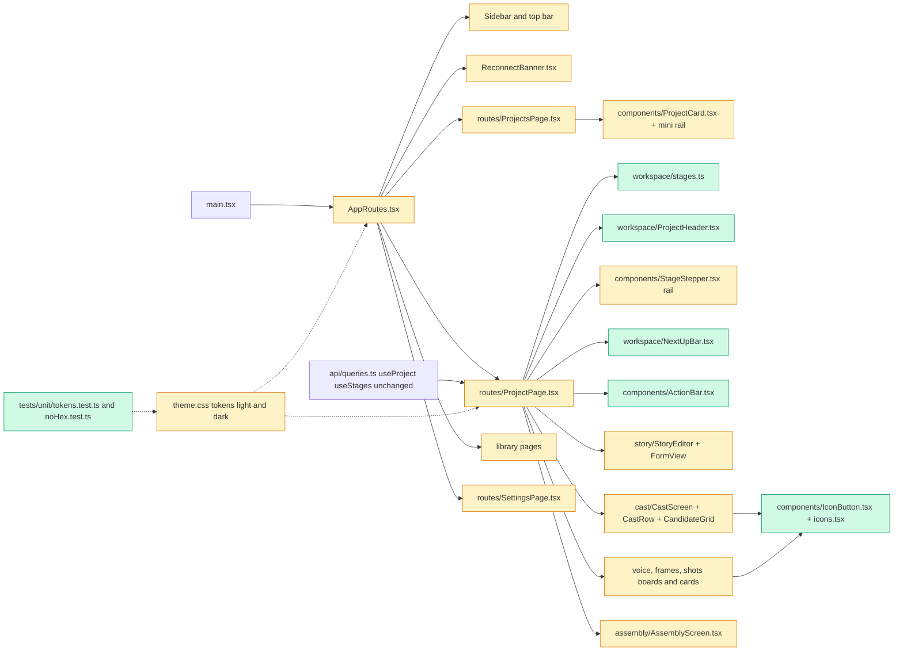

# Tech spec — ReelForge v2.0 UI redesign (workspace, stage rail, colour, readable config)

## Approach
Front-end only, all under `web/`. No API, query key, WebSocket, cache or route change (R37); the only new URL state is the `stage` query parameter.

1. **Tokens first.** Extend `web/src/theme.css` (do not replace): `:root` holds the light set, `@media (prefers-color-scheme: dark) { :root { ... } }` holds the dark set, both defining the same token names. Every hex or `rgb(` value in component CSS and TSX moves to tokens; hex lives only in `theme.css`. Today `theme.css` is the only file under `web/src` with hex, so AC-16 is a guard test rather than a large migration. Shared classes (`btn btn-cta|btn-primary|btn-secondary|btn-ghost|btn-danger`, `btn-icon`, `chip`, `notice`, `card`, `card-header`, `status-strip`, `action-bar`) are plain CSS in `theme.css`; no CSS framework.
2. **Workspace routing in `ProjectPage.tsx`.** A pure helper module `web/src/workspace/stages.ts` resolves the shown stage (`stage` over `screen`, locked or unknown falls back to the landing stage from `project.stage`), the waiting stage and the approved count. `ProjectPage` renders only the resolved panel. This replaces the `VOICE_STAGES`/`FRAME_STAGES` set logic: the unlock state comes from `useStages` (`locked`), and while stages are not loaded the fallback uses `project.stage` only.
3. **Stage rail.** Keep `StageStepper` in `web/src/components/StageStepper.tsx` (the frozen `stageStepper.test.tsx` renders it without a Router and imports `badgeText`). It becomes the rail using plain `<a href="?stage=key">` with an `onSelect` callback that calls `preventDefault` and `setSearchParams` (client-side navigation, history entry added). New props are optional, so the old call shape still works. This also keeps the existing unsaved-changes guard in `StoryEditor.tsx` working: it already intercepts clicks on `a[href]`; extend its selector to `a[href], [data-leave-guard]` and put `data-leave-guard` on the next-up bar button and the Continue/Back buttons, so any in-page navigation away from Story asks `You have unsaved changes. Leave anyway?` (answers the product-spec open question: today the guard covers anchor clicks and `beforeunload`; browser Back is not guarded and stays that way).
4. **Existing wording reused.** Rail and chip state text reuse `badgeText` (answers the second open question): Queued, Rendering, Rendering N%, Needs review, Approved, Stale, Failed, Not started.
5. **Projects mini rail without an API change.** `ProjectOut` only has `stage` and `stages_approved`. The card derives six segments: the first `stages_approved` are approved, the next is "waiting" (needs you, unless all six approved), the rest not started. Each segment has a `title` and `data-state`.
6. **Per-stage panels** keep their data hooks and logic and are restyled and re-laid out (cards, chips, icon buttons, action bar). Icon buttons share one `web/src/components/IconButton.tsx` (new: the same pattern repeats about 20 times with title, aria-label and inline SVG, so a component beats copies) and one `web/src/components/icons.tsx` (inline SVG set, `currentColor`).

Patterns followed: `components/StageStepper.tsx` (exported `badgeText`), `routes/ProjectPage.tsx` (route-level composition), `story/StoryEditor.tsx` (guard hook), `tests/unit/*.test.tsx` style (RTL + vitest).

## Architecture

## Interface contract
Everything is under `web/`. Tests are vitest + RTL (`web/tests/acceptance/`) plus Playwright (`web/e2e/`). Import alias `@` = `web/src`.

### Pure helpers: `@/workspace/stages`
- `export type StageKey = "story" | "cast" | "voices" | "frames" | "shots" | "assembly"`
- `export const STAGE_KEYS: readonly StageKey[]` in that order.
- `export function landingStage(projectStage: Project["stage"]): StageKey` — DRAFT story; STORY_APPROVED cast; CAST_APPROVED voices; VOICES_APPROVED frames; FRAMES_APPROVED shots; SHOTS_APPROVED, REEL_EXPORTED, EXPORTED assembly.
- `export function resolveStage(params: URLSearchParams, projectStage: Project["stage"], stages: StageInfo[] | undefined): StageKey` — `stage` param wins over `screen`; a value not in `STAGE_KEYS`, or whose `StageInfo` has `locked: true`, yields `landingStage(projectStage)`. With `stages` undefined, only unknown values fall back.
- `export function waitingStage(stages: StageInfo[]): StageInfo | null` — first unlocked stage with state `needs_review`, `failed` or `stale`; else first unlocked stage not `approved`; else `null`.
- `export function approvedCount(stages: StageInfo[]): number` — count of state `approved`.
- `export function waitingReason(stage: StageInfo): string` — `"<label> needs review"`, `"<label> failed"`, `"<label> is stale"`, `"<label> not started"`, otherwise `"<label> <badgeText lowercased>"`.
- `StageInfo`, `badgeText(stage)` stay exported from `@/components/StageStepper` with the current behaviour.

### Routes and URL
- `/` still replaces to `/projects`. `/projects/<id>?stage=<StageKey>`; legacy `?screen=voices|frames|shots|assembly` still works. Landing stage is shown without rewriting the URL. No other route or API call changes.

### App shell (`@/AppRoutes` `AppRoutes`, rendered inside a Router and QueryClientProvider as today)
- `nav` with accessible name `Main`; links in order `Projects` (`/projects`), `Settings & status` (`/settings`), `Library` (`/library`); active has `aria-current="page"`. Brand text `ReelForge` inside the nav. Reconnect banner keeps `role="status"` and today's text.

### Project page (`@/routes/ProjectPage` `ProjectPage`)
- Breadcrumb: `nav` named `Breadcrumb` with link `Projects` (`/projects`) then the text `Project`. `h1` is the project title.
- Progress readout: text exactly `N of 6 stages approved` (absent until stages load) and an element `role="progressbar"` with `aria-valuenow=N`, `aria-valuemin=0`, `aria-valuemax=6`, whose fill child `data-testid="progress-fill"` has inline `style.width` = `N/6*100%` (3 gives `50%`).
- Rail: `ol` named `Stages`, six `li`. Unlocked `li` contains one `a` (href ends `?stage=<key>`); locked `li` has `aria-disabled="true"` and no `a`. Shown stage's `a` has `aria-current="step"`, no other. Each cell contains `[data-testid="stage-name"]` (bold name, icon `svg` or number in the same row, `title` = full label) and a separate `[data-testid="stage-state"]` with `badgeText` (e.g. `Rendering 42%`). Rail has class `stage-rail`; `li` cells have class `stage-cell`. Grid: six equal columns, gap at most 8 px.
- Panels: panel for the shown stage only, as `section` with `data-testid="stage-panel-<key>"` (absent from the DOM for other stages). Headings and texts inside are as today (Story editor, `Cast` heading, voice board, etc.).
- Next-up bar: element `data-testid="next-up"` containing `waitingReason` text and button named `Go to <label>` (e.g. `Go to Cast`); absent when the waiting stage equals the shown stage or nothing waits.
- Page-state messages keep exact text and tags/roles: `Loading...`, `Project not found.`, `Couldn't load this project.`, `This stage arrives in a later milestone.`, `Couldn't load the story.`; each in an element with class `state-message`.
- In-flow buttons keep names: `Continue to key frames`, `Continue to shots`, `Continue to assembly`, `Back to key frames`, `Back to Shots`; clicking pushes a history entry with the new `?stage=` and does not reload.

### Buttons and action bar
- Button levels are classes on the `button`: `btn btn-cta`, `btn btn-primary`, `btn btn-secondary`, `btn btn-ghost`, `btn btn-danger`; icon buttons add `btn-icon`.
- CTA names (class `btn-cta`; disabled exactly when today's precondition is unmet): `Approve story` (Story until approved, then `btn-secondary`), `Approve this one` (each Cast card), `Continue to key frames`, `Continue to shots`, `Continue to assembly`, `Export final`.
- Primary: `Generate candidates`, `Generate all lines`, `Generate all frames`, `Render all`, `Rebuild preview`, `Save` only while dirty. `Delete` is `btn-danger`.
- At most one `.btn-cta` per stage panel; in Cast at most one per character card (`[data-testid="cast-card"]`, class `card`, added in CastRow).
- Action bar: `data-testid="action-bar"` (class `action-bar`) inside the panel, containing the stage CTA. Story action bar shows the text `Unsaved changes` and `Save` has `btn-primary` while the YAML text differs from the saved story; otherwise neither (Save is `btn-secondary`). `Save your changes first` title text is unchanged.

### Story form
- Each character: `section` with `aria-label="Character <key>"`; each scene: `section` with `aria-label="Scene <id>"`. `Look`, `Action`, `Line` are labelled `textarea` showing the full text and auto-growing (no `rows` clipping). Field labels and YAML edits are exactly as before. `needs update` text appears only inside an element with class `card-header` (as `chip`). Settings summary is a read-only block that expands into today's editable fields (labels unchanged). Version selector label `Version`, tabs `tablist`/`tab` named `Form` and `YAML` unchanged. `Approved` banner text `Story approved. Editing it will mark dependent items for update.` has class `notice`.

### Cast
- Heading `Cast`; status strip `data-testid="status-strip"` with `N of M characters approved`. Candidate tiles are `button` with `aria-pressed` true/false, class `tile`, fixed square; the selected tile contains `[data-testid="check-badge"]` (only that tile).
- Icon buttons (each a `button` with accessible name = `title` = today's text, containing an `svg`): `Regenerate 4 more`, `Edit look text and regenerate`, `Refine selected (img2img)`, `Upload my own image`, `Use from library`, `Change approval`, `Replace from library`. `Approve this one` shows the visible word `Approve` plus an `svg`, `aria-label="Approve this one"`, disabled until a candidate is selected. `Generate candidates` keeps its text. The only visible-text buttons on a card are those two.
- Generating text `Generating image X of Y - N s elapsed` and `Cancel` unchanged, with a `role="progressbar"` bar.

### Voices, Key frames, Shots
- Status strip `data-testid="status-strip"` above the cards with the existing count texts (`N of M lines approved`, `N lines have no take yet` and the frame and shot equivalents). Each card has `[data-testid="state-chip"]` whose text equals the state label used today (Approved, Stale, Failed, Rendering, Not started, ...). Cards that need the person (failed, stale, needs review) carry `data-attention="true"`. Repeated card actions (play, regenerate, approve, reopen, delete) are icon buttons with `title` and `aria-label` equal to the names they have today.

### Assembly
- Layout: player column left, then timeline, captions and `Export` section (label kept) right. `Rebuild preview` is `btn-primary`; `Export final` is `btn-cta`.

### Projects, Library, Settings
- Project card (`li`): title link, text `N/6 stages approved`, `[data-testid="mini-rail"]` with six `[data-testid="mini-rail-segment"]`, each with `data-state` (`approved`, `waiting`, `not_started`) and a `title`. Heading `Projects`, list label, `No projects yet.` and skeleton test ids unchanged. `New project` is `btn-primary`.
- Settings: one status card per dependency with a dot and a word `Ready`, `Warning` or `Missing`; `Voice model` select label unchanged.

### Theme tokens (`web/src/theme.css`)
- `:root { ... }` is the light set; `@media (prefers-color-scheme: dark) { :root { ... } }` is the dark set. Both define exactly the same custom property names, including at least: `--bg --surface --surface-2 --border --text --muted --accent --focus --cta-from --cta-to --cta-text --green --amber --red --blue` and chip pairs `--chip-green-bg --chip-green-fg --chip-amber-bg --chip-amber-fg --chip-red-bg --chip-red-fg --chip-blue-bg --chip-blue-fg --chip-grey-bg --chip-grey-fg`, plus `--space-1..` `--radius-card` (12px), `--fs-12 --fs-14 --fs-16 --fs-20 --fs-28`, `--shadow-bar`. Colour token values are `#rrggbb` hex so tests can compute contrast.
- Contrast pairs asserted: `--text` on `--bg` and `--surface` at least 4.5; `--cta-text` on `--cta-from` and `--cta-to` at least 4.5; each chip fg on its bg at least 4.5; `--border`, `--focus` against `--surface` at least 3.
- One `@media (prefers-reduced-motion: reduce)` block sets `animation: none` and `transition: none` on all elements except the class `.spinner`, which keeps its rotation keyframes (name `spin`). No `@keyframes` other than `spin`, `pulse`, `shimmer`, `slide` exist; all non-spin ones are disabled in that block.
- No file under `web/src` other than `theme.css` (and `schema.d.ts`) contains `#rgb`, `#rrggbb`, `#rrggbbaa` or `rgb(`.

### Playwright (`web/e2e/stage-rail.spec.ts`)
- On a project page at 1440 px and 900 px wide: six `li` in `ol[aria-label="Stages"]` have widths equal within 1 px, gap at most 8 px, first left edge and last right edge equal the `ol` container edges within 1 px; each cell has name and state in separate elements; `Key frames` on one line.

## Data and state changes
None to API, schema, storage or env vars. New URL query parameter `stage`. Component-local React state only (Story section collapse, Cast voice-setup collapse).

## Tasks
1. **Theme tokens and base styles** — `web/src/theme.css` (modified): light and dark token sets with identical names (invert current default: light in `:root`, dark in the media query), teal accent, coral CTA gradient, chip, notice, card, button level and `btn-icon` classes, focus ring, type scale, 8 px spacing, `spin/pulse/shimmer/slide` keyframes and one reduced-motion block. Existing class names used by current components stay defined. `web/tests/unit/themeTokens.test.ts` (new): same token names, contrast, reduced motion. `web/tests/unit/noHexColours.test.ts` (new): scans `web/src` for hex and `rgb(`.
2. **Shared UI primitives** — `web/src/components/icons.tsx` (new, inline SVGs), `web/src/components/IconButton.tsx` (new: props `label`, `icon`, `onClick`, `disabled?`, `tone?`, sets `title`, `aria-label`, class `btn btn-icon`), `web/src/components/Notice.tsx` (new, `tone` info|success|warning|error with icon), `web/src/components/StateMessage.tsx` (new: `Loading...`, error, empty style), `web/src/components/Chip.tsx` (new), `web/src/components/ActionBar.tsx` (new, sticky bar with `left` and `cta` slots). Tests for each in `web/tests/unit/primitives.test.tsx`.
3. **App shell, reconnect banner, button classes** — `web/src/AppRoutes.tsx` (modified: sidebar with brand, top bar below 900 px, content max width), `web/src/components/ReconnectBanner.tsx` (modified: tokens, role and text kept), `web/src/components/NewProjectForm.tsx` (modified: primary button). Existing tests stay green.
4. **Projects, Library, Settings restyle** — `web/src/components/ProjectCard.tsx` (mini rail, chip for waiting stage), `web/src/routes/ProjectsPage.tsx`, `web/src/library/LibraryPage.tsx`, `web/src/library/LibraryDetail.tsx`, `web/src/routes/SettingsPage.tsx` (status cards with dot and word). Test ids and texts unchanged. Unit tests extend `projectsPage.test.tsx` equivalents in a new file `web/tests/unit/projectCardRail.test.tsx`.
5. **Stage helpers** — `web/src/workspace/stages.ts` (new) with the signatures above; `web/tests/unit/workspaceStages.test.ts` (new) covering the landing table, `stage`/`screen` precedence, locked and unknown fallback, waiting stage rules and reasons.
6. **Stage rail** — `web/src/components/StageStepper.tsx` (modified: plain anchors, `current`, `onSelect`, `hrefFor` optional props, two-line cells, icon, truncation with `title`, rendering mini bar, `aria-current="step"`, `aria-disabled` locked cells without `a`), `theme.css` rail grid and sticky rules. Extend `stageStepper` coverage in a new `web/tests/unit/stageRail.test.tsx` (frozen `stageStepper.test.tsx` untouched).
7. **Workspace page** — `web/src/routes/ProjectPage.tsx` (modified: one panel via `resolveStage`, `setSearchParams` navigation, onContinue/onBack push history, wrapper `section data-testid="stage-panel-<key>"`, `StateMessage` for the page states), `web/src/workspace/ProjectHeader.tsx` (new: breadcrumb, title, progress), `web/src/workspace/NextUpBar.tsx` (new), `web/src/story/StoryEditor.tsx` (modified: guard selector `a[href], [data-leave-guard]`). Existing frozen tests that expect all stages on one page are checked here; any real conflict goes to Gate 2, not a hand edit. Tests: `web/tests/unit/projectWorkspace.test.tsx` (new).
8. **Story stage** — `web/src/story/StoryEditor.tsx`, `FormView.tsx`, `StaleBadge.tsx`, `VersionPanel.tsx`, `StructureStatus.tsx`, `GapQuestions.tsx`, `YamlView.tsx`, `StoryInput.tsx`, `StoryEditor` action bar (modified): header, segmented toggle, approved notice, settings summary, character and scene cards with `aria-label` sections, auto-grow textareas, `needs update` chip only in card headers, dashed add-cards, action bar with `Unsaved changes`, CTA/secondary `Approve story`, `Save` primary only when dirty. YAML output unchanged. Tests: `web/tests/unit/storyForm.test.tsx` (new).
9. **Cast stage** — `web/src/cast/CastScreen.tsx`, `CastRow.tsx`, `CandidateGrid.tsx`, `LicenceBanner.tsx`, `BackendDown.tsx`, `ApproveDialog.tsx`, `LibraryPicker.tsx` (modified): status strip, large image, square tiles with check badge, icon button toolbar via `IconButton`, `Approve this one` CTA with visible word, progress bar, collapsible voice setup (`VoiceSetup.tsx` wrapper only), Escape closes dialogs and returns focus. Tests: `web/tests/unit/castCard.test.tsx` (new).
10. **Voices board** — `web/src/voice/VoiceBoard.tsx`, `LineCard.tsx`, `VoiceSetup.tsx` (modified): status strip, state chips, attention edge, icon buttons, token-styled audio player, `Continue to key frames` CTA in action bar.
11. **Key frames and Shots** — `web/src/frames/FrameBoard.tsx`, `FrameCard.tsx`, `web/src/shots/ShotBoard.tsx`, `ShotCard.tsx`, `QueuePanel.tsx`, `CompareTakes.tsx` (modified): same pattern, compact queue panel, side-by-side takes, `Continue to shots` / `Continue to assembly` CTAs.
12. **Assembly** — `web/src/assembly/AssemblyScreen.tsx`, `ExportPanel.tsx`, `Timeline.tsx`, `CaptionEditor.tsx`, `LicenceDialog.tsx`, `web/src/player/Player.tsx`, `SafeZoneOverlay.tsx` (modified: tokens only): two-column layout, `Rebuild preview` primary, `Export final` CTA.
13. **CTA and chip audits plus e2e** — `web/tests/unit/ctaRules.test.tsx` (new: one `.btn-cta` per panel, per Cast card), `web/e2e/stage-rail.spec.ts` (new, AC-2a). `docs/manual-checks.md` (modified: v2 UI checklist for AC-20 items a to e, light and dark, 1440 and 390 px, four project stages). `phases/v2-design-req.md` (new in git: commit the untracked source file with the task).

## Implementation tests
New (not frozen): `themeTokens.test.ts`, `noHexColours.test.ts`, `primitives.test.tsx`, `projectCardRail.test.tsx`, `workspaceStages.test.ts`, `stageRail.test.tsx`, `projectWorkspace.test.tsx`, `storyForm.test.tsx`, `castCard.test.tsx`, `ctaRules.test.tsx`, plus Playwright `stage-rail.spec.ts`. All run under `pnpm --dir web test --run`; lint with `pnpm --dir web lint`; build with `pnpm --dir web build`. Mock helpers are in `web/tests/acceptance/helpers.tsx` (read, not edited).

## Risks and rollout
- Frozen tests (`stages.test.tsx`, `story.test.tsx`, `cast.test.tsx`, `m6*`, `projects.test.tsx`) may assume the stacked page (for example Story and Cast both present, `?screen` semantics). Task 7 runs them and, on a real conflict, stops and raises a Gate 2 revision rather than editing them.
- Mini rail is derived from `stages_approved` and cannot show a failed or stale segment on the Projects list (no API change allowed).
- Swapping which panel is mounted unmounts Story, losing unsaved draft text; mitigated by the extended guard confirm on in-page navigation. Browser Back is not guarded (as today).
- The light/dark default flip in `theme.css` touches every page, hence task 1 first and one commit per area afterwards. Ship as one change, per the owner's decision.
- Contrast numbers rely on hex token values; if the owner's palette review changes a token, re-run `themeTokens.test.ts`.
- Playwright needs ports 7400 and 7401 free.

## Open questions
- none
